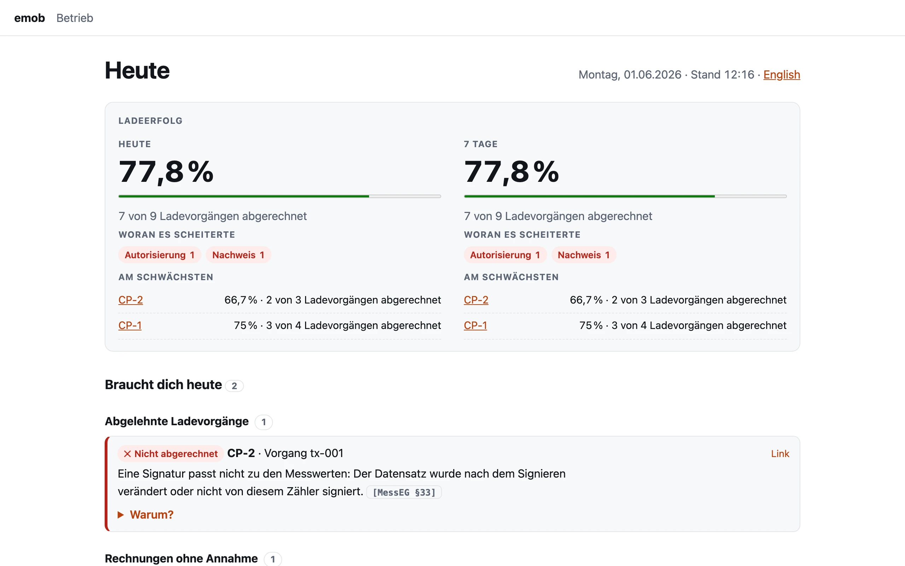
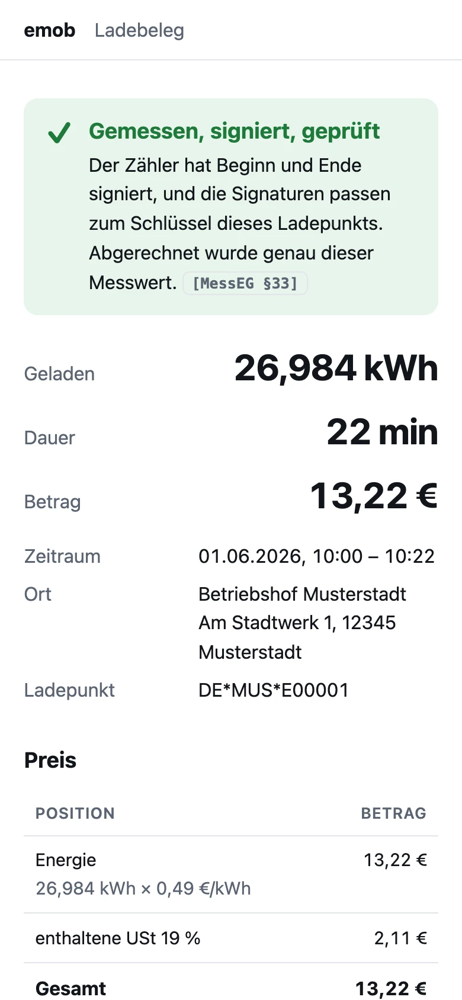
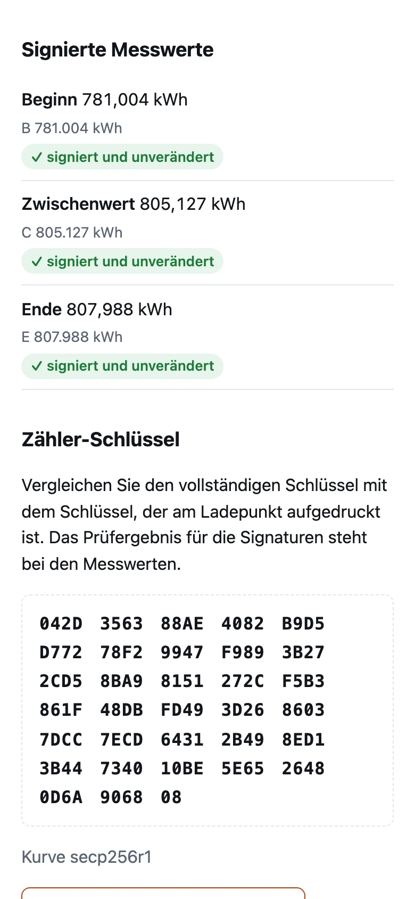
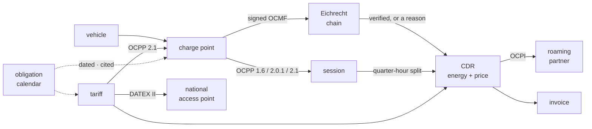

# emob

**An open-source e-mobility platform in Rust: CSMS, roaming, Eichrecht and billing
for charge point operators and e-mobility providers — one workspace that agrees
with itself about what a kilowatt-hour was worth.**

[](https://github.com/hupe1980/emob/actions/workflows/ci.yml)
[](#license)
[](#crates)
[](https://hupe1980.github.io/emob/)

📖 **[Documentation](https://hupe1980.github.io/emob/docs/)** ·
[Getting started](https://hupe1980.github.io/emob/docs/getting-started/) ·
[Run the estate](https://hupe1980.github.io/emob/docs/run-the-estate/) ·
[The Eichrecht chain](https://hupe1980.github.io/emob/docs/eichrecht/) ·
[Architecture](https://hupe1980.github.io/emob/docs/architecture/)

<picture><source media="(prefers-color-scheme: dark)" srcset="site/static/img/heute-dark.webp"></picture>

`just demo` — the whole estate, three stations and a roaming partner on your
machine, in one command.

Open source mostly stops at the charging station: [CitrineOS] and [SteVe] are
CSMSs (charging station management systems), [EVerest] is station firmware. emob
is the other half — the e-mobility service provider, the roaming node, the
calibration-law evidence chain and the billing — built as one system on
existing protocol libraries: [`ocpp-kit`], [`ocpi-kit`], [`oicp-kit`],
[`iso15118`], [`eebus`] and [`ocmf`].

## Why emob

- **A verifiable Eichrecht chain.** German calibration law (*Eichrecht*) lets you
  invoice a measured value only if the customer can check it `[MessEG §33]`. A
  signed meter value (OCMF — the Open Charge Metering Format) becomes billable
  energy through exactly one function, which answers `None` when anything is
  wrong, and the driver gets a file their own verifier reads.
- **Exact money.** No binary floats anywhere outside tests — a build guard fails
  on any `f32` or `f64`. Energy keeps the meter's scale, money rounds once at the
  currency's minor unit, and every rounding is stated on the document.
- **Compliance as code.** AFIR, the German Ladesäulenverordnung and
  price-indication rules, MessEG, the THG-Quote, the MiSpeL levy rules for
  bidirectional charging and NIS2 are dated, cited,
  executable rules: "which duties will this estate fail on 1 January 2027?" is a
  function call.
- **German market particulars, done properly.** The quarter-hour settlement grid,
  `[EnWG §14a]` grid-operator control of charge points, the THG-Quote
  (greenhouse-gas quota) filing, EN 16931 e-invoices with SEPA collections, and
  the DATEX II feed to the national access point.
- **One price, every audience.** The tariff that rates a session is the one shown
  on the station (OCPP 2.1), sent to roaming partners (OCPI 2.3.0) and published
  to the national access point (DATEX II).
- **A journal you can audit.** Every fact a daemon keeps names who caused it,
  every journal's end is signed, and a witness outside the daemon's volume
  notices a journal cut short or restored from an old backup.

## Try it

```console
just doctor      # what is missing, and the command that installs it
just demo        # the estate on loopback: Heute, a receipt, the partner's inbox, the invoice
just a11y        # every page a person reads, checked for accessibility
```

`just demo` starts every daemon in one process with a generated estate for
*Stadtwerke Musterstadt eMobility* — three simulated stations on OCPP 1.6,
2.0.1 and 2.1 over `wss://` (security profile 2), an OCPI partner, a seeded
morning at 60×: seven sessions billed, one signed value tampered with and
refused with its paragraph, one blocked card, and the month's invoice. It
prints its links within a minute — Heute (signed in), a driver's receipt, the
partner's inbox and, after month end, the invoice page — then the witness line
`🔏 witness: csmsd ✓ N · billd ✓ N · roamd ✓ N · empd ✓ N`, and runs until
Ctrl-C. CP-3 also shows its receipt link on its display. Loopback only; every
token, key and password is minted for the run and gone with it. `--clock`,
`--speed` and `--seed` make it reproducible.

CI runs `emob demo --check` on every push: it fails if an outcome differs, if
the invoice files do not validate, if a journal record names no actor, if a head
is not witnessed, or if a log line holds a secret. Then `just a11y` checks Heute,
the receipts and the invoice page in light and dark at 320 and 1280 px — one h1,
ordered headings, named controls, alt text, landmarks, a visible focus on every
Tab stop, 4.5:1 contrast, 24×24 px targets and no sideways scroll — with zero
violations, through Chrome's accessibility tree and no npm packages.

No Rust toolchain? `just demo` runs the published
`ghcr.io/hupe1980/emob` image with Docker instead (host networking; on Docker
Desktop enable it under Settings → Resources → Network).

<picture><source media="(prefers-color-scheme: dark)" srcset="site/static/img/receipt-dark.webp"></picture>


Every session the estate settles or refuses has a **receipt** the driver opens
on a phone: the verdict first ("Gemessen, signiert, geprüft", or "Nicht
abgerechnet" with the citation), the energy, the price lines from the CDR, the
meter key in groups of four to compare with the charge-point label, the
S.A.F.E. transparency file, and **Selbst prüfen** — a WebAssembly build of the
OCMF verifier that checks every signed value on the phone, offline once loaded.
`emob verify <transparency-file>` does the same on the command line.

## Status

**The journal you can trust, events any system can subscribe to, and ready for
1 January 2027.** The fifteen
domain crates are built and tested (**1341 tests** across the workspace). The
nine daemons start from one `estate.toml` and are wired end to end:

- stations connect to `csmsd` over OCPP 1.6J, 2.0.1 and 2.1 with security
  profiles 1–3 and TLS;
- `empd` answers every authorisation, and `csmsd` fails closed when it cannot
  ask;
- every ledger is folded from a hash-chained journal sealed under the daemon's
  own data key, so a restart loses nothing and no card UID is on disk in clear;
- every journal record names its **actor** — `station:<identity>`,
  `partner:<party>`, `operator:<name>`, `service:<daemon>`, `timer` or `estate`
  — inside the digest, readable with `jq -r .actor` without the data key;
- each journalled daemon signs its **head** (position and hash, Ed25519, a C2SP
  signed note) after every append, serves it at `GET /v1/<name>/head`, and
  refuses to start from a journal shorter than it; **Heute** and `emob witness`
  keep a copy no daemon volume holds and alarm on a regression, fork or rekey;
- daemons log JSON with a request id and the actor on every request, and no
  secret;
- `csmsd` delivers each settled session to `billd` (one EN 16931 invoice per
  partner and month), `roamd` (OCPI to the partner) and any `[[subscribers]]`
  as signed CloudEvents through a journalled outbox;
- every issued invoice has a page at `/i/{token}` with its XRechnung / EN 16931
  files in UBL and CII, and with `[billing.delivery]` `billd` hands it to the
  operator's ERP or Peppol provider as a signed CloudEvent;
- stations are **onboarded** from Heute — one form, an installer sheet with a
  password shown once, connected without a restart — into `csmsd`'s journalled
  registry, searched at ten thousand stations as at three; `csmsd` knows each
  one — online or silent since when, what it said at boot, what its meter
  signs, every firmware change as an intervention record — and every station
  opens its **asset card**;
- the fleet is a **map** drawn by `deskd` from a bundled outline (no tiles, no
  third party); a station's locator names coordinates that lie outside its
  country or look swapped, and Heute groups silent stations by **mobile
  network** (MCC-MNC, never the IMSI);
- `emob check estate.toml` names a mistake by line and key, and editors
  complete the estate from its published JSON Schema;
- the operator works from **Heute** (`deskd`), the driver checks a **receipt** —
  on a phone, or from the link on the station's display;
- `emob_session::mispel` nets a bidirectional site's month under the
  Bundesnetzagentur's MiSpeL rules, and `emob-pnc` validates ISO 15118-20
  contract chains under named roots;
- releases are signed and attested, with an SBOM.

Not wired into a daemon: the OICP and national-access-point push clients, SEPA
runs from `billd`, the SHIP/EEBUS session for § 14a, and MiSpeL on Heute (no
grid-meter series reaches a daemon). emob has had no external security review and no
production deployment; see [THREAT_MODEL.md](THREAT_MODEL.md) for what holds and
what is open.

### What the tests prove

- **A real message, end to end.** The Open Charge Alliance's published OCPP
  example goes in at the wire and comes out as a taxable amount and a file the
  driver's own verifier reads.
- **Meters this workspace did not write.** Records from five real devices in the
  S.A.F.E. reference data set, including an eBZ LD3 on secp192r1 with the
  non-canonical DER a real meter emits.
- **One session, three roaming paths, one amount.** Self-roaming, OCPI 2.3.0 and
  OICP 2.3 through a broker that refuses what the live one refuses.
- **A month and a year.** A month closes into a validated EN 16931 invoice, a SEPA
  collection and balanced postings; a year files its THG-Quote notification with
  every ineligible point refused by name.
- **A PKI this workspace does not run.** Hubject's published Plug & Charge test
  environment validates against ISO 15118-2's Annex F profiles, and a contract
  from a second ecosystem is refused.
- **A setpoint over a real wire.** Two SPINE (EEBUS) engines exchange datagrams;
  the allocation binds exactly and no charge point exceeds the ceiling.
- **A hundred stations reconcile exactly**: `billed + refused == metered`, with a
  residual of zero.
- **A restart in the middle.** Service ledgers are folded from a hash-chained
  journal: a spent invoice number stays spent, a sealed record stays sealed, a
  blocked card stays blocked, and an edited journal stops the service.
- **A removed record is caught twice.** A journal cut at its end refuses to
  start against its signed head, and a witness reports a restored-from-backup
  daemon as `regressed`; the head format is checked against the reference vector
  of Go's `sumdb/note`.
- **The regulator's own arithmetic.** The MiSpeL month reproduces the
  Bundesnetzagentur's Beispielrechnungen 1 and 2 and the Pauschaloption's two
  Rumpfjahre to the digit.
- **ISO 15118-20 under three roots.** Each of three -20 test roots named for the
  European ecosystems validates its own contract and refuses the others', a -2
  chain under -20 rules and the reverse are refused, and Ed448 is refused by
  name.
- **Properties over generated input and sequences** — one price however a
  session is sliced, a month that passes all 317 EN 16931 rules, and invariants
  checked after every step of generated roaming and bookkeeping sequences.

## Quick start

```console
cargo add emob-eichrecht emob-session emob-cdr emob-tariff
```

A signed meter value becomes a billable quantity through one door, and that door
answers `None` when anything is wrong — a bad signature, an unregistered key, a
substituted reading, a record deleted from the middle of the session:

```rust
use emob_eichrecht::{Evidence, KeyRegistry};

let evidence = Evidence::assemble(&records, &registry, session_start);

match evidence.billable_energy() {
    Some(energy) => println!("bill {energy}"),   // 29.500 kWh
    None => for reason in evidence.reasons() {
        eprintln!("blocked: {reason}");          // → an operator, not an invoice
    },
}
```

There is no second route: a caller who wants to bill anyway has to write code that
visibly ignores the answer. [Getting started](https://hupe1980.github.io/emob/docs/getting-started/)
takes the session the rest of the way — split across quarter hours, priced into a
CDR (charge detail record), sent to a roaming partner and the national access
point, and invoiced with a SEPA collection.



## Running the estate

Every daemon reads its own sections of one `estate.toml` (`EMOB_ESTATE`,
default `./estate.toml`): `deploy/estate.example.toml` is the loopback estate,
`deploy/estate.compose.toml` the compose one. Secrets are environment variables
the estate names (`*_env`). Three commands take a clone to a running estate
without the demo:

```console
just dev-keys > .env        # every secret the estate names, for this machine (gitignored)
just dev-ca                 # throwaway loopback TLS for csmsd (openssl)
just run                    # the nine daemons from source; checks the estate, waits until ready
```

`emob check estate.toml` checks an estate before any daemon reads it — every
section, then each daemon's own checks, and with `--secrets` every variable —
and reports a mistake the way `rustc` does:

```console
error: unknown field `evse_id`
  --> estate.toml:24:1
   |
24 | evse_id = "DE*ABC*E00001"
   | ^^^^^^^
   |
   = help: did you mean `evse`?
```

The first line of the example, `#:schema ../schemas/estate.schema.json`, lets
Taplo or Tombi complete and check the file as you type; the schema is published
at `https://hupe1980.github.io/emob/schemas/estate.schema.json`.

```console
just doctor                 # check the tools
just demo                   # everything, in one process, on loopback
just desk                   # Heute on :9587, against daemons started from the example estate
just up                     # all nine in containers; shells on :8080…:8088, OCPP on wss://localhost:9000
just down                   # stop, keeping the journals
just images                 # build the nine daemon images and `emob` from one Dockerfile (docker buildx bake)
```

| Variable | Read by | Meaning |
|---|---|---|
| `EMOB_ESTATE` | every daemon | Path of the estate file |
| `EMOB_WEBHOOK_SECRET` | `csmsd`, `billd`, `roamd` | `whsec_<base64>`: signs the deliveries between daemons |
| `EMOB_SERVICE_TOKEN` | `csmsd`, `empd` | The bearer `csmsd` presents to `empd` |
| `EMOB_OPERATOR_TOKEN` | every daemon | The operators' bearer for the read models (`GET /v1/<daemon>/today`), and Heute's password |
| `EMOB_PARTNER_DE_MSP_TOKEN_A` | `roamd` | The Token A the example partner registers with |
| `CSMSD_DATA_KEY`, `ROAMD_DATA_KEY`, `EMPD_DATA_KEY`, `BILLD_DATA_KEY` | that daemon | 32 bytes, base64, sealing its journal. Losing `EMPD_DATA_KEY` erases every card UID `empd` journalled (intended crypto-erasure); losing another stops that daemon from starting, naming the key id |
| `CSMSD_SIGNING_KEY`, `ROAMD_SIGNING_KEY`, `EMPD_SIGNING_KEY`, `BILLD_SIGNING_KEY`, `POID_SIGNING_KEY` | that daemon | 32 random bytes, base64 — an Ed25519 seed that signs where its journal ends. Never defaulted: `just up` and compose refuse without them, and a `.head` signed under another key refuses the start |
| the variable `[billing.delivery] secret_env` names | `billd` | `whsec_<base64>`: signs each invoice handed to the operator system |
| `EMOB_JOURNAL_DIR` | every daemon with a ledger, and `deskd` | Where the journal and its `.head` live (`deskd`: `witness.ndjson`). Not a temp directory: a ledger in `/tmp` comes back empty after a reboot |
| `EMOB_HTTP_BIND`, `<DAEMON>_HTTP_BIND` | every daemon | The shell's bind address. Each daemon defaults to loopback (`127.0.0.1:9580`–`9587`, `csmsd` `127.0.0.1:9001`); compose sets `0.0.0.0:8080` |
| `CSMSD_BIND` | `csmsd` | The OCPP WebSocket, default `127.0.0.1:9000`; a non-loopback bind without `[csms] tls_cert` refuses to start |
| `POID_NAP_IDENTIFIER` | `poid` | The identifier the national access point issued; refused when unset (`just dev-keys` prints `DE-NAP-DEV`) |
| `SITED_FAILSAFE_KW` | `sited` | Site power held when the grid operator goes silent |
| `EMOB_LOG_FORMAT` | every daemon | JSON lines by default; `text` for a terminal |
| `RUST_LOG` | every daemon | Log filter |

Optional estate keys:

| Key | Read by | Meaning |
|---|---|---|
| `[witness] keys = { <daemon> = "<verifier key>" }` | `deskd` | the key each head must be signed under; a daemon not named is pinned at first sight |
| `[[operators]] name` | every daemon | the actor on what that operator causes (`operator:<name>`): 1–64 of `[A-Za-z0-9*._:=+\|@ -]`, refused at start otherwise |
| `[[stations]] receipt_display_minutes` | `csmsd` | 1–15: show `Beleg: <receipt link>` on an OCPP 2.0.1 / 2.1 station's display. Off when absent, because a screen is public |
| `[billing] iban`, `creditor_id`, `contact`, `public_url` | `billd` | payee account, SEPA creditor id, seller contact, and the origin of `/i/{token}` |
| `[billing.delivery] url`, `secret_env`, `syntax` | `billd` | where each issued invoice is posted as a signed CloudEvent, in `ubl` or `cii` |
| `[[subscribers]] name`, `url`, `secret_env`, `types` | `csmsd`, `billd` | a system outside the estate that receives the CloudEvents its `types` take, under its own secret; `emob subscribers test <name>` sends it a signed sample |
| `[[stations]] commissioned` | `csmsd` | `YYYY-MM-DD`; the station page shows the station's age |
| `[[partners]] specification`, `buyer_reference`, `mandate` | `billd` | `en16931` or `xrechnung`, the buyer's reference (a Leitweg-ID), a SEPA mandate |
| `electronic_address` on `seller` and a partner's `billing` | `billd` | the e-invoice address both parties need under XRechnung |

Stations connect to `wss://…:9000/<identity>`. In the example estate `CP-1` is
profile 2 with the `AuthorizationKey` `6d6f636b2d73746174696f6e2d736563726574`
(hex of `mock-station-secret`); `csmsd hash-password <1.6|2.0.1|2.1>` reads a
station's password on stdin and prints its `password_hash`. After an intended
journal reset, move the `<journal>.head` file aside too.
[Run the estate](https://hupe1980.github.io/emob/docs/run-the-estate/) has the
whole walkthrough.

## The twenty-eight properties that decide quality

Each property is either true of every run or false; the tests exist to keep it
true. Each row links to the page that explains it.

| # | Property | Where |
|---|---|---|
| 1 | A value that does not verify does not bill | [Eichrecht](https://hupe1980.github.io/emob/docs/eichrecht/) |
| 2 | A chain proves four things, and OCMF says which | [Eichrecht](https://hupe1980.github.io/emob/docs/eichrecht/) |
| 3 | The signed record also says when the car stopped charging | [Eichrecht](https://hupe1980.github.io/emob/docs/eichrecht/) |
| 4 | Import and export never net, and the register says so | [Eichrecht](https://hupe1980.github.io/emob/docs/eichrecht/) |
| 5 | The customer can repeat the check, in software neither party wrote | [Eichrecht](https://hupe1980.github.io/emob/docs/eichrecht/) |
| 6 | The quarter-hour split conserves energy exactly | [Settlement](https://hupe1980.github.io/emob/docs/settlement/) |
| 7 | …and the grid that settles the energy does not price the minutes | [Settlement](https://hupe1980.github.io/emob/docs/settlement/) |
| 8 | The identification is read off the signed record, not asked for | [Settlement](https://hupe1980.github.io/emob/docs/settlement/) |
| 9 | A record says what it is, and nothing is inferred back out of it | [Settlement](https://hupe1980.github.io/emob/docs/settlement/) |
| 10 | The rounding happens once, and the document says what it cost | [Settlement](https://hupe1980.github.io/emob/docs/settlement/) |
| 11 | A roaming settlement is not taxed where the charge point stands | [Settlement](https://hupe1980.github.io/emob/docs/settlement/) |
| 12 | The price shown is the price charged, and it rides on the record | [Tariffs](https://hupe1980.github.io/emob/docs/pricing/) |
| 13 | One price, three audiences, and the screen the article regulates | [Tariffs](https://hupe1980.github.io/emob/docs/pricing/) |
| 14 | A reservation is priced, and it is not a period of the session | [Tariffs](https://hupe1980.github.io/emob/docs/pricing/) |
| 15 | A price bound is two ceilings, not one | [Tariffs](https://hupe1980.github.io/emob/docs/pricing/) |
| 16 | A price per hour of the day needs a zone, and an offset is not one | [Tariffs](https://hupe1980.github.io/emob/docs/pricing/) |
| 17 | What cannot be evaluated is not assumed open | [Tariffs](https://hupe1980.github.io/emob/docs/pricing/) |
| 18 | The wire's numbers are telemetry, and the seam says so in the types | [OCPP](https://hupe1980.github.io/emob/docs/ocpp/) |
| 19 | A record two companies hold is one they can both read | [Roaming](https://hupe1980.github.io/emob/docs/roaming/) |
| 20 | A crossing has a cost, and the record says what it was | [Roaming](https://hupe1980.github.io/emob/docs/roaming/) |
| 21 | A record that has been settled cannot be sent again | [Roaming](https://hupe1980.github.io/emob/docs/roaming/) |
| 22 | The identifier that routes the money checks itself | [Roaming](https://hupe1980.github.io/emob/docs/roaming/) |
| 23 | The price on the map is the price on the invoice | [Locations](https://hupe1980.github.io/emob/docs/locations/) |
| 24 | Compliance is a query, not a consulting engagement | [Compliance](https://hupe1980.github.io/emob/docs/compliance/) |
| 25 | Notified is not published, and the quota turns on the difference | [Compliance](https://hupe1980.github.io/emob/docs/compliance/) |
| 26 | Money is never a float, and scale is information | [Architecture](https://hupe1980.github.io/emob/docs/architecture/) |
| 27 | An agent proposes; it cannot move money, and that is a property | [Architecture](https://hupe1980.github.io/emob/docs/architecture/) |
| 28 | A policy may grant, and it may never widen a delegation | [Architecture](https://hupe1980.github.io/emob/docs/architecture/) |

Three claims a reviewer should doubt first:

- **The Eichrecht chain is tested against hardware nobody here wrote** — five
  real meters from the S.A.F.E. reference data set — and the
  [`ocmf`](https://crates.io/crates/ocmf) format crate underneath is tested
  against all 256 records of that corpus with OpenSSL as an independent oracle.
- **One tariff object reaches all three audiences owed a price** — the driver
  over OCPP 2.1, the roaming partner over OCPI 2.3.0, the national access point
  over DATEX II — with a test asserting all three read the same number, so the
  display-versus-bill drift `[AFIR Art. 5(4)]` prohibits cannot be represented.
- **The regulation is read from the Official Journal, not from a summary.** A
  renovation is not a deployment; an exemption is a date, not a technology; the
  NIS2 SME threshold's financial half is an `and` that most restatements write
  as `or`; and the German price-indication duty is older and wider than AFIR's.

## Crates

Fifteen published domain crates (✅ built, MSRV 1.94 unless noted). None of them reads a
clock or opens a socket, so a two-year-old dispute replays exactly; `just purity`
enforces it.

| Crate | What it holds | State |
|---|---|---|
| [`emob-core`](crates/emob-core) | Identifiers that round-trip verbatim, exact energy and money, time zones, the settlement grid, and the obligation calendar (51 duties and entitlements) for charge points, providers and companies | ✅ |
| [`emob-eichrecht`](crates/emob-eichrecht) | Calibration law over OCMF: which quantity each failure takes away, the key registry, the evidence record, the customer's transparency file | ✅ |
| [`emob-session`](crates/emob-session) | Authorisation paths, meter series, the timestamped state machine, the quarter-hour split that conserves energy exactly, the charging success rate, and the MiSpeL month for bidirectional charging | ✅ |
| [`emob-cdr`](crates/emob-cdr) | Charge detail records: priced from their own periods, accepted exactly once, validated without repair | ✅ |
| [`emob-tariff`](crates/emob-tariff) | Period-based rating with tiers and VAT, the driver display derived from it, AFIR and PAngV checks, versions and fingerprints | ✅ |
| [`emob-ocpp`](crates/emob-ocpp) | The OCPP seam: signed meter values in (never telemetry floats), tariffs and § 14a limits out over OCPP 2.1 | ✅ |
| [`emob-poi`](crates/emob-poi) | The charge point register and the DATEX II AFIR feed for the national access point | ✅ |
| [`emob-roam`](crates/emob-roam) | OCPI 2.3.0 / 2.2.1 in both directions and OICP 2.3 via Hubject, each crossing with an account of what it lost; routing from the contract id. MSRV **1.96** (required by `ocpi-kit`) | ✅ |
| [`emob-sim`](crates/emob-sim) | A deterministic fleet of virtual stations signing genuine OCMF, with seeded faults and an exact reconciliation | ✅ |
| [`emob-smart`](crates/emob-smart) | `[EnWG §14a]` as executable law: which points a grid operator may curtail, what the operator keeps, an allocation that cannot exceed the setpoint | ✅ |
| [`emob-eebus`](crates/emob-eebus) | The § 14a wire: EEBUS SPINE setpoints as exact decimals, and the five LPC states | ✅ |
| [`emob-pnc`](crates/emob-pnc) | ISO 15118 Plug & Charge from the platform side: pool membership, ISO 15118-2 and -20 chains under named roots, revocation, the eMAID read off the certificate | ✅ |
| [`emob-thg`](crates/emob-thg) | The THG-Quote: `[38k §6(3)]` eligibility per point and a notification built only from signed energy | ✅ |
| [`emob-billing`](crates/emob-billing) | Rated CDRs → EN 16931 e-invoice and its validation, SEPA collection, double-entry postings | ✅ |
| [`emob-service`](crates/emob-service) | The daemon shell: the estate file, health probes, OCPI-party authority, CloudEvents, webhook signatures, Cedar policies, data keys, the sealed hash-chained journal with actors, signed heads and the witness, JSON logs, and the server-rendered pages | ✅ |

Two unpublished crates ship with the daemons:

| Crate | What it holds | State |
|---|---|---|
| [`emob-verify`](crates/emob-verify) | One OCMF record, one key, one verdict — natively and as the receipt page's WebAssembly module (C ABI, no `wasm-bindgen`, no npm) | ✅ |
| [`emob-cli`](crates/emob-cli) | `emob verify <transparency-file>` (exit 0/1/2/64/66), `emob demo` and `emob witness` (exit 0/1/2/64) | ✅ |

Nine daemons, one image each, all started from the one estate file.

| Service | Owns | State |
|---|---|---|
| [`csmsd`](services/csmsd) | The CSMS stations connect to: OCPP 1.6J / 2.0.1 / 2.1 over `ocpp-kit` with security profiles 1–3, from signed value to settled record; the outbox; driver receipts, also on the station's display | ✅ |
| [`roamd`](services/roamd) | The OCPI roaming node in both directions, with the credentials module and a reach-back guard; sealed CDRs | ✅ · ⏳ OICP transport |
| [`empd`](services/empd) | The provider side: keyed token store, authorisation for `csmsd` | ✅ · ⏳ OCPI tokens, fees |
| [`billd`](services/billd) | Receiving CDRs, closing each partner's month once into an EN 16931 invoice, numbering, postings; the invoice page and signed delivery to the operator's system | ✅ · ⏳ SEPA runs |
| [`deskd`](services/deskd) | The operator's page Heute: the charging success rate, refused sessions with "Warum?", what needs a person today, and the witness of every journal | ✅ |
| [`tarifd`](services/tarifd) | Publishing the estate's tariff versions to all audiences before they take effect | ✅ read model · ⏳ push clients |
| [`poid`](services/poid) | The inventory and snapshots for the national access point `[AFIR Art. 20(2)]` | ✅ inventory · ⏳ push |
| [`sited`](services/sited) | The site controller for § 14a setpoints, with a failsafe when the grid operator goes silent | ⏳ SHIP session, OCPP leg |
| [`agentd`](services/agentd) | Advisory agents on `agentplane` (evidence triage, tariff and compliance sweeps), run under the read-only advisory principal, that cannot move money | ✅ runtime · ⏳ event feed |

## Documentation

- [Getting started](https://hupe1980.github.io/emob/docs/getting-started/) ·
  [Run the estate](https://hupe1980.github.io/emob/docs/run-the-estate/) ·
  [Architecture](https://hupe1980.github.io/emob/docs/architecture/) ·
  [Glossary](https://hupe1980.github.io/emob/docs/glossary/)
- [Eichrecht](https://hupe1980.github.io/emob/docs/eichrecht/) ·
  [Settlement](https://hupe1980.github.io/emob/docs/settlement/) ·
  [Tariffs](https://hupe1980.github.io/emob/docs/pricing/) ·
  [OCPP](https://hupe1980.github.io/emob/docs/ocpp/) ·
  [Roaming](https://hupe1980.github.io/emob/docs/roaming/) ·
  [Locations](https://hupe1980.github.io/emob/docs/locations/)
- [Compliance](https://hupe1980.github.io/emob/docs/compliance/) ·
  [Bidirectional charging and MiSpeL](https://hupe1980.github.io/emob/docs/bidirectional/) ·
  [Smart charging](https://hupe1980.github.io/emob/docs/smart-charging/) ·
  [Plug & Charge](https://hupe1980.github.io/emob/docs/plug-and-charge/)
- API reference on [docs.rs](https://docs.rs/emob-core), one page per crate.

Every regulatory claim in the code cites a document and section in a fixed form
such as `[AFIR Art. 5(4)]`; `cargo xtask check-citations` fails the build on a
citation it cannot resolve to an indexed source.

## Security

Report a vulnerability through GitHub private vulnerability reporting — see
[SECURITY.md](SECURITY.md). [THREAT_MODEL.md](THREAT_MODEL.md) is the system
threat model: every trust boundary, what holds it today and the test that
proves it, and the controls still missing, ranked. A change that crosses a
trust boundary gets a feature threat model extending it, through the
[ThreatSpec](https://github.com/hupe1980/spec-kit-threatspec) extension.

Every release carries a CycloneDX SBOM (`emob-<version>.cdx.json`),
`SHA256SUMS` and a build-provenance attestation over every `.crate` and the
SBOM. Verify a downloaded crate with:

```console
gh attestation verify emob-core-<version>.crate --repo hupe1980/emob
```

## Contributing

```console
just            # list every recipe
just ci         # fmt, clippy, purity, tests, guards, deny, docs — what CI runs
just test       # cargo test --workspace --all-features
just guards     # no-floats, citations, manifests, wire formats, prose, counts,
                # reachability, documented APIs and routes, constructors, dependency graph,
                # Actions pinned by SHA and base images by digest (check-actions)
just purity     # no clock, no I/O, no unsafe in the domain crates
just msrv       # the crates that promise 1.94 still build on 1.94
just a11y       # accessibility of every page, light and dark, 320 and 1280 px (Node, Chrome)
just site       # serve the documentation site locally (zola)
just wasm       # rebuild the receipt page's verifier (CI fails on a diff)
just pins       # every pinned Action and base image, to move by hand
just sbom       # the release's CycloneDX bill of materials
```

Run `just ci` before opening a pull request; [CONTRIBUTING.md](CONTRIBUTING.md)
has the way in and the rules that are tests. Features are specified with
[Spec Kit](https://github.com/github/spec-kit) before they are built.

Releases: `just release-check` packages every publishable crate and builds each
from its tarball. Pushing a `vX.Y.Z` tag runs
[`release.yml`](.github/workflows/release.yml), which re-runs the gate and
publishes the fifteen crates in dependency order with crates.io **trusted
publishing** (each crate's trusted publisher is configured once on crates.io:
repository `emob`, workflow `release.yml`, environment `crates-io`); a re-run
after a partial publish resumes rather than failing. The tag also pushes
`ghcr.io/hupe1980/emob-<daemon>:<version>` images and the
`ghcr.io/hupe1980/emob:<version>` CLI image, with provenance, `linux/amd64`
only. What
changed is in [CHANGELOG.md](CHANGELOG.md).

## License

Licensed under either of [Apache License 2.0](LICENSE-APACHE) or
[MIT](LICENSE-MIT), at your option.

[CitrineOS]: https://lfenergy.org/projects/citrineos/
[SteVe]: https://github.com/steve-community/steve
[EVerest]: https://everest.github.io
[`ocpp-kit`]: https://github.com/hupe1980/ocpp-kit
[`ocmf`]: https://github.com/hupe1980/ocmf
[`ocpi-kit`]: https://github.com/hupe1980/ocpi-kit
[`oicp-kit`]: https://github.com/hupe1980/oicp-kit
[`iso15118`]: https://github.com/hupe1980/iso15118
[`eebus`]: https://github.com/hupe1980/eebus
