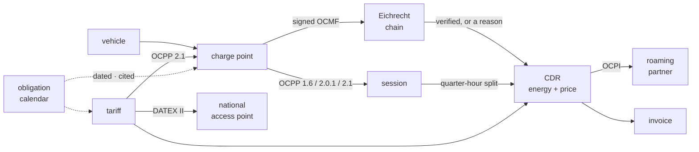

# emob

**A self-hosted EV charging platform for charge point operators and mobility providers. Manage stations and driver cards, publish prices, verify meter readings and settle partner invoices.**

[](https://github.com/hupe1980/emob/actions/workflows/ci.yml)
[](#license)
[](#crates)
[](https://hupe1980.github.io/emob/)

📖 **[Documentation](https://hupe1980.github.io/emob/docs/)** ·
[Getting started](https://hupe1980.github.io/emob/docs/getting-started/) ·
[Run the estate](https://hupe1980.github.io/emob/docs/run-the-estate/) ·
[The Eichrecht chain](https://hupe1980.github.io/emob/docs/eichrecht/) ·
[Architecture](https://hupe1980.github.io/emob/docs/architecture/)

<picture><source media="(prefers-color-scheme: dark)" srcset="site/static/img/heute-dark.webp"></picture>

Run the standalone platform with `just demo`. It starts emob’s services, three simulated stations and a simulated roaming peer on your machine. The demo supplies its own credentials and billing fixtures.

## Why emob

- **A verifiable Eichrecht chain.** German calibration law (*Eichrecht*) lets you
  invoice a measured value only if the customer can check it `[MessEG §33]`. A
  signed meter value (OCMF — the Open Charge Metering Format) becomes billable
  energy through exactly one function, which answers `None` when anything is
  wrong, and the driver gets a file their own verifier reads.
- **Exact money.** No binary floats anywhere outside tests — a build guard fails
  on any `f32` or `f64`. Energy keeps the meter's scale, money rounds once at the
  currency's minor unit, and every rounding is stated on the document.
- **Compliance as code.** AFIR, the German Ladesäulenverordnung and
  price-indication rules, MessEG, the THG-Quote, the MiSpeL levy rules for
  bidirectional charging and NIS2 are dated, cited,
  executable rules: "which duties will this estate fail on 1 January 2027?" is a
  function call.
- **German market particulars, done properly.** The quarter-hour settlement grid,
  `[EnWG §14a]` grid-operator control of charge points, the THG-Quote
  (greenhouse-gas quota) filing, EN 16931 e-invoices with SEPA collections, and
  the DATEX II feed to the national access point.
- **A price before plugging in.** Open a public station’s ad-hoc price or choose a published provider plan. Both show gross components. The provider quote identifies the two tariff versions and can be reopened after a price change. [Pricing guide](site/content/docs/pricing.md)
- **Public charging data with delivery evidence.** The publisher sends the table and changing point data to separate Mobilithek offers. Operators can see the last receiver acknowledgement, stale source data and the result of sending a tariff to the station. [Locations and publication](site/content/docs/locations.md)
- **A journal you can audit.** Every fact a daemon keeps names who caused it,
  every journal's end is signed, and a witness outside the daemon's volume
  notices a journal cut short or restored from an old backup.

## Try it

```console
just doctor      # what is missing, and the command that installs it
just demo        # the estate on loopback: Heute, a receipt, the partner's inbox, the invoice
just a11y        # every page a person reads, checked for accessibility
```

The demo runs five services, three simulated OCPP stations and a local OCPI peer. Open the printed links to inspect a refusal in Heute, verify a driver's receipt or view a partner invoice. Ctrl-C removes the disposable estate.

No Rust toolchain? `just demo` runs the published
`ghcr.io/hupe1980/emob` image with Docker instead (host networking; on Docker
Desktop enable it under Settings → Resources → Network).

<picture><source media="(prefers-color-scheme: dark)" srcset="site/static/img/receipt-dark.webp"></picture>


With receipts enabled, the estate issues a **receipt** for a recorded session. A driver can open it on a phone and see the verdict first ("Gemessen, signiert, geprüft", or "Nicht
abgerechnet" with the citation), the energy, the price lines from the CDR, the
meter key in groups of four to compare with the charge-point label, the
S.A.F.E. transparency file, and **Selbst prüfen** — a WebAssembly build of the
OCMF verifier that checks every signed value on the phone, offline once loaded.
`emob verify <transparency-file>` does the same on the command line.

## Running services

The workspace has **1426 tests**. Nine daemons share one estate configuration. The CSMS accepts OCPP 1.6J, 2.0.1 and 2.1 stations. The mobility provider manages driver agreements and cards. Verified sessions feed partner billing and OCPI roaming. Configured public points supply the Mobilithek static and dynamic feeds. [Architecture](site/content/docs/architecture.md) · [Deployment and security boundaries](THREAT_MODEL.md)

### Investigate a refusal

Start `just demo`, open **Heute** and select the transaction in the refused row. The timeline shows which messages arrived, when the CSMS made its decision and how to reach the station, provider card and available receipt. Look up the printed number `MOB-1001`, open the matching card and choose **Reported lost** to review a block. Confirming records your name and reason and makes the provider refuse the next online authorization. Open the same card and choose **Card recovered** to restore ordinary contract checks. The review explains what an offline station can still do. [Operator walkthrough](site/content/docs/run-the-estate.md#investigate-a-refused-session)

### Enrol a driver

To issue a new driver card, open **Driver contracts**, choose a published offer and enter `STOCK-1004`. Review the gross price and point before confirming. The provider issues an eMAID and records the exact offer. A simulated charge and provider restart exercise the full workflow in `just e2e`. [Enrolment walkthrough](site/content/docs/run-the-estate.md#enrol-a-driver-and-issue-a-card)

## Quick start

```console
cargo add emob-eichrecht emob-session emob-cdr emob-tariff
```

A signed meter value becomes a billable quantity through one door, and that door
answers `None` when anything is wrong — a bad signature, an unregistered key, a
substituted reading, a record deleted from the middle of the session:

```rust
use emob_eichrecht::{Evidence, KeyRegistry};

let evidence = Evidence::assemble(&records, &registry, session_start);

match evidence.billable_energy() {
    Some(energy) => println!("bill {energy}"),   // 29.500 kWh
    None => for reason in evidence.reasons() {
        eprintln!("blocked: {reason}");          // → an operator, not an invoice
    },
}
```

There is no second route: a caller who wants to bill anyway has to write code that
visibly ignores the answer. [Getting started](https://hupe1980.github.io/emob/docs/getting-started/)
takes the session the rest of the way — split across quarter hours, priced into a
CDR (charge detail record), sent to a roaming partner and the national access
point, and invoiced with a SEPA collection.



## Running the estate

Start with the [example estate](deploy/estate.example.toml). Validate it with `emob check` and keep private keys and journal data outside version control. The operator guide covers configuration, Docker Compose, credentials, monitoring and recovery. [Run the estate](site/content/docs/run-the-estate.md)

## The twenty-eight properties that decide quality

Each property is either true of every run or false; the tests exist to keep it
true. Each row links to the page that explains it.

| # | Property | Where |
|---|---|---|
| 1 | A value that does not verify does not bill | [Eichrecht](https://hupe1980.github.io/emob/docs/eichrecht/) |
| 2 | A chain proves four things, and OCMF says which | [Eichrecht](https://hupe1980.github.io/emob/docs/eichrecht/) |
| 3 | The signed record also says when the car stopped charging | [Eichrecht](https://hupe1980.github.io/emob/docs/eichrecht/) |
| 4 | Import and export never net, and the register says so | [Eichrecht](https://hupe1980.github.io/emob/docs/eichrecht/) |
| 5 | The customer can repeat the check, in software neither party wrote | [Eichrecht](https://hupe1980.github.io/emob/docs/eichrecht/) |
| 6 | The quarter-hour split conserves energy exactly | [Settlement](https://hupe1980.github.io/emob/docs/settlement/) |
| 7 | …and the grid that settles the energy does not price the minutes | [Settlement](https://hupe1980.github.io/emob/docs/settlement/) |
| 8 | The identification is read off the signed record, not asked for | [Settlement](https://hupe1980.github.io/emob/docs/settlement/) |
| 9 | A record says what it is, and nothing is inferred back out of it | [Settlement](https://hupe1980.github.io/emob/docs/settlement/) |
| 10 | The rounding happens once, and the document says what it cost | [Settlement](https://hupe1980.github.io/emob/docs/settlement/) |
| 11 | A roaming settlement is not taxed where the charge point stands | [Settlement](https://hupe1980.github.io/emob/docs/settlement/) |
| 12 | The price shown is the price charged, and it rides on the record | [Tariffs](https://hupe1980.github.io/emob/docs/pricing/) |
| 13 | One price, three audiences, and the screen the article regulates | [Tariffs](https://hupe1980.github.io/emob/docs/pricing/) |
| 14 | A reservation is priced, and it is not a period of the session | [Tariffs](https://hupe1980.github.io/emob/docs/pricing/) |
| 15 | A price bound is two ceilings, not one | [Tariffs](https://hupe1980.github.io/emob/docs/pricing/) |
| 16 | A price per hour of the day needs a zone, and an offset is not one | [Tariffs](https://hupe1980.github.io/emob/docs/pricing/) |
| 17 | What cannot be evaluated is not assumed open | [Tariffs](https://hupe1980.github.io/emob/docs/pricing/) |
| 18 | The wire's numbers are telemetry, and the seam says so in the types | [OCPP](https://hupe1980.github.io/emob/docs/ocpp/) |
| 19 | A record two companies hold is one they can both read | [Roaming](https://hupe1980.github.io/emob/docs/roaming/) |
| 20 | A crossing has a cost, and the record says what it was | [Roaming](https://hupe1980.github.io/emob/docs/roaming/) |
| 21 | A record that has been settled cannot be sent again | [Roaming](https://hupe1980.github.io/emob/docs/roaming/) |
| 22 | The identifier that routes the money checks itself | [Roaming](https://hupe1980.github.io/emob/docs/roaming/) |
| 23 | The price on the map is the price on the invoice | [Locations](https://hupe1980.github.io/emob/docs/locations/) |
| 24 | Compliance is a query, not a consulting engagement | [Compliance](https://hupe1980.github.io/emob/docs/compliance/) |
| 25 | Notified is not published, and the quota turns on the difference | [Compliance](https://hupe1980.github.io/emob/docs/compliance/) |
| 26 | Money is never a float, and scale is information | [Architecture](https://hupe1980.github.io/emob/docs/architecture/) |
| 27 | An agent proposes; it cannot move money, and that is a property | [Architecture](https://hupe1980.github.io/emob/docs/architecture/) |
| 28 | A policy may grant, and it may never widen a delegation | [Architecture](https://hupe1980.github.io/emob/docs/architecture/) |

Three claims a reviewer should doubt first:

- **The Eichrecht chain is tested against hardware nobody here wrote** — five
  real meters from the S.A.F.E. reference data set — and the
  [`ocmf`](https://crates.io/crates/ocmf) format crate underneath is tested
  against all 256 records of that corpus with OpenSSL as an independent oracle.
- **One tariff object reaches all three audiences owed a price** — the driver
  over OCPP 2.1, the roaming partner over OCPI 2.3.0, the national access point
  over DATEX II — with a test asserting all three read the same number, so the
  display-versus-bill drift `[AFIR Art. 5(4)]` prohibits cannot be represented.
- **The regulation is read from the Official Journal, not from a summary.** A
  renovation is not a deployment; an exemption is a date, not a technology; the
  NIS2 SME threshold's financial half is an `and` that most restatements write
  as `or`; and the German price-indication duty is older and wider than AFIR's.

## Crates

Fifteen published domain crates (✅ built, MSRV 1.94 unless noted). None of them reads a
clock or opens a socket, so a two-year-old dispute replays exactly; `just purity`
enforces it.

| Crate | What it holds | State |
|---|---|---|
| [`emob-core`](crates/emob-core) | Identifiers that round-trip verbatim, exact energy and money, time zones, the settlement grid, and the obligation calendar (51 duties and entitlements) for charge points, providers and companies | ✅ |
| [`emob-eichrecht`](crates/emob-eichrecht) | Calibration law over OCMF: which quantity each failure takes away, the key registry, the evidence record, the customer's transparency file | ✅ |
| [`emob-session`](crates/emob-session) | Authorisation paths, meter series, the timestamped state machine, the quarter-hour split that conserves energy exactly, the charging success rate, and the MiSpeL month for bidirectional charging | ✅ |
| [`emob-cdr`](crates/emob-cdr) | Charge detail records: priced from their own periods, accepted exactly once, validated without repair | ✅ |
| [`emob-tariff`](crates/emob-tariff) | Period-based rating with tiers and VAT, the driver display derived from it, AFIR and PAngV checks, versions and fingerprints | ✅ |
| [`emob-ocpp`](crates/emob-ocpp) | The OCPP seam: signed meter values in (never telemetry floats), tariffs and § 14a limits out over OCPP 2.1 | ✅ |
| [`emob-poi`](crates/emob-poi) | The charge point register and the DATEX II AFIR feed for the national access point | ✅ |
| [`emob-roam`](crates/emob-roam) | OCPI 2.3.0 / 2.2.1 in both directions and OICP 2.3 via Hubject, each crossing with an account of what it lost; routing from the contract id. MSRV **1.96** (required by `ocpi-kit`) | ✅ |
| [`emob-sim`](crates/emob-sim) | A deterministic fleet of virtual stations signing genuine OCMF, with seeded faults and an exact reconciliation | ✅ |
| [`emob-smart`](crates/emob-smart) | `[EnWG §14a]` as executable law: which points a grid operator may curtail, what the operator keeps, an allocation that cannot exceed the setpoint | ✅ |
| [`emob-eebus`](crates/emob-eebus) | The § 14a wire: EEBUS SPINE setpoints as exact decimals, and the five LPC states | ✅ |
| [`emob-pnc`](crates/emob-pnc) | ISO 15118 Plug & Charge from the platform side: pool membership, ISO 15118-2 and -20 chains under named roots, revocation, the eMAID read off the certificate | ✅ |
| [`emob-thg`](crates/emob-thg) | The THG-Quote: `[38k §6(3)]` eligibility per point and a notification built only from signed energy | ✅ |
| [`emob-billing`](crates/emob-billing) | Rated CDRs → EN 16931 e-invoice and its validation, SEPA collection, double-entry postings | ✅ |
| [`emob-service`](crates/emob-service) | The daemon shell: the estate file, health probes, OCPI-party authority, CloudEvents, webhook signatures, Cedar policies, data keys, the sealed hash-chained journal with actors, signed heads and the witness, JSON logs, and the server-rendered pages | ✅ |

Two unpublished crates ship with the daemons:

| Crate | What it holds | State |
|---|---|---|
| [`emob-verify`](crates/emob-verify) | One OCMF record, one key, one verdict — natively and as the receipt page's WebAssembly module (C ABI, no `wasm-bindgen`, no npm) | ✅ |
| [`emob-cli`](crates/emob-cli) | `emob verify <transparency-file>` (exit 0/1/2/64/66), `emob demo` and `emob witness` (exit 0/1/2/64) | ✅ |

And one Python package, on PyPI:

| Package | What it holds | State |
|---|---|---|
| [`emobtest`](emobtest) | The test and conformance toolkit for any charging platform, on these crates: stations and cars that charge on any CSMS over OCPP 1.6/2.0.1/2.1, an eMSP that answers it, a meter that signs OCMF, the verifier and the Eichrecht chain, the tariff rating and the Preisstand, event schemas and Standard Webhooks, a signed-event inbox, and the `receiver` and `authorize` conformance suites a replacement for `billd` or `empd` runs — `pip install emobtest` | ✅ |

Nine daemons, one image each, all started from the one estate file.

| Service | Owns | State |
|---|---|---|
| [`csmsd`](services/csmsd) | The CSMS stations connect to: OCPP 1.6J / 2.0.1 / 2.1 over `ocpp-kit` with security profiles 1–3, from signed value to settled record; the outbox; driver receipts, also on the station's display | ✅ |
| [`roamd`](services/roamd) | The OCPI roaming node in both directions, with the credentials module and a reach-back guard; sealed CDRs | ✅ · ⏳ OICP transport |
| [`empd`](services/empd) | The provider side: keyed token store, authorisation for `csmsd` | ✅ · ⏳ OCPI tokens, fees |
| [`billd`](services/billd) | Receiving CDRs, closing each partner's month once into an EN 16931 invoice, numbering, postings; the invoice page and signed delivery to the operator's system | ✅ · ⏳ SEPA runs |
| [`deskd`](services/deskd) | The operator's page Heute: the charging success rate, refused sessions with "Warum?", what needs a person today, and the witness of every journal | ✅ |
| [`tarifd`](services/tarifd) | Publishing the estate's tariff versions to all audiences before they take effect | ✅ read model · ✅ `driver-tariff.v1` · ⏳ push clients |
| [`poid`](services/poid) | The inventory and snapshots for the national access point `[AFIR Art. 20(2)]` | public registry, separate static and dynamic offers, receiver acknowledgements |
| [`sited`](services/sited) | The site controller for § 14a setpoints, with a failsafe when the grid operator goes silent | ⏳ SHIP session, OCPP leg |
| [`agentd`](services/agentd) | Advisory agents on `agentplane` (evidence triage, tariff and compliance sweeps), run under the read-only advisory principal, that cannot move money | ✅ runtime · ⏳ event feed |

## Documentation

- [Getting started](https://hupe1980.github.io/emob/docs/getting-started/) ·
  [Run the estate](https://hupe1980.github.io/emob/docs/run-the-estate/) ·
  [Architecture](https://hupe1980.github.io/emob/docs/architecture/) ·
  [Glossary](https://hupe1980.github.io/emob/docs/glossary/)
- [Verify an OCMF record in your browser](https://hupe1980.github.io/emob/verify/) —
  paste a signed value and a key; nothing is uploaded
- [Eichrecht](https://hupe1980.github.io/emob/docs/eichrecht/) ·
  [Settlement](https://hupe1980.github.io/emob/docs/settlement/) ·
  [Tariffs](https://hupe1980.github.io/emob/docs/pricing/) ·
  [OCPP](https://hupe1980.github.io/emob/docs/ocpp/) ·
  [Roaming](https://hupe1980.github.io/emob/docs/roaming/) ·
  [Locations](https://hupe1980.github.io/emob/docs/locations/)
- [Compliance](https://hupe1980.github.io/emob/docs/compliance/) ·
  [Bidirectional charging and MiSpeL](https://hupe1980.github.io/emob/docs/bidirectional/) ·
  [Smart charging](https://hupe1980.github.io/emob/docs/smart-charging/) ·
  [Plug & Charge](https://hupe1980.github.io/emob/docs/plug-and-charge/)
- API reference on [docs.rs](https://docs.rs/emob-core), one page per crate.

Every regulatory claim in the code cites a document and section in a fixed form
such as `[AFIR Art. 5(4)]`; `cargo xtask check-citations` fails the build on a
citation it cannot resolve to an indexed source.

**Sibling projects:** [mako](https://hupe1980.github.io/mako/) — German energy
market communication in Rust, where NZR-EMob Modell 2 for charge points lives
— and [hems](https://hupe1980.github.io/hems/) — home energy management, § 14a
behind the meter. Both can build on emob's money crates.

## Security

Report a vulnerability through GitHub private vulnerability reporting — see
[SECURITY.md](SECURITY.md). [THREAT_MODEL.md](THREAT_MODEL.md) is the system
threat model: every trust boundary, what holds it today and the test that
proves it, and the controls still missing, ranked. A change that crosses a
trust boundary gets a feature threat model extending it, through the
[ThreatSpec](https://github.com/hupe1980/spec-kit-threatspec) extension.

Every release carries a CycloneDX SBOM (`emob-<version>.cdx.json`),
`SHA256SUMS` and a build-provenance attestation over every `.crate` and the
SBOM. Verify a downloaded crate with:

```console
gh attestation verify emob-core-<version>.crate --repo hupe1980/emob
```

## Contributing

```console
just            # list every recipe
just ci         # fmt, clippy, purity, tests, guards, deny, docs — what CI runs
just test       # cargo test --workspace --all-features
just guards     # no-floats, citations, manifests, wire formats, prose, counts,
                # reachability, documented APIs and routes, constructors, dependency graph,
                # Actions pinned by SHA and base images by digest (check-actions)
just purity     # no clock, no I/O, no unsafe in the domain crates
just msrv       # the crates that promise 1.94 still build on 1.94
just a11y       # accessibility of every page, light and dark, 320 and 1280 px (Node, Chrome)
just site       # serve the documentation site locally (zola)
just wasm       # rebuild the receipt page's verifier (CI fails on a diff)
just pins       # every pinned Action and base image, to move by hand
just sbom       # the release's CycloneDX bill of materials
```

Run `just ci` before opening a pull request; [CONTRIBUTING.md](CONTRIBUTING.md)
has the way in and the rules that are tests. Features are specified with
[Spec Kit](https://github.com/github/spec-kit) before they are built.

Releases: `just release-check` packages every publishable crate and builds each
from its tarball. Pushing a `vX.Y.Z` tag runs
[`release.yml`](.github/workflows/release.yml), which re-runs the gate and
publishes the fifteen crates in dependency order with crates.io **trusted
publishing** (each crate's trusted publisher is configured once on crates.io:
repository `emob`, workflow `release.yml`, environment `crates-io`); a re-run
after a partial publish resumes rather than failing. The tag also pushes
`ghcr.io/hupe1980/emob-<daemon>:<version>` images and the
`ghcr.io/hupe1980/emob:<version>` CLI image, with provenance, `linux/amd64`
only. What
changed is in [CHANGELOG.md](CHANGELOG.md).

## License

Licensed under either of [Apache License 2.0](LICENSE-APACHE) or
[MIT](LICENSE-MIT), at your option.

[CitrineOS]: https://lfenergy.org/projects/citrineos/
[SteVe]: https://github.com/steve-community/steve
[EVerest]: https://everest.github.io
[`ocpp-kit`]: https://github.com/hupe1980/ocpp-kit
[`ocmf`]: https://github.com/hupe1980/ocmf
[`ocpi-kit`]: https://github.com/hupe1980/ocpi-kit
[`oicp-kit`]: https://github.com/hupe1980/oicp-kit
[`iso15118`]: https://github.com/hupe1980/iso15118
[`eebus`]: https://github.com/hupe1980/eebus
