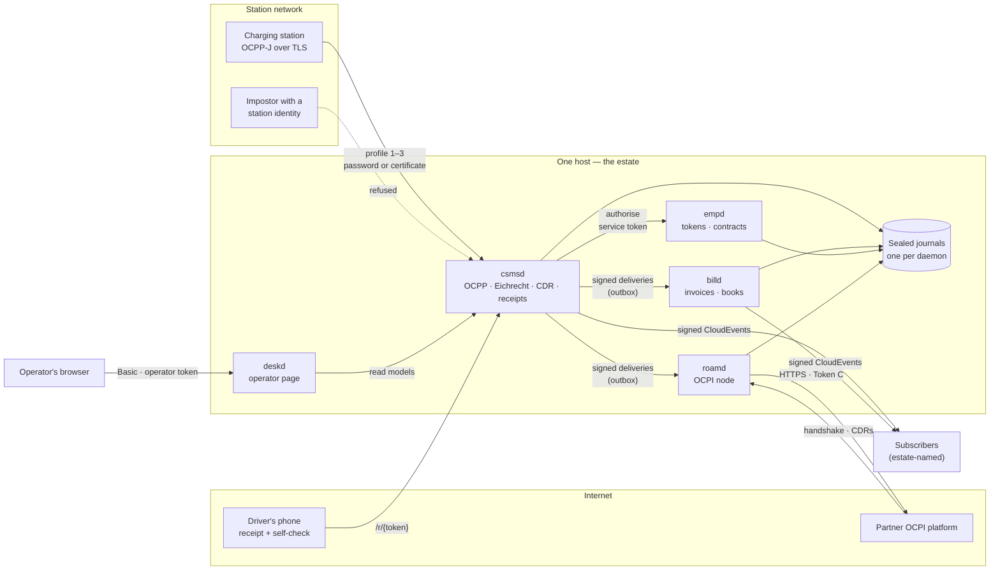

# Threat model

The system-level threat model of emob: what crosses which trust boundary, what
is worth attacking, what goes wrong, and which mechanism in the code stops it —
or that nothing does yet. How the services fit together is the
[architecture page](site/content/docs/architecture.md); how to report a
vulnerability is [SECURITY.md](SECURITY.md).

## Scope and method

| | |
|---|---|
| **Scope** | The daemons — `csmsd`, `roamd`, `empd`, `billd`, `poid`, `tarifd`, `sited`, `agentd` and `deskd` (the operator page) — configured from one `estate.toml`, their sealed journals and the deliveries between them; the public driver receipt; the domain crates whose decisions they inherit (OCMF verification, the key registry, CDRs, tariffs, invoices, Plug & Charge); the stations, roaming partners and vehicles they face; and the build and release supply chain |
| **Not yet in scope** | Surfaces that do not exist in code: `sited`'s EEBUS/SHIP socket, `poid`'s Mobilithek push, a Peppol access point (invoices leave through a signed webhook to the operator's system), the OICP mutual-TLS client, and Plug & Charge inside a service. Each is modelled when it is wired |
| **Method** | STRIDE per element, plus the OWASP Top 10 for LLM Applications and for Agentic Applications, through the [ThreatSpec](https://github.com/hupe1980/spec-kit-threatspec) Spec Kit extension (profiles `stride`, `llm`, `agent`). emob runs no language model: every LLM technique carries a recorded not-applicable disposition |
| **Machine-readable model** | An Open Threat Model 0.2.0 baseline plus one model per feature that extends it. This file is their public summary and follows them |
| **Severity** | Inherent, before the listed controls: likelihood × impact on ThreatSpec's 3×3 matrix (high × high is critical) |
| **Status** | **Control** — a mechanism exists and a test proves it. **Partial** — a control exists and a required one is missing. **Open** — no control in the code |

The baseline counts 25 system threats, all controlled, and 28 security
requirements. The eleven features of releases 0.2 and 0.3 add 107 threats with
their own requirements (SR-029 to SR-135): 105 are controlled and verified by
tests or review, one is accepted with an expiry (plain HTTP between daemons on
one host, until the daemons leave one host) and one is verified only on the
first tagged release (release provenance). Nothing open is rated critical.

## Trust boundaries

| Boundary | What crosses it | What holds it |
|---|---|---|
| Station → `csmsd` | Boot, authorisation, transactions, OCMF signed meter values | Security profile per station: a password checked against an Argon2id hash (1–2) or a client certificate that chains to the configured CA and names the identity (3); TLS on any non-loopback bind; connection, message-rate and idle limits; every billable value verified against a key the station did not supply |
| `csmsd` → `empd` | Is this token allowed to charge now? | A service token compared in constant time; `csmsd` fails closed when `empd` does not answer |
| Daemon → daemon | Closed sessions to `billd` and `roamd` | A journalled outbox; Standard Webhooks signatures with a freshness window; a body cap before the signature is checked; the CDR id as idempotency key, so a replay or retry settles once. Plain HTTP on one host is an accepted risk |
| `csmsd`, `billd` → subscribers | `de.emob.cdr.issued` (card UID, station) and `de.emob.invoice.issued` | Named only in the estate file; `https`, or `http` on loopback; a `whsec_` secret per subscriber; type patterns checked against the catalogue at start; every answer journalled and none of them accepts, books or consigns |
| Partner ↔ `roamd` | Credentials handshake, CDR push and receipt | Tokens held as keyed digests or sealed; a pushed record authorised as the credential's party; the handshake reach-back allowed only to `https` hosts outside private ranges |
| Driver → receipt | `/r/{token}`, the transparency file, the verifier | A 128-bit token stored only as its hash; the same 404 for any unknown path; no name, card or contract on the page; a strict content security policy; verification runs on the driver's device |
| Operator → `deskd` | The estate's refused sessions, stations, invoices, consignments | Operator token over HTTP Basic, loopback by default; read-only; no card UID or contract id on the page; bounded lists; a daemon that is down is named rather than shown as calm |
| Daemon → journal volume | Every fact a service decided | Each journal sealed under the daemon's data key (AES-256-GCM) and hash-chained over the sealed bytes; a foreign key refuses to start (or, for `empd`, erases the UIDs); an edited record stops the daemon. A truncated tail is invisible without an outside witness |
| Supply chain → release | Crates, images, Actions | Actions pinned by commit and base images by digest under a guard; `cargo deny`; crates.io trusted publishing without a stored token; an SBOM, checksums and build provenance on every release |

## Threats and their status

### The station edge

| Threat | Severity | Status | Evidence |
|---|---|---|---|
| An impostor who knows a station identity connects as that station | critical | **Control** | `services/csmsd/tests/a_station_proves_who_it_is.rs` |
| OCPP without TLS exposes passwords and card UIDs | high | **Control** | non-loopback bind without TLS refuses to start (same file) |
| Every card is accepted and `empd` is never asked | high | **Control** | `services/empd/tests/a_token_is_asked_about.rs`; `services/csmsd/tests/the_estate_runs.rs` (blocked card, `empd` down) |
| A connection or message flood exhausts `csmsd` | medium | **Control** | connection cap, message rate and idle timeout (enforced by `ocpp-kit`, counted by `csmsd`) — `a_station_proves_who_it_is.rs` |

### The Eichrecht chain and the driver

| Threat | Severity | Status | Evidence |
|---|---|---|---|
| A forged or altered OCMF record is billed | high | **Control** | `crates/emob-eichrecht/src/evidence.rs::a_tampered_value_rates_nothing_and_says_why`; the demo's tampered session |
| The key registry is empty or has no provenance | medium | **Control** | keys come from the estate with provenance; an empty registry is not ready |
| The driver never receives the evidence the bill rests on | high | **Control** | `services/csmsd/tests/a_receipt_is_checked.rs`; the in-browser verdict matches `emob-eichrecht` on the S.A.F.E. reference records |
| A receipt is guessed, leaks through logs or shows personal data | medium | **Control** | token hygiene, identical 404s, no-PII and escaping tests in `a_receipt_is_checked.rs` |

### Roaming, money and personal data

| Threat | Severity | Status | Evidence |
|---|---|---|---|
| A partner pushes a record naming another party | high | **Control** | `services/roamd/tests/a_record_reaches_its_partner.rs` |
| A retransmission or replayed delivery settles twice | critical | **Control** | `the_estate_runs.rs` (restarts of every daemon, replayed deliveries) |
| A journal copy is a working partner credential | high | **Control** | the end-to-end test searches the journals on disk for tokens and UIDs |
| Card UIDs and bank data at rest cannot be erased | medium | **Control** | sealed journals; `empd` crypto-erasure; redacted `Debug` for mandates |
| The handshake is pointed at an internal address | medium | **Partial** | https and resolved-address checks; a DNS-rebinding window between the check and the protocol library's own connect remains |
| An invoice number is issued twice or a correction booked out of order | high | **Control** | `services/billd/tests/a_month_is_closed_once.rs` |
| The displayed price differs from the billed one | high | **Control** | `crates/emob-tariff/src/display.rs::the_displayed_price_is_the_price_that_rates` |

### Pages

| Threat | Severity | Status | Evidence |
|---|---|---|---|
| Station- or partner-controlled text runs as script on a page | high | **Control** | every value passes `emob_service::ui::escape`; strict CSP; tests in `deskd` and `csmsd` |
| The operator page reads "nothing to do" while a daemon is down | high | **Control** | `services/deskd/tests/heute_reads_the_estate.rs` |
| The operator token leaks onto the page or into logs | high | **Control** | same file |
| A long history or a huge `limit` makes a read model or the page unbounded | medium | **Control** | bounded `/today` views (limit 1–200, strict query, integer cursors), 1 MiB cap in `deskd`; `services/deskd/tests/heute_at_scale.rs` at one million sessions |

### Journals, audit and the advisory plane

| Threat | Severity | Status | Evidence |
|---|---|---|---|
| A journal is truncated and the service folds a shorter history | medium | **Control** | every append signs the head (Ed25519, C2SP signed note); a restart refuses a journal shorter than its signed head; `emob witness` and Heute keep heads somebody else saw and raise a lasting alarm on a regression, fork or key change |
| No record names the principal behind a decision | medium | **Control** | every fact carries its actor (station, partner, operator by name, service, timer, estate) under the chain digest; JSON logs carry the same actor and a request id, and a test proves they hold no token or card UID |
| `agentd`'s read-only principal is built but not handed to its runtime | low | **Control** | specialists run under the advisory delegation chain; the runtime refuses a capability outside it |
| Someone holding a daemon's signing key rewrites history and extends it past the witnessed position | medium | **Partial** | accepted residual: the journal is a chain, not a Merkle tree, so a forward head is accepted without a consistency proof |

### Invoices, Plug & Charge and the station display

| Threat | Severity | Status | Evidence |
|---|---|---|---|
| An invoice page token is guessed, leaks, or shows more than the invoice | medium | **Control** | the receipt's token rules; masked IBAN; `noindex`, `no-store`, `no-referrer`; tests in `services/billd` |
| A delivered invoice is forged, altered or its answer misread | high | **Control** | Standard Webhooks signature per attempt; only a 2xx books; tests in `services/billd` |
| An event reaches a system nobody meant, or is read or forged on the way | medium | **Control** | `crates/emob-service/src/estate.rs::a_subscriber_is_checked_before_anything_is_sent_to_it`; `the_estate_runs.rs::a_subscriber_outside_the_estate_receives_the_issued_record_as_a_cloudevent`; `a_month_is_closed_once.rs::a_subscriber_receives_each_invoice_event_once_and_decides_nothing` (SR-029) |
| A receipt reveals other drivers' sessions through the invoice | medium | **Control** | a receipt never links to the monthly invoice; the invoice links each receipt |
| An ISO 15118-20 chain is judged under the wrong rules or root | high | **Control** | the generation is named per call, never inferred; Ed448 refused by name; tests in `crates/emob-pnc` |
| A MiSpeL month overstates the relieved share | high | **Control** | the formulas' equalities and bounds hold over 500 seeded months; the published worked examples reproduce |
| The receipt link on a public station display is read by the next person | low | **Partial** | opt-in per station, shown 1–15 minutes, and the receipt carries no personal data — accepted residual |

### Supply chain

| Threat | Severity | Status | Evidence |
|---|---|---|---|
| A moved Action tag or base-image tag puts code into a release | medium | **Control** | `cargo xtask check-actions` |
| A stored registry token leaks | medium | **Control** | trusted publishing; no token in the workflows |
| A release cannot be told from one built elsewhere | medium | **Partial** | SBOM, checksums and provenance are produced by `release.yml`; verified on the first tag |
| A reporter has no private route | high | **Control** | [SECURITY.md](SECURITY.md) |

`cargo deny` ignores two upstream advisories with a written exposure analysis
and a review date: `crypto-bigint` 0.5 (timing side channels; emob verifies over
public keys and signatures, and only the simulator signs) and `chrono`
(unmaintained, through `cedar-policy`).

## Open risks, ranked

1. **DNS rebinding in the handshake** — needs the OCPI library to connect to the
   address that was checked.
2. **Plain HTTP between daemons** — accepted while the estate runs on one host;
   TLS between daemons when it does not.
3. **A rewrite past the witnessed head by a signing-key holder** — a Merkle
   log with consistency proofs would close it.
4. **Release provenance** — verified on the first tagged release.
5. **Ed448 contract chains** — refused until a stable Rust implementation on
   the workspace's cryptography generation exists.

## Extending the model

Each change is specified with Spec Kit, and a change that crosses a trust
boundary gets a feature threat model that extends the baseline:
`/speckit-threatspec-model` after specify and plan, `/speckit-threatspec-check`
after tasks and before implement, `/speckit-threatspec-converge` after
implement. Its `SR-###` requirements carry evidence in tests that name them.
