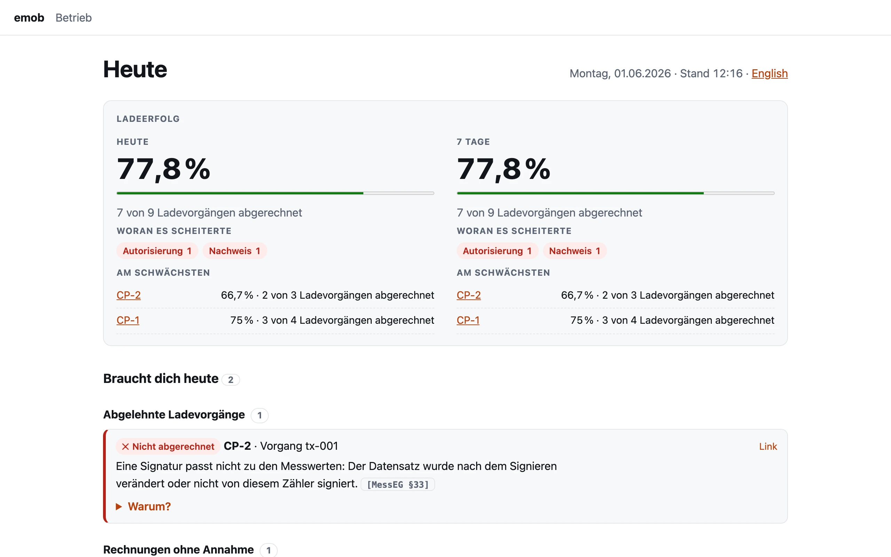

# deskd

<picture><source media="(prefers-color-scheme: dark)" srcset="../../site/static/img/heute-dark.webp"></picture>

The operator's page. **Heute** is what needs a person today, in order, headed by
the charging success rate — rendered on the server from the read models of the
daemons that made each decision. `deskd` decides nothing; the one thing it
keeps is the **witness** — its own record of where each daemon's journal ended.

## Status

| | |
|---|---|
| ✅ page | `GET /` — the success rate (estate, weakest points, failures by cause), then refused sessions with **"Warum?"**, stations silent beyond their heartbeat, records a partner has not taken, invoices awaiting acceptance, the obligation calendar's duties of the next 90 days, and **Journale** (below). German first, `?lang=en`. Works without JavaScript; `/ui/heute.js` (< 2 kB) refreshes it every 15 s while visible |
| ✅ station page | `GET /station/<identity>` — one station's asset card from `csmsd`'s station view: whether it is held for a card (reserved and cancelled from the card), its notes (written and removed from the card), online or silent since when, what it said at boot, what its meter signs and whether its key is registered, every firmware change (the `[MessEG §31(2) Nr. 4]` intervention record), its reports, success and last sessions. Station links open this card while the point remains registered |
| ✅ access | HTTP Basic whose password is one of the estate's `[[operators]]` tokens; binds `127.0.0.1:9587` unless `DESKD_HTTP_BIND`/`EMOB_HTTP_BIND` says otherwise (compose publishes it on `localhost:8088`) |
| ✅ witness | every 30 s reads the signed journal head of `csmsd`, `billd`, `roamd` and `empd` and records it in `witness.ndjson` under `EMOB_JOURNAL_DIR` — on deskd's own volume (`deskd:/var/lib/emob` in compose), never one of the daemons' |
| ✅ tested | render tests (order, escaping, bounds, a down daemon, de/en, a11y basics) and `tests/heute_reads_the_estate.rs`, which starts the real `empd`, `billd`, `roamd` and `csmsd` and holds the rate's numerator to the records `billd` received |

## What it reads

| From | What | Rendered as |
|---|---|---|
| `csmsd` `GET /v1/csmsd/today` | the success rate per day (`emob_session::success::Daily`): today and the last 7 days, refused sessions with their typed `findings` (`emob_eichrecht::Finding`), silent stations | "Heute" and "7 Tage", refused sessions and "Warum?", silent stations |
| `csmsd` `GET /v1/csmsd/stations/<identity>` | one station: presence, identity, meters, firmware history, last sessions and the current boot’s tariff installation result | the station page, including tariff fingerprint, station response, retry state and the separate on-site check |
| `csmsd` `GET /v1/csmsd/stations`, `GET /v1/csmsd/map` | a page of the search and its map: points, or grid cells | "Stationen": the map (inline SVG over the bundled Natural Earth outline, `src/europe.rs`) and the table |
| `roamd` `GET /v1/roamd/today` | consignments not `accepted` | records a partner has not taken |
| Optional `poid` `GET /v1/poid/dynamic` | separate static and dynamic attempt counts, attempt times and acknowledgements, last full dynamic snapshot, measured change-to-receipt time, delta messages since the snapshot, cumulative late deliveries and current problem | Mobilithek delivery on Heute |
| `billd` `GET /v1/billd/today` | documents whose `submission` is not accepted | invoices awaiting acceptance |
| `emob_core::obligation` | `starting_between(today, today + 90 days)` | duties, with "in 44 Tagen" and the exact date on focus |
| `csmsd`, `billd`, `roamd`, `empd` `GET /v1/<name>/head` | each journal's signed head | "Journale" |

**At scale.** The desk reads bounded views with a 1 MiB maximum response. The scale test builds an estate with one million settled sessions and 50 000 refusals, checks the paginated rows, then times the owner read and desk render (`tests/heute_at_scale.rs`). Each long list ends in a plain "Ältere anzeigen" link — no script needed.

Each read has a 2 s timeout and a 1 MiB cap. A daemon that does not answer is
named in its section with since when; the rest of the page renders, and the
"nothing to do" sentence appears only when every daemon answered.

## Investigate a session

In Heute, select a transaction in **Refused sessions** to open its evidence. Each timeline entry names the source of its time. Missing frames, a retired station or a missing card reference remain visible as gaps. Use the receipt link to inspect the evidence available to the driver. The timeline prints with the browser’s normal print command.

**Find a session or card** takes a local transaction reference, a printed card number, an emob lookup number or an eMAID. If two stations reused the same transaction reference, select the station and time in the results. The lookup submits identifiers and pagination cursors in a form body. The desk uses its existing operator access check and requests each bounded result page from the owner. To find an EVSE, open **Stations**. German and English pages work with JavaScript disabled.

## Block or unblock a provider card

Open **Find a session or card**, choose a card from the results, or follow a session’s linked card. Its page shows the provider’s current status and ten most recent changes. With a named writer account, select a reason and **Review block** or **Review unblock**. Check the emob lookup number, reason, effect and expiry, then confirm or return to the card. A review lasts five minutes. Opening another review with the same account replaces it.

Blocking takes effect at the next online authorization. Unblocking restores the ordinary contract and credit checks. Existing charging sessions continue, and a disconnected station can still use its cached decision. If the confirmation response is lost, open **Check card history** and match the action reference before making another change. The same confirmation can be retried. Each recorded change identifies its operator, reason, review time and application time.

Card lookups and both action forms use POST bodies. The desk forwards the signed-in operator’s credential to the provider for a preview or confirmation. The separate background credential reads the provider’s card status and history. Readers can also inspect station reservations and notes. The desk presents mutation controls to writers.

Use a current browser over HTTPS or on loopback HTTP. For private lookups and actions the browser must send `Sec-Fetch-Site: same-origin`. Behind TLS termination, configure the reverse proxy to preserve the public `Host` (including its port), `Origin` and Fetch Metadata headers. The desk’s privacy policy can cause the browser to send an opaque `Origin: null`; the same-origin Fetch Metadata check still applies. Clients that omit Fetch Metadata receive HTTP 403 for form submissions. [W3C Fetch Metadata](https://www.w3.org/TR/fetch-metadata/)

## Enrol a driver card

Open **Driver contracts** on Heute. With a named writer account, choose a plan and charging point, enter the unissued card’s stock number, and select **Review contract**. In the example estate use `STOCK-1004`. The provider supplies the masked card, gross rates, separate monthly fee, exact offer reference and review expiry. **Confirm enrolment** issues the card and records that operator’s agreement with the displayed terms. A confirmed agreement can be reopened with its reference from the same page using a reader account.

If confirmation is interrupted, choose **Check agreement**. Retrying the same confirmation returns the recorded result after a successful issue. Stock numbers and agreement references travel in private POST bodies. The receipt links to the issued card’s current status. It records fulfilment and agreed terms. Monthly driver invoicing is a later milestone.

## Public charging and price evidence

Set `[desk] poid` to the publisher's operator API base URL. Heute shows the last dynamic receiver acknowledgement and complete snapshot independently. A source change and its own acknowledgement measure delivery latency even if a later refresh has already been accepted. The cumulative late count is the number of acknowledged deliveries with a new source change more than 60 seconds old. When a known change awaits acknowledgement, the page shows its original timestamp and flags it once 60 seconds have elapsed. The last receipt stays visible alongside any current problem. To establish subscriber visibility, observe the values at a subscriber and record the time and EVSE.

On a station's asset card, an OCPP 2.1 tariff installation records the station registration, boot, tariff fingerprint, attempt time and outcome. An accepted tariff still requires an on-site check of the displayed or posted energy price and any occupancy charge before charging. The create and edit forms keep public access, price delivery and the renewable-electricity declaration explicit. An undeclared electricity mix is distinct from a declaration that it is less than 100% renewable.

## Journale: the witness on Heute

A daemon refuses to start from a journal shorter than the head it signed — but
whoever can cut the journal can delete that head too, and a backup restore
brings an old one back. So deskd keeps a copy no daemon's volume holds. The
**Journale** section lists each daemon with its last witnessed position, the
time, and where the key came from: *Schlüssel aus dem Estate* (named in
`[witness] keys`) or *Schlüssel beim ersten Mal gemerkt* (pinned at first
sight).

A head that went backwards, forked (same position, another hash) or came under
another key is a red row naming both positions. It **stays** — the witness file
is a chained history, not a flag the next good head clears — until somebody
moves `witness.ndjson` aside, and while it stands the "nothing to do" sentence
is not shown. The publication card reads a delivery summary from `poid`. Use
`emob witness` for the signed head of its journal.

## Run it

```sh
export EMOB_ESTATE=deploy/estate.example.toml EMOB_OPERATOR_TOKEN=… EMOB_DESK_READ_TOKEN=…   # distinct secrets, plus the daemons' secrets
just desk            # or: cargo run -p deskd
open http://127.0.0.1:9587/    # any user name, $EMOB_OPERATOR_TOKEN as the password
```

The estate's `[desk]` section names `csmsd`'s shell, the token variable and the
zone the page tells time in; `billd`, `roamd` and `empd` are read at their
`[services]` addresses. The optional `[witness] keys` names a daemon's verifier
key (what its head route sends in `Emob-Verifier-Key`); a daemon not named is
pinned the first time it is seen.

| Variable | Default | Purpose |
|---|---|---|
| `EMOB_ESTATE` | `./estate.toml` | `[desk]`, `[services]`, `[witness]`, `[[operators]]` |
| `EMOB_DESK_READ_TOKEN` | **required in the example estate** | dedicated read-only token selected by `[desk] token_env` for background reads and witnessing |
| `EMOB_OPERATOR_TOKEN` | **required in the example estate** | named human writer’s password for the desk; actions are attributed to this operator |
| `DESKD_HTTP_BIND` / `EMOB_HTTP_BIND` | `127.0.0.1:9587` | the page |
| `EMOB_JOURNAL_DIR` | `var` | where `witness.ndjson` lives |
| `EMOB_LOG_FORMAT`, `RUST_LOG` | JSON, `info,deskd=debug` | log format and filter |

The fastest way to see it is `just demo`, which prints a signed-in Heute link.

## Built on

`emob-service` (the shell, `ui::operator_page`, the shared stylesheet, the
witness),
`emob-session` (the success tally), `emob-eichrecht` (typed findings) and
`emob-core` (the obligation calendar). See
[Run the estate](https://hupe1980.github.io/emob/docs/run-the-estate/) and the
[workspace README](../../README.md).

## License

MIT OR Apache-2.0
