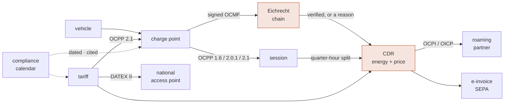

+++
title = "emob"
template = "index.html"
description = "Open-source EV charging software for Europe: CSMS and eMSP back office in Rust — OCPP 2.1, OCPI 2.3.0, Eichrecht-verified billing, AFIR compliance as code."
+++

## Why emob

Someone plugs in a car. Minutes later a number exists that two companies will
settle against, a tax authority may examine, and a driver may dispute two years
from now. Between the plug and that number sit a calibrated meter, a station
protocol, a roaming hub, a tariff and a dozen European duties with dates
attached. Most charging platforms treat that chain as plumbing. **emob treats it
as the product.**

<a class="feature" href="docs/eichrecht/"><h3>Eichrecht, verified end to end</h3>
Every OCMF signed meter value is checked against a registered key, the session's records are checked for gaps, and a value that fails never reaches an invoice — with the reason attached.
</a>
<a class="feature" href="docs/pricing/"><h3>One price, everywhere</h3>
The tariff that rates a session is the one shown on the station (OCPP 2.1), sent to roaming partners (OCPI) and published to the national access point (DATEX II). Display and bill cannot disagree.
</a>
<a class="feature" href="docs/settlement/"><h3>Money is never a float</h3>
Exact decimals throughout, a quarter-hour split that conserves every watt-hour, and invoice lines that explain their own amounts — out to EN 16931 and SEPA.
</a>
<a class="feature" href="docs/compliance/"><h3>Compliance is a query</h3>
AFIR, its delegated act on ISO 15118, the Ladesäulenverordnung, PAngV, NIS2 and the Cyber Resilience Act as dated, cited duties — assessed per charge point, provider and company.
</a>
<a class="feature" href="docs/roaming/"><h3>Roaming without silent loss</h3>
OCPI 2.3.0 and 2.2.1 both ways, OICP 2.3 through Hubject. Every translation returns the record and an account of what the crossing cost.
</a>
<a class="feature" href="docs/architecture/"><h3>Replayable by design</h3>
Domain crates read no clock and open no socket. A dispute about a two-year-old session is answered by replaying the check exactly as it ran.
</a>

Also inside: [Plug & Charge for ISO 15118-2 and -20](@/docs/plug-and-charge.md) ·
[§ 14a smart charging](@/docs/smart-charging.md) ·
[MiSpeL for bidirectional charging](@/docs/bidirectional.md) ·
[AFIR data and the Mobilithek feed](@/docs/locations.md) ·
THG-Quote filing.

## How a charging session becomes an invoice

A charge point streams the session over OCPP; its meter signs each reading in
OCMF. emob verifies the signatures, splits the energy into the quarter hours the
market settles on, prices it with the tariff, and produces a charge detail
record (CDR) — the document two companies settle against. From there it goes to
roaming partners, to the invoice and to the books. Every arrow is a place a
kilowatt-hour can quietly become the wrong number; each one has a test.

## Four questions before a kilowatt-hour bills

German calibration law lets you invoice a measured value only if the customer
can check it, long after the session `[MessEG §33]`. emob asks four separate
questions, in order, and answers each on its own:

| Question | Answered by |
|---|---|
| Did *this key* produce *these bytes*? | ECDSA verification over the bytes as written |
| Is it *this charge point's* key? | an out-of-band key registry with validity windows |
| Is any record missing from the session? | the chain validator: pagination and begin/end markers |
| May these readings be billed at all? | the meter's state and error flags |

The driver gets the evidence too: a transparency file the independent S.A.F.E.
verifier reads, emitted whether or not the session bills — because a dispute is
exactly when it matters. [Read the Eichrecht guide →](@/docs/eichrecht.md)

## The European rulebook, with dates

| Date | Rule | In emob |
|---|---|---|
| 14 Apr 2026 | AFIR Art. 20: static and dynamic data as DATEX II via the Mobilithek | ✅ feed generated · ⏳ push |
| 11 Sep 2026 | Cyber Resilience Act: vulnerability reporting | ✅ assessed per company |
| 21 Oct 2026 | BNetzA MiSpeL: levy relief for bidirectional charging points | ✅ month and year netted · two entitlements |
| 1 Jan 2027 | ISO 15118-20 on new public points (Delegated Regulation 2025/656) | ✅ duty modelled · -2 and -20 contract chains validated under named roots |
| 1 Jan 2027 | AFIR card payment at existing ≥ 50 kW TEN-T points | ✅ duty modelled |
| 1 Jan 2027 | German B2B e-invoices issued for turnover above €800k | ✅ EN 16931 / XRechnung in UBL and CII · invoice page · signed handover |
| 10 Oct 2028 | EU measuring-instruments rules cover charging equipment | ✅ tracked |

[How compliance is modelled →](@/docs/compliance.md)

## See it run: the operator page and the driver receipt

`just demo` starts the whole estate on your machine in one command — every
daemon, three simulated stations on OCPP 1.6, 2.0.1 and 2.1, an OCPI roaming
partner and a seeded morning of sessions — and prints two links worth opening.

<figure>
<picture><source media="(prefers-color-scheme: dark)" srcset="img/heute-dark.webp"></picture>
<figcaption><strong>Heute</strong> — what needs a person today, headed by the charging success rate counted from the ledger that bills. <a href="docs/run-the-estate/">The operator page →</a></figcaption>
</figure>
<figure>
<picture><source media="(prefers-color-scheme: dark)" srcset="img/receipt-dark.webp"></picture>
<figcaption><strong>The receipt</strong> — the verdict, the energy, the price and the meter key, checked on the driver's phone. <a href="docs/run-the-estate/#the-driver-receipt">The receipt →</a></figcaption>
</figure>

## Where it stands

**✅ Release 0.3 — a journal you can trust, and ready for 2027.** Nine daemons
start from one `estate.toml`. Stations connect to `csmsd` over OCPP with
security profiles 1–3 and TLS; `empd` answers every authorisation, failing
closed; sessions are journalled (sealed under a per-daemon data key), billed by
`billd` into a monthly EN 16931 invoice and pushed to roaming partners by
`roamd` over OCPI. The operator works from **Heute**, the driver checks a
**receipt** in the browser, and releases are signed and attested. Also:

- every journal fact names its **actor**, logs are JSON with request ids, and
  each journal **signs its head** for a **witness** (`emob witness`, and a
  section on Heute); a daemon refuses to start from a journal shorter than its
  signed head;
- the **MiSpeL month** for bidirectional points, and two calendar entries;
- **ISO 15118-20** contract chains under named roots;
- the **invoice page** with its XRechnung / EN 16931 files, delivered to the
  operator's ERP or Peppol provider as a signed **CloudEvent** — and every
  record and invoice to any system you name as a **subscriber**;
- an **accessibility check** on every page in CI, the receipt link on the
  station's display (opt-in), and a Docker-only `just demo`.

**✅ Underneath:** fifteen domain crates — Eichrecht verification, sessions and
the quarter-hour split, CDRs, tariffs, OCPP, OCPI and OICP crossings, AFIR data,
EN 16931 invoices and SEPA, THG-Quote, § 14a, Plug & Charge — each with no I/O,
no clock and no binary floats.

**⏳ In a library, not in a daemon:** the OICP and national-access-point push
clients, SEPA runs from `billd`, the SHIP/EEBUS session for § 14a, and MiSpeL
on Heute.

Every page in these docs marks what ✅ runs and what ⏳ only a library does, and
never blurs the difference. [Run the estate →](@/docs/run-the-estate.md)
