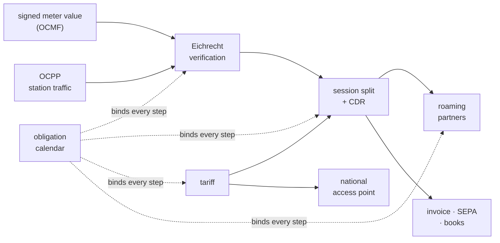

+++
title = "Documentation"
description = "emob documentation: Eichrecht-verified EV charging billing, OCPP 2.1 and OCPI 2.3.0, AFIR price transparency, roaming, settlement and the compliance calendar."
sort_by = "weight"
template = "section.html"
+++

# Documentation

emob is a Rust workspace for running EV charging as a business in Europe: it
verifies signed meter values under German calibration law (*Eichrecht*), prices
and settles charging sessions, exchanges records with roaming partners, and
answers which regulatory duties a charge point, a provider or a company meets.
These pages explain how each part works and why it is built that way.

New here? Run `just demo` and read **[Run the estate](@/docs/run-the-estate.md)**,
or start with **[Getting started](@/docs/getting-started.md)** for library
code; then read in the order below. Unfamiliar terms (CPO, eMSP, CDR,
OCMF, AFIR …) are defined in the [glossary](@/docs/glossary.md).

Its siblings: [mako](https://hupe1980.github.io/mako/) for German energy
market communication (NZR-EMob Modell 2 for charge points) and
[hems](https://hupe1980.github.io/hems/) for home energy management behind the
meter.

## Reading order

| # | Page | What it answers | Read it if you are… |
|---|---|---|---|
| 1 | [Getting started](@/docs/getting-started.md) | Install the crates; verify, price and settle one session | any developer evaluating emob |
| 2 | [Run the estate](@/docs/run-the-estate.md) | `just demo`, the estate file, keys and TLS, signed journal heads and the witness, Heute, the driver receipt and the invoice page | running or evaluating the daemons |
| 3 | [The Eichrecht chain](@/docs/eichrecht.md) | How a signed OCMF meter value becomes a billable quantity, and the file the driver checks it with | building billing, or auditing it |
| 4 | [The OCPP seam](@/docs/ocpp.md) | How signed values are taken out of OCPP 1.6J / 2.0.1 / 2.1 traffic, and the price sent back to the station | integrating charge points |
| 5 | [Sessions and settlement](@/docs/settlement.md) | Quarter-hour splitting, CDRs, invoices (EN 16931), SEPA and bookkeeping | working on settlement or finance |
| 6 | [Tariffs and price transparency](@/docs/pricing.md) | Rating a session, and showing the same price before it starts under AFIR | designing tariffs |
| 7 | [Locations and the national access point](@/docs/locations.md) | Publishing locations and prices as DATEX II to the national access point | responsible for data publication |
| 8 | [Roaming](@/docs/roaming.md) | Sending and receiving CDRs, tariffs and locations over OCPI and OICP | connecting to partners or hubs |
| 9 | [Plug & Charge](@/docs/plug-and-charge.md) | Checking ISO 15118 contract certificates and their ecosystem | operating Plug & Charge |
| 10 | [§ 14a and the grid](@/docs/smart-charging.md) | Sharing a site's power under a grid operator's setpoint, over EEBUS | running depots or private sites |
| 11 | [Bidirectional charging and MiSpeL](@/docs/bidirectional.md) | How much of a bidirectional site's grid draw is relieved of levies, per month or year | running bidirectional points |
| 12 | [The obligation calendar](@/docs/compliance.md) | Which AFIR, LSV, MessEG, THG, MiSpeL, NIS2 and CRA entries bind, from when, and whether they are met | compliance and audit |
| 13 | [Architecture](@/docs/architecture.md) | How the crates, daemons and protocol libraries fit together, and what is built today | evaluating the design |

## Conventions on these pages

- **Status markers.** ✅ built, tested and run by a daemon · ⏳ built in a
  library that no daemon calls.
- **Citations.** Every regulatory claim names its source in brackets, for
  example `[AFIR Art. 5(4)]` (Regulation (EU) 2023/1804), `[MessEG §33]` (the
  German Measurement and Calibration Act) or `[OCMF Tab. 7]` (a table of the
  Open Charge Metering Format). A build check rejects citations to documents it
  does not know.
- **German legal terms stay German** where the law uses them — *Ladepunkt*,
  *Eichrecht*, *Durchleitung* — because a translated term of art drifts in
  meaning. Each is explained on first use.
- **Code samples** are abridged from the crates' own tests. For exact
  signatures, see the API documentation on [docs.rs](https://docs.rs/emob-core).

Security assumptions and threats are described in the repository's
[threat model](https://github.com/hupe1980/emob/blob/main/THREAT_MODEL.md).
