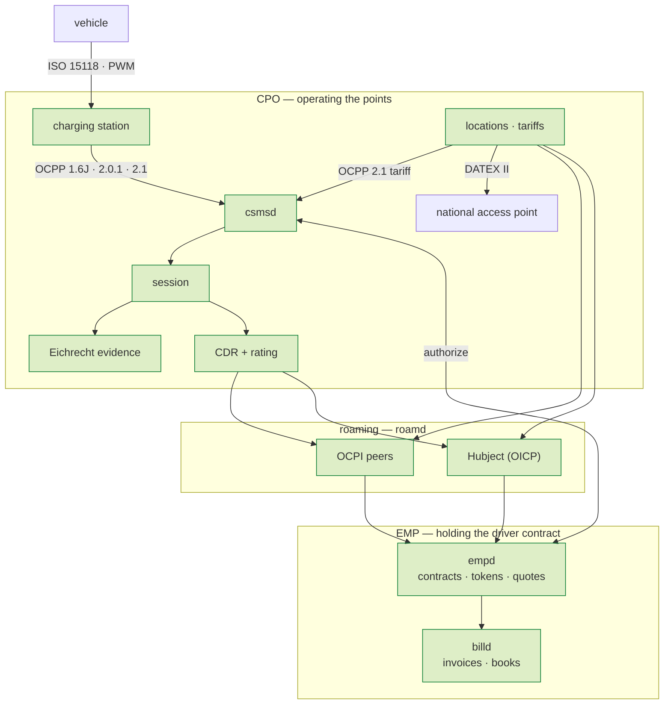

+++
title = "Architecture"
weight = 13
description = "emob architecture: sans-I/O Rust crates for Eichrecht, OCPP, OCPI and billing; nine journalled daemons wired by APIs and signed CloudEvents."

[extra]
nav = "Architecture"
+++

emob is a Rust workspace of **15 library crates** that hold every rule about
charging, metering, pricing and settlement, plus **nine daemons** that run
those rules as services from one estate file: stations connect to `csmsd`,
`empd` authorises, `billd` invoices and `roamd` roams, each with a journal it
rebuilds its state from, and the operator page `deskd` reads them all. Every
journal fact names its actor, and each journal signs where it ends for a
witness to check. emob does not implement the charging protocols
itself: it builds on separate protocol libraries (OCPP, OCPI, OICP, ISO 15118,
EEBUS, OCMF) and adds the business rules on top.

## Two roles: charge point operator and mobility service provider

A German charging business usually plays two roles. As **CPO** (charge point
operator) it runs the stations; as **EMP/eMSP** (e-mobility service provider) it
holds the driver's contract and bills them. The law gives each role different
duties, so emob models both.



Every box has its rules built in a library. Two arrows are not wired: `roamd`
sends no OICP to Hubject, and `poid` pushes nothing to the access point.

When an operator's own EMP charges at its own stations, the session goes through
the same model as a roaming session — same validation, pricing and evidence — so
adding partners changes the transport, never the arithmetic.

## Workspace layout: domain crates, the service shell and daemons

| Layer | Where | Does I/O? |
|---|---|---|
| Domain crates | `crates/emob-*` (14 crates) | No — sans-I/O, no clock, no floats |
| Service shell | `crates/emob-service` | Yes — HTTP, config, journals, shutdown |
| Daemons | `services/*` (8 binaries) | Yes — sockets, clock, files |
| Protocol kits | separate crates on crates.io | the wire formats |

### Domain crates ✅

| Crate | Holds |
|---|---|
| `emob-core` | Identifiers (EVSE id, eMAID, party id) that compare canonically and print verbatim; exact energy and money; the 15-minute settlement grid; charge-point, provider and company profiles; the obligation calendar; `Crossing`, the account of what a translation lost |
| `emob-eichrecht` | German calibration law over OCMF records: the key registry, the chain check, the evidence record, and the transparency file a driver checks the bill with |
| `emob-session` | Authorisation paths, meter series, the session state machine, and the quarter-hour split that conserves energy exactly |
| `emob-cdr` | The charge detail record with its price, idempotent acceptance, and pre-flight validation |
| `emob-tariff` | Rating with tiers and VAT breakdown, the price display derived from the same tariff, the AFIR shape check, validity windows |
| `emob-ocpp` | The OCPP seam: signed meter values out of transaction events, and the tariff onto OCPP 2.1's *Tariff and Cost* messages |
| `emob-poi` | The location register and the DATEX II feed for the national access point |
| `emob-roam` | CDRs, tariffs and locations onto OCPI 2.3.0 / 2.2.1 and OICP, each translation returning an account of what it cost; routing by the contract id's issuer |
| `emob-pnc` | Plug & Charge from the platform's side: which ecosystem a contract certificate belongs to, revocation, and the eMAID read from the certificate |
| `emob-eebus` | The § 14a wire: a grid operator's EEBUS setpoint as an exact decimal, and the failsafe states of the *Limitation of Power Consumption* use case |
| `emob-smart` | Which charge points § 14a reaches, the guaranteed minimum power, and allocation under a grid limit |
| `emob-billing` | EN 16931 invoices with per-line rounding, VAT treatment derived from the parties, SEPA direct debits, and postings by role |
| `emob-thg` | The greenhouse-gas quota (THG-Quote): eligibility conditions and notifications built only from signed energy |
| `emob-sim` | A deterministic simulated fleet whose stations sign genuine OCMF, with seeded faults |

### Daemons

| Daemon | Owns | State |
|---|---|---|
| `csmsd` | The CSMS: OCPP 1.6J / 2.0.1 / 2.1 with security profiles 1–3, settlement, the outbox, driver receipts | ✅ |
| `empd` | Contracts, tokens, authorisation (`POST /v1/authorize`) | ✅ · ⏳ OCPI tokens endpoint, fees |
| `billd` | Receiving CDRs, closing each partner's month into an invoice, numbering, postings; the invoice page and signed delivery to the operator system | ✅ · ⏳ SEPA runs |
| `roamd` | OCPI in both directions behind a reach-back guard; who a record goes to | ✅ OCPI · ⏳ OICP transport |
| `deskd` | The operator page Heute; the witness of every journal's signed head | ✅ |
| `tarifd` | Publishing the estate's tariff versions | ✅ read model · ✅ `driver-tariff.v1` · ⏳ push clients |
| `poid` | The inventory for the national access point | ✅ inventory from the estate, priced · ✅ table push · ⏳ dynamic delta |
| `sited` | The § 14a site controller, run **at** the site | ⏳ SHIP session, OCPP leg |
| `agentd` | Advisory specialists over many records, run under the read-only advisory principal | ✅ runtime · ⏳ nothing triggers a run |

The edges between them:

| From → to | How |
|---|---|
| station → `csmsd` | OCPP over `wss://`; Basic against an Argon2id hash, or a client certificate |
| `csmsd` → `empd` | `POST /v1/authorize` with the service token; a timeout answers `Invalid` (fail closed) |
| `csmsd` → `billd`, `roamd` | the outbox: each settled session as a `de.emob.cdr.issued` CloudEvent, signed per Standard Webhooks, `POST /v1/deliveries`, retried until a `2xx`, journalled |
| `roamd` ↔ partner | OCPI 2.3.0 credentials, CDRs |
| `deskd` → `csmsd`, `billd`, `roamd` | the bounded operator read models, `GET /v1/<daemon>/today` |
| `deskd` → `csmsd`, `billd`, `roamd`, `empd` | the signed journal heads, `GET /v1/<daemon>/head`, every 30 s |
| `billd` → operator system | each issued invoice as a `de.emob.invoice.issued` CloudEvent carrying the UBL or CII file, signed, retried until answered |
| `csmsd`, `billd` → subscribers | the same events to every `[[subscribers]]` entry whose `types` take them, each signed with its own secret, retried until a `2xx`, journalled |

Between emob and anything else there are two ways in or out: an HTTP API or a
CloudEvent. emob emits two event types, both
in its own namespace — `de.emob.cdr.issued` (subject `cdr/<key>`) and
`de.emob.invoice.issued` (subject `invoice/<number>`) — and reads no other
system's types; where two systems meet, an adapter renames.

Every daemon serves `/health/live`, `/health/ready` and `/about`, and its read
model behind the operator token. `emob demo` runs the daemons' own
`daemon::run` functions in one process — the same code path as their `main`,
configured rather than forked — and `deskd` takes its clock as a parameter, so
the demo can play a morning at 60×. See [Run the estate](@/docs/run-the-estate.md).

**1374 tests** cover the workspace.

An end-to-end test drives the full chain: OCMF records signed with a real key at
test time, verified, matched against a session, split into quarter hours, built
into a CDR, priced from those quarter hours, validated as a partner would,
accepted once and exported as a transparency file — with the displayed price
asserted equal to the charged one. It also proves the failures: a changed digit,
a deleted record, a substitute reading, an unregistered station and an
unsynchronised clock each stop the right part of the chain with a named reason.
Two further tests take the same session through OCPI 2.3.0, OCPI 2.2.1 and
self-roaming at the same money, and close a month into an invoice, a pain.008
file and balanced postings.

## Sans-I/O domain crates: why the rules never touch a clock

The domain crates never read a clock, open a socket or touch the filesystem.
Every instant is an argument and the key registry is passed in already loaded.

The reason is disputes. Eichrecht gives a customer years to question a bill, and
the answer is to replay the verification exactly as it ran — same records, same
keys, same instant. A replay that consults the ambient world is no longer a
replay. `just purity` and `check-graph` fail the build if a domain crate, or any
of its dependencies, reaches for a clock, a socket or a database.

The same crates hold no binary floating point (`no-floats`): every quantity is
or becomes money, and `f64` cannot represent 0.10.

## The `Crossing`: every translation reports what it cost

Translating a record into another company's format is where roaming money goes
missing: a silent conversion makes a lossy decision, and weeks later two
companies hold two numbers for one session. So every translation returns a
`Crossing` — the translated value **and** notes, addressed by JSON Pointer into
the recipient's document, saying what was assumed or lost.

Three seams use it: OCPI and OICP in `emob-roam`, DATEX II in `emob-poi`, and the
OCPP 2.1 tariff in `emob-ocpp`. An example: OCPI states durations in **hours**,
and most durations have no exact decimal in hours (an hour has 3600 seconds, and
3600 has two factors of three). Twenty minutes becomes 0.3333 h, and the note
says that the cost beside it was computed from whole seconds.

Where a note would not be enough, the translation refuses. A V2G discharge has no
signed representation in an OCPI CDR, so it would arrive as an ordinary draw and
settle backwards; an unrated record cannot cross because 0.00 means *free of
charge*. Details are on the [roaming](@/docs/roaming.md) page.

## The daemon shell: `emob-service`

`emob-service` is the shared shell every daemon builds on: settings, telemetry,
health probes, graceful shutdown, a journal, CloudEvents, webhook signatures, and
an authority model for OCPI parties.

### Authority: a valid token is not access to someone else's records

A roaming node holds several companies' sessions in one process. Its worst
failure is serving party A's CDRs to party B in answer to a perfectly valid
credential. A reverse proxy cannot catch that, because it does not know who owns
a record. So a `Principal` answers three separate questions — who, what, and
whose records:

```rust
let peer = Principal::peer(theirs, Role::Emsp, Capabilities::of([caps::CDR_READ]));

peer.may_act_for(caps::CDR_READ, &theirs);   // true
peer.may_act_for(caps::CDR_READ, &ours);     // false — someone else's record
peer.may_act_for(caps::CDR_WRITE, &theirs);  // false — reading is not writing
```

`attenuate` derives a narrower principal and returns nothing rather than
widening. Misconfiguration fails closed: an empty grant permits nothing, an empty
readiness set is not ready, and a webhook verifier without a secret rejects.

### Optional Cedar policies

For conditions a capability list cannot express — "CDRs, **until the trial
ends**" — the optional `policy` feature adds [Cedar](https://www.cedarpolicy.com/)
policies. It is off by default because it adds many dependencies and only the
roaming node needs it.

```cedar
@id("nl-tnm-trial")
permit (
  principal == emob::Party::"NL*TNM",
  action in [emob::Action::"emob.cdr.read", emob::Action::"emob.tariff.read"],
  resource
)
when { resource.owner == principal }
unless { context.at > datetime("2027-01-01T00:00:00Z") };
```

- The Cedar schema is **derived** from the capability list, so a policy cannot
  name an action nobody can be granted.
- A policy can grant but never widen: the typed check runs first, and its "no"
  is final.
- Cedar warnings are errors — including confusable Unicode in identifiers, which
  in a party id is a data leak.
- A policy that fails to evaluate counts as a refusal, not a pass.

### Readiness and shutdown

Readiness is a set of named dependencies, and a `503` lists which are missing,
so an orchestrator never routes stations to a CSMS whose key registry has not
loaded. Liveness is separate, because restarting a CSMS drops every station's
connection. Shutdown first stops reporting ready, then drains, so a stopping
CSMS does not lose the final transaction message that carries the signed meter
record.

## The journal: state that survives a restart ✅

The domain crates are stateless. The daemons hold the rules about **history**:
an invoice number is used only once `[UStG §14(4) Nr. 4]`; a CDR is sealed once
the eMSP has it `[OCPI 2.3.0 §mod_cdrs]`; a card is blocked; a contract has run
up these sessions. Held only in memory, each of these answers wrongly after a
restart.

`emob_service::journal` stores them. A daemon appends the **facts** it decided,
in order, and rebuilds its state on startup by folding them. Because every
instant and key is an argument, the fold gives the same answer every time.

- **Facts, not commands.** Replaying commands would re-decide them with today's
  tariffs and clock.
- **Hash-chained.** Each entry chains to the previous one, so an edited or
  deleted middle entry breaks every digest after it and the daemon refuses to
  start. The file is newline-delimited and checkable with `sha256sum`.
- **A failed write halts the daemon.** Continuing would leave state ahead of the
  record.
- **Every fact names its actor.** Beside its `kind`, each record carries who
  caused it — `station:<identity>`, `partner:<party>`, `operator:<name>`,
  `service:<daemon>`, `timer` or `estate` — taken from what the daemon
  authenticated and covered by the digest. It reads without the data key
  (`jq -r .actor`).
- **The end is signed.** A chain cannot show that its last records were cut
  off. So after every append the daemon signs its head — position and hash —
  with its Ed25519 key as a [C2SP signed note](https://c2sp.org/signed-note) in
  `<journal>.head`, and refuses to start from a journal shorter than that head
  or diverging from it.
- **Somebody else remembers.** The `.head` file can be deleted with the
  journal, so a **witness** (`deskd`, or `emob witness`) reads each head from
  `GET /v1/<daemon>/head` and alarms on a regression, a fork or a new key. A
  history rewritten *and* extended past the witnessed position is beyond it: the
  journal is a chain, not a Merkle tree.

`csmsd`, `billd`, `roamd`, `empd` and `poid` fold their journals on start. A
journal is the file most likely to leave the building in a backup, so record
bodies are sealed with AES-256-GCM under a per-daemon data key while the hash
chain runs over the sealed bytes — it verifies without the key, and no card UID
or credential sits on disk in clear. A daemon with a journal is a **single
writer**, so the deployment runs no replicas.

## Deployment

One `Dockerfile` builds all nine daemons and the `emob` command line, selected by a build argument, on a
`distroless/cc` runtime (no shell, no package manager). `docker-bake.hcl` builds
them all; `compose.yaml` starts them on one machine with a named volume per
journal. Every default bind address is loopback, so nothing is reachable until
you configure it, and `csmsd` refuses a non-loopback OCPP bind without TLS.
Release images are `ghcr.io/hupe1980/emob-<daemon>:<version>` plus
`ghcr.io/hupe1980/emob` (which `just demo` runs where there is no Rust
toolchain), `linux/amd64` only, with build provenance. See
[Run the estate](@/docs/run-the-estate.md).

## The OCPP seam and `csmsd`

OCPP carries two kinds of meter value and only one is billable. The numeric ones
(`meterStop`, `SampledValue.value`) tell you whether every event arrived; the
signed OCMF data set is what you may bill. The Open Charge Alliance's own example
carries `meterStop: 108814` — the meter's lifetime register in Wh — beside a
signed value of `0.636 kWh` for the transaction.

`emob-ocpp` makes the separation structural: its input types have **no numeric
meter value field**, so nothing from the protocol's numbers can reach a CDR. It
is a crate of its own so that `emob-core`, `emob-session`, `emob-eichrecht`,
`emob-tariff` and `emob-cdr` build without any OCPP in their dependency tree; it
depends on `emob-tariff`, never the reverse.

`csmsd` is deliberately thin. It runs two ledgers side by side: `ocpp-kit`'s
operational ledger (did every message arrive? was this a retry?) and the
Eichrecht chain (what may be billed?). The operational verdict is read, so a
station's retried stop message is not treated as a second session. A station
must be provisioned before it is admitted — an unknown identity in the WebSocket
URL is answered **404** `[OCPP 2.0.1 Part 4 §3.1.1]` — and its public key comes
from type approval, never from the station itself. An integration test runs a
real `ocpp-kit` station against `csmsd` over a TCP WebSocket and bills the OCA
example at **0.636 kWh**. See [The OCPP seam](@/docs/ocpp.md).

## Advisory agents: `agentd` proposes, it cannot move money

The libraries answer questions about **one** thing. An operator's morning
question is about a population: four hundred refused sessions may be four hundred
tickets or one faulty meter.

```text
[evidence-triage] BQ27400330016: the meter was in state Substitute at record 2,
                  which may not be billed
                  (3800.000 kWh at risk across 380) — a device fault rather than
                  a dispute: raise it with the station vendor…
```

`agentd`'s three specialists — evidence triage, a tariff sweep and a compliance
sweep that judges upcoming duties against today's estate — are deterministic
functions on [`agentplane`](https://crates.io/crates/agentplane); none calls a
language model. "Advisory only" is structural: nothing in the workspace consumes
their output type, and a specialist's principal is derived with `attenuate`, so
it cannot hold a write capability. Each specialist is started by its read
capability, and the runtime acts as the advisory principal's delegation chain:
`agentplane` refuses at admission a run whose capability is outside it.
`agentplane` records each run in a hash-chained log that can be replayed.

## Testing with a simulated fleet

`emob-sim` runs a reference day: virtual stations that sign genuine OCMF with
real ECDSA keys, run through the real verifier, split, rating engine and ledger.
Eight faults are seeded — a substitute reading, a dropped record, a tampered
byte, an unsynchronised clock, an export register billed as a draw, a `TX=X`
exception, an unregistered station, and a tariff the post may not offer — and the
run asserts each is exercised.

The key assertion is that energy **reconciles**: every kilowatt-hour a meter
moved either reached a settled record or was refused with a reason. Half the
posts are 22 kW and half 150 kW, because a per-minute-only tariff is lawful on
the first and not on the second `[AFIR Art. 5(4)]`. The fleet run is what showed
that evidence which is present but **failed** must be refused, not just evidence
that is absent.

## Protocol kits emob builds on

emob does not implement charging protocols; it depends on these libraries:

| Library | Version | What emob uses |
|---|---|---|
| [`ocmf`](https://crates.io/crates/ocmf) | 0.2 | Parsing and verifying OCMF records without disturbing the signed bytes; the S.A.F.E. transparency container |
| [`ocpp-kit`](https://crates.io/crates/ocpp-kit) | 0.8 | OCPP 1.6J / 2.0.1 / 2.1 messages, transport and the CSMS ledger |
| [`ocpi-kit`](https://crates.io/crates/ocpi-kit) | 0.5 | OCPI 2.1.1 / 2.2.1 / 2.3.0 models, version translation and the client. **Not** its tariff engine: one pricing engine means one answer |
| [`oicp-kit`](https://crates.io/crates/oicp-kit) | 0.1 | Hubject OICP, CPO and EMP sides |
| [`datex2`](https://crates.io/crates/datex2) | 0.3 | DATEX II for the AFIR feed to the Mobilithek |
| [`iso15118`](https://crates.io/crates/iso15118) | 0.9 | Certificate path validation for Plug & Charge |
| [`eebus`](https://crates.io/crates/eebus) | 0.13 | SHIP and SPINE for § 14a; used without its runtime, so `emob-eebus` stays sans-I/O |
| [`en16931`](https://crates.io/crates/en16931), `en16931-formats` | 0.10 | The European e-invoice model, validation, UBL and CII |
| [`sepa`](https://crates.io/crates/sepa) | 0.10 | SEPA direct debit (pain.008) |
| [`doubleentry`](https://crates.io/crates/doubleentry) | 0.9 | Bookkeeping in `billd` |
| [`agentplane`](https://crates.io/crates/agentplane) | 0.61 | The run journal for `agentd` |

The crates that decide money keep Rust 1.94 as their minimum version so that
sibling workspaces ([`mako`](https://hupe1980.github.io/mako/) for German market communication, [`hems`](https://hupe1980.github.io/hems/) for home
energy management) can consume them; `emob-roam` needs 1.96 because `ocpi-kit`
does.

## Why the dependencies point the way they do

- **`emob-cdr` depends on `emob-eichrecht`.** Three of the builder's checks —
  identification strength, whether the clock can carry a duration, and energy
  direction — read facts only the signed records know.
  `EvidenceRef::from_evidence` takes them from verified evidence, because a
  hand-filled field can be filled with whatever makes the record build.
- **`emob-cdr` depends on `emob-tariff`.** A CDR carries both energy and money,
  and the quarter-hour periods the split produces are the periods the rating
  walks — so tiers price what was actually settled.
- **`emob-core` has its own identifiers.** `ocpi-kit` and `oicp-kit` each have an
  `EvseId` correct for their wire; handlers need one type that agrees with both.
  `DE*ABC*E123` equals `deabce123`, and `-` is not a separator in an EVSE id, so
  `DE-AB7-E840` cannot parse as a charge point.
- **`emob-roam` depends on `emob-poi`.** One location inventory and one price
  feed the roaming partner, the national access point and the station's screen,
  so the three never drift apart. See [Locations](@/docs/locations.md).

## Roaming protocols

| Wire | Partner | Via | State |
|---|---|---|---|
| OCPI 2.3.0 (2.2.1 translated at the edge) | peers, most hubs | `ocpi-kit` | ✅ library and `roamd` |
| OICP 2.3 | Hubject | `oicp-kit` | ✅ library (outbound documents) · ⏳ `roamd` transport |
| eMIP | GIREVE legacy | — | not supported; GIREVE speaks OCPI |
| OCHP | e-clearing.net | — | not supported; the specification froze in 2016 |

The rules that hold across every wire:

- **Nothing a peer sent is thrown away** — unknown fields and enum values survive
  a round trip.
- **Identifiers compare canonically and print verbatim.**
- **Routing comes from the identifier.** A contract id names its issuer in its
  first five characters; a partner's declared namespaces override that default.
- **Translation cost is reported** through `Crossing`.
- **An unevaluable restriction never matches.** A tariff element with a
  restriction this build does not understand is not applied, and the rating says
  so.

## § 14a: controllable charge points

`[EnWG §14a]` lets a grid operator reduce the draw of controllable devices, and
`[BK6-22-300 Ziff. 2.4.1]` excludes **publicly accessible** charge points — so
§ 14a reaches depots, workplaces and fleet yards, not the public fast charger.
`emob-smart` allocates power so the grid limit cannot be exceeded (`allocate` is
the only way to get an `Allocation`, and it takes the limit), and keeps the
minimum power the operator is owed. See [§ 14a and the grid](@/docs/smart-charging.md).

## Build guards

`just guards` runs checks the compiler cannot:

| Guard | Prevents |
|---|---|
| `no-floats` | binary floating point anywhere money is computed |
| `check-citations` | a regulatory citation in code or docs that names no known document |
| `check-manifests` | a `cargo publish` that fails after the version is spent |
| `purity` / `check-graph` | a domain crate reaching a clock, socket or database, directly or through a dependency |
| `check-constructors` | a type with a validating constructor that derives `Deserialize`, which would let wire data bypass the validation |
| `check-reach` | a public function nothing calls — a rule nobody enforces |
| `check-api` | documentation naming an API that no longer exists |
| `check-prose` | a user-facing string with a hole from a lost line continuation |
| `check-wire` | a date serialised in a format partners cannot read instead of RFC 3339 |
| `check-concepts` | a count stated in documentation that does not match its source, and malformed Markdown tables |
| `check-actions` | a GitHub Action not pinned by commit SHA, a base image not pinned by digest, a workflow without declared `permissions:` |

Related: [Getting started](@/docs/getting-started.md) ·
[The Eichrecht chain](@/docs/eichrecht.md) · [Roaming](@/docs/roaming.md) ·
[threat model](https://github.com/hupe1980/emob/blob/main/THREAT_MODEL.md)
