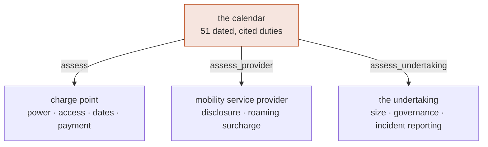

+++
title = "The obligation calendar"
weight = 12
description = "EV charging compliance as code: AFIR, ISO 15118-20, LSV, PAngV, MessEG, THG-Quote, MiSpeL, § 14a, NIS2, CRA — dated, cited duties per charge point and company."

[extra]
state = "built"
nav = "Compliance"
+++

The obligation calendar in `emob-core` answers "is this charge point, provider
or company compliant on this date?" — duty by duty, each with its legal citation,
the date it starts to bind, and a remedy. European charging regulation (AFIR, the
EU Alternative Fuels Infrastructure Regulation, plus German and cybersecurity
law) arrives in stages between 2024 and 2028, binds different subjects, and has
explicit exemptions, so readiness is a query rather than a document.

```rust
use emob_core::obligation::assess;
use time::macros::date;

let report = assess(&point, date!(2027-01-01));

for finding in report.breaches() {
    println!("{}  {}", finding.obligation.citation, finding.obligation.remedy);
}
```

## Three subjects: charge point, provider, company



Some duties bind the **charge point**, some the **mobility service provider**
(the company selling charging to drivers), and some the **undertaking** — the
company as a whole. A test asserts every duty is answered by exactly one of the
three, so no duty can silently go unassessed. A company whose every charge point
is compliant can still be in breach as a provider, and again as an undertaking.

## Every duty in the calendar

**51 duties** over three subjects. "Reads" says which facts decide whether the
duty applies.

| Duty | Source | From | Reads |
|---|---|---|---|
| Ad-hoc charging without a contract | `[AFIR Art. 5(1)]` | 13.04.2024 | public; **a free point satisfies it outright** |
| A payment instrument widely used in the Union | `[AFIR Art. 5(1)]` | 13.04.2024 | public ∧ paid ∧ **deployed** ≥ 13.04.2024 |
| …retrofit at ≥ 50 kW on TEN-T **or a safe and secure parking area** | `[AFIR Art. 5(1)]` | 01.01.2027 | reaches points deployed before 13.04.2024 |
| The right *not* to use automatic authentication | `[AFIR Art. 5(2)]` | 13.04.2024 | public ∧ offers it |
| **Prices must not discriminate** between end users and providers, or between providers | `[AFIR Art. 5(3)]` | 13.04.2024 | public; differentiation only if proportionate and objectively justified |
| At ≥ 50 kW the ad-hoc price is **based on a price per kWh** | `[AFIR Art. 5(4)]` | 13.04.2024 | deployed ≥ 13.04.2024 |
| At ≥ 50 kW the €/kWh and any occupancy fee shown at the station | `[AFIR Art. 5(4)]` | 13.04.2024 | deployed ≥ 13.04.2024 |
| Below 50 kW every component available, **in the prescribed order** | `[AFIR Art. 5(4)]` | 13.04.2024 | **no deployment-date limit** |
| The **Arbeitspreis** (price per kWh) at or beside the point, by one of three named media | `[PAngV §14(2)]` | **28.05.2022** | public ∧ paid ∧ an ad-hoc payment method is in use — **at any power** |
| …and, where a **web-based** system is used, through it before the session starts | `[PAngV §14(2)]` | 28.05.2022 | a second duty, not a fourth medium |
| …and every further price completely, **in immediate vicinity** | `[PAngV §14(3)]` | 28.05.2022 | arises only where such a price is charged |
| **The interface Annex II names** — AC ⇒ Type 2, DC ⇒ CCS Combo 2, *"at least"* | `[AFIR Art. 21(1)]` | 13.04.2024 | public — read off the connector list; `[DA-656]` replaced points 1.1–1.4 and excepts two bands at 3.7 kW |
| Provider: disclose every component, e-roaming costs included | `[AFIR Art. 5(5)]` | 13.04.2024 | the provider profile |
| Provider: **no** extra charge for cross-border e-roaming | `[AFIR Art. 5(5)]` | 13.04.2024 | the provider profile |
| Every public point is a **digitally-connected** recharging point | `[AFIR Art. 5(7)]` | 14.10.2024 | public |
| **Smart-recharging capable** | `[AFIR Art. 5(8)]` | 13.04.2024 | built after 13.04.2024 ∨ renovated after 14.10.2024 |
| **Fixed cable** on every public DC point | `[AFIR Art. 5(10)]` | 14.04.2025 | public ∧ DC |
| A **third-party owner** must supply a point whose characteristics let the operator meet 5(2), (7), (8), (10) | `[AFIR Art. 5(11)]` | 13.04.2024 | public ∧ the operator does not own it |
| Static data, including the 100%-renewable electricity indicator | `[AFIR Art. 20(2)(a)–(b)]` | 14.04.2025 | public |
| Dynamic status, availability and ad-hoc price | `[AFIR Art. 20(2)(f)]` | 14.04.2025 | all public points, including free charging |
| A free, unrestricted **API registered with the NAP** | `[AFIR Art. 20(3)]` | 14.04.2025 | public |
| …the German feed in the **DATEX II Recharging profile** | `[DATEX-II-Profil]` | 14.04.2026 | public |
| EN ISO 15118-1…-5 | `[DA-656 Anh. 2.1.1]` | 08.01.2026 | public ∧ **installed or renovated** ≥ 08.01.2026 |
| EN ISO 15118-20, public | `[DA-656 Anh. 2.1.2]` | 01.01.2027 | public ∧ installed or renovated ≥ 01.01.2027 |
| EN ISO 15118-20, **private Mode 3/4** | `[DA-656 Anh. 2.1.3]` | 01.01.2027 | private ∧ not Mode 2 ∧ installed or renovated ≥ 01.01.2027 |
| Automatic authentication ⇒ **both** -2 and -20 | `[DA-656 Anh. 2.1.2]` | 01.01.2027 | AutoCharge counts, not only Plug & Charge |
| Every point meets the **technical requirements** (§ 49(1) EnWG) | `[LSV26 §3]` | 01.01.2026 | public — the duty § 5(1)–(3) are exercised over |
| …and the operator can **prove** it on request | `[LSV26 §4]` | 01.01.2026 | § 4(2) |
| Commissioning notified **within two weeks** | `[LSV26 §4]` | 01.01.2026 | § 4(3) runs it from the day a point *became* public |
| Decommissioning notified **unverzüglich** (without undue delay) | `[LSV26 §4]` | 01.01.2026 | § 4(1) Nr. 2 |
| An operator change notified by **both** operators | `[LSV26 §4]` | 01.01.2026 | § 4(1) S. 2 — one notice is not enough |
| Conformity-assessed meter for energy billing | `[MessEG §33]` | 01.04.2019 | bills by energy |
| …on a meter whose **verification period has not expired** | `[MessEG §37(1)]` | 01.04.2019 | bills by energy — eight years `[MessEV Anl. 7 Nr. 6.7]` from the placing on the market, ending with the calendar year `[MessEV §34(2)]` |
| …and every intervention on it recorded, firmware pushes included | `[MessEG §31(2)]` | 01.04.2019 | bills by energy |
| A **provider** billing on somebody else's meter owes a confirmation from its operator | `[MessEG §33(2)]` | 01.04.2019 | the provider profile |
| Verifiable measured values | `[PTB-A 50.7]` | 01.04.2019 | bills by energy |
| AC metering before the rectifier only in DC stations placed on the market before 2018 and **at most** 50 kW | `[REA 6-A]` | 16.03.2017 | the same number as AFIR's threshold, pointing the other way |
| …and only where the rectification belongs to **one** session | `[REA 6-A]` | 16.03.2017 | a shared rectifier fails it |
| …and the customer must be told the rectification loss is inside the value | `[REA 6-A]` | 16.03.2017 | see [the Eichrecht chain](@/docs/eichrecht.md#rectifier-losses-on-dc-stations-metered-on-the-ac-side) |
| THG-Quote: publishable register entry, lawful metering, issued operator code | `[38k §6(3)]` | standing | public |
| The undertaking gives the authority its details | `[NIS2 Art. 3(4)]` | 06.03.2026 | an Annex I type of at least medium size; three months from coming into scope |
| …and takes **all ten** risk-management measures | `[NIS2 Art. 21(2)]` | 06.12.2025 | a conjunction, not a score |
| …and can warn the CSIRT **within 24 h** | `[NIS2 Art. 23(4)]` | 06.12.2025 | then 72 h, then a report within a month |
| The **management body** approves and oversees the measures | `[NIS2 Art. 20(1)]` | 06.12.2025 | its members are liable |
| …and its members attend cybersecurity training | `[NIS2 Art. 20(2)]` | 06.12.2025 | required for the body, encouraged for all staff |
| A **manufacturer** reports an exploited vulnerability within 24 h | `[CRA Art. 14]` | 11.09.2026 | only where products with digital elements are placed on the market |
| …and places only conformity-assessed products on the market | `[CRA Art. 13]` | 11.12.2027 | Annex I Part I ∧ Part II vulnerability handling |
| A § 14a device is **always controllable** | `[BK6-22-300 Ziff. 4.6]` | 01.01.2024 | a non-public point over 4.2 kW, commissioned from that date |
| The grid operator's reduction **outranks** market-driven load control | `[BK6-22-300 Ziff. 4.6]` | 01.01.2024 | a non-public point over 4.2 kW, commissioned from that date |
| MiSpeL: fed-back energy is relieved of levies only under a Formelsatz with its metering concept | `[MiSpeL A1 3.2.5]` | 21.10.2026 | bidirectional; **an entitlement**, not a duty |
| MiSpeL: until 30.09.2027 only with the grid and metering operators' consent | `[MiSpeL Tenor 9]` | 21.10.2026 | bidirectional; ends 30.09.2027; **an entitlement** |

## Six possible answers per duty

A private depot is **not failing** the ad-hoc payment duty — the duty does not
bind it. So each duty has one of six statuses:

| Status | Meaning |
|---|---|
| `Satisfied` | binds this subject, and it is met |
| `Failing` | binds this subject, and it is not |
| `NotApplicable` | does not bind this subject |
| `NotYetInForce` | has not started binding yet — plan for it |
| `NoLongerInForce` | bound once, since superseded |
| `DifferentScope` | binds a different *kind* of subject |

Every duty carries `applies_from` (and `applies_until` where superseded), and you
can only use the calendar by asking about a date, so a duty is never applied
before it exists:

```rust
// DATEX II starts on 14.04.2026.
assert_eq!(status_on(date!(2026-04-13)), Status::NotYetInForce);
assert_eq!(status_on(date!(2026-04-14)), Status::Failing);
```

### Breaches versus a forgone entitlement

Three of the fifty-one entries are not duties. The four conditions for the
greenhouse-gas quota (THG-Quote) are worth money but break no law when unmet,
and so are the two MiSpeL entries: a bidirectional point without a Formelsatz
(`mispel-metering-concept`, from 21.10.2026) or, until 30.09.2027, without the
grid and metering operators' consent (`mispel-operator-consent`) has broken
nothing — it pays the levies on all of its grid draw. So each entry says what
failing it costs, and the report separates them:

```rust
report.verdict();      // Compliant — nothing unlawful
report.breaches();     // what a regulator can act on
report.forgone();      // money left on the table, not a breach
report.failing();      // both, for a caller that wants the union
```

### Exemptions that are easy to miss

Each of these is modelled as `NotApplicable`, not as a pass:

- **Free public charging.** Payment-instrument requirements apply where payment is required. Free public points still owe both static and dynamic data. The calendar assesses the operator's declarations. Independent receiver acknowledgements and source timestamps belong to the publication record. [Amending regulation, Article 1](https://eur-lex.europa.eu/eli/reg_del/2025/671/oj/eng/pdf)
- **A QR code satisfies the payment duty only below 50 kW.** Art. 5(1)(c)
  restricts internet-connected payment to points below 50 kW.
- **The 2027 retrofit also reaches safe and secure parking areas**, not only the
  TEN-T road network, and explicitly covers points deployed before 13.04.2024.

### Every duty is tested in both directions

A property test checks the whole table: a subject that does everything asked
fails nothing, and every entry fails for at least one subject in a panel (a bare
point, a fast DC charger doing nothing, the same charger deployed before
13.04.2024, a private wall box from 2027, a provider, a surcharging provider, and
an undertaking in NIS2 scope doing nothing). This catches a check that reads the
wrong field and is therefore always satisfied.

### Citations are checked at build time

`cargo xtask check-citations` finds every citation in code and docs and fails the
build if one names a document the reference index does not list. The documents
are third-party and not in the repository; the index records where to retrieve
each.

## Provider duties under AFIR Art. 5(5)

`[AFIR Art. 5(5)]` binds the **mobility service provider**, not the point: it
must disclose every price component, e-roaming costs included, and may not
surcharge cross-border roaming. It is judged against a `ProviderProfile`:

```rust
let mut provider = ProviderProfile::bare(PartyId::new("DE", "MSP")?);
provider.discloses_all_price_components = true;
provider.discloses_electronically = true;

// Still failing: the e-roaming cost is a component the article names explicitly.
assert_eq!(
    assess_provider(&provider, today).status_of(ObligationId::AfirMspPriceDisclosure),
    Some(Status::Failing),
);

provider.surcharges_cross_border_roaming = true; // forbidden outright
assert_eq!(assess_provider(&provider, today).verdict(), Verdict::Failing);
```

`[AFIR Art. 5(6)]` tells authorities to monitor operators and providers for
compliance with **paragraphs 3 and 5** specifically. Paragraph 5 is the provider
duty above; paragraph 3 binds the operator — prices must be reasonable,
comparable, transparent and non-discriminatory, and differentiation is allowed
only if "proportionate and objectively justified". Both are in the calendar. The
comparability and transparency limbs are enforced through the display duties of
Art. 5(4) and the [tariff shape check](@/docs/pricing.md).

`[AFIR Art. 5(11)]` binds neither: where a host (hotel, supermarket,
municipality) owns the charger and a CPO operates it, the **owner** must supply
hardware that lets the operator meet Art. 5(2), (7), (8) and (10). The remedy
says the fix is a contract clause, not a technical change.

## NIS2 and the Cyber Resilience Act: duties of the company

`[NIS2 Anh. I]` names charge point operators in the Energy sector. None of what
it asks is a fact about a charge point — size, governance, incident reporting
are facts about the undertaking:

```rust
let mut operator = UndertakingProfile::bare(PartyId::new("DE", "CPO")?);
operator.operates_recharging_points = true;
operator.employees = 400;
operator.risk_management = RiskManagement::complete();
operator.risk_management.supply_chain_security = false;

assert_eq!(operator.nis2_class(), Some(Nis2Class::Essential));
assert_eq!(operator.risk_management.missing(), vec!["(d) supply-chain security"]);
assert_eq!(
    assess_undertaking(&operator, today).status_of(ObligationId::Nis2RiskManagement),
    Some(Status::Failing),
);
```

Seven duties: five from NIS2 (registration, the ten risk-management measures,
the 24-hour early warning, management approval, training) and two from the Cyber
Resilience Act, which bind only a company that places products with digital
elements on the market. The ten measures are a **conjunction** — the article says
they "shall include at least" all ten.

Three details that are easy to get wrong, all tested:

- **The size test's financial half is an "and".** `[NIS2 Art. 2(1)]` uses the
  EU SME definition: fewer than 250 staff **and** (turnover ≤ €50 M **or**
  balance sheet ≤ €43 M). So an entity exceeds the ceilings if
  `employees ≥ 250 ∨ (turnover > €50 M ∧ balance sheet > €43 M)`. Dropping the
  balance-sheet condition misclassifies asset-light operators as essential.
- **A directive binds from national transposition.** `[NIS2 Art. 41]` set
  18.10.2024 for Member States, but Germany's implementing act took effect on
  06.12.2025 with no general transition, so the calendar uses that date.
- **A statutory window is part of the duty.** German law gives registration
  three months from coming into scope, so that duty is dated 06.03.2026.

The CRA is a **Regulation**, so `[CRA Art. 71]`'s dates apply directly in every
Member State: 11.09.2026 for vulnerability reporting, 11.12.2027 for the rest.

### This repository's own CRA practice

emob is software with digital elements too, so the repository carries the
artefacts the CRA's vulnerability-handling duties ask of a manufacturer:

| Duty | Here |
|---|---|
| A disclosure route | [`SECURITY.md`](https://github.com/hupe1980/emob/blob/main/SECURITY.md) (GitHub private vulnerability reporting) and `/.well-known/security.txt` on this site |
| An SBOM per release | one CycloneDX file for the workspace (`just sbom`), attached to every GitHub release |
| Provenance | a build-provenance attestation over every `.crate` and the SBOM; images carry BuildKit provenance |
| Known advisories | decided in `deny.toml` with the exposure analysis and a review date, so `cargo deny` stays green |

## Which date AFIR means: deployed, built, installed or renovated

Article 5 uses three wordings, and they are not interchangeable:

| Wording | Reads | Duties |
|---|---|---|
| "deployed from 13 April 2024" | `commissioned_on` | 5(1), 5(4)¶1–2 |
| "built after … **or renovated after** …" | both, with **different dates** | 5(8) |
| "installed **or renovated** from …" | `installed_or_renovated_on()` | `[DA-656 Anh. 2.1]` |

A renovation is not a deployment; reading it as one drags untouched 2019
hardware into duties written for new equipment:

```rust
point.commissioned_on = date!(2019-01-01);
point.renovated_on = Some(date!(2026-03-01));

// The card-reader duty binds points *deployed* from 13.04.2024. This one wasn't.
assert_eq!(status(ObligationId::AfirPaymentInstrument), Status::NotApplicable);

// Smart recharging says "renovated after 14 October 2024", so it binds.
assert_eq!(status(ObligationId::AfirSmartRecharging), Status::Failing);
```

Art. 5(4)'s date limit covers only its first two subparagraphs, so the ordered
price components below 50 kW apply to the whole installed base.

## ISO 15118 duties: the exemption is a date, not a technology

`[DA-656]` (Delegated Regulation (EU) 2025/656) exempts existing points by date:
2.1.1 binds points "installed or renovated **from 8 January 2026**". Testing the
technology as well ("not applicable if the point only does PWM") would let a
PWM-only point installed in 2026 escape the duty *because* it fails it.

```rust
// A PWM-only point installed in June 2026: failing.
assert_eq!(status(&fresh, ObligationId::Da656Iso15118Dash2), Status::Failing);
// A 2019 point: out of scope, by date.
assert_eq!(status(&legacy, ObligationId::Da656Iso15118Dash2), Status::NotApplicable);
```

The 2027 generation is three duties: **2.1.2** for public points, **2.1.3(b)**
for private **Mode 3/4** points (a domestic socket with an in-cable box is
Mode 2), and 2.1.2's second sentence for **automatic authentication** — which
includes AutoCharge, not only Plug & Charge.

### ISO 15118-20 on 01.01.2027: where it stands (18.11.2026)

- **The date stands.** No act amending Delegated Regulation (EU) 2025/656 is
  published, so the three entries keep 01.01.2027.
- **CharIN asks for 2028.** Its position paper of 03.08.2026 recommends moving
  the -20 software requirement to 01.01.2028 — an industry position, not law.
- **The Sustainable Transport Forum's Q&A** on ISO 15118 under the delegated
  act is due for endorsement at its plenary on **25.11.2026**. The calendar
  changes only from the published text.

On the platform side, `emob-pnc` validates ISO 15118-20 contract chains under
their own roots — see [Plug & Charge](@/docs/plug-and-charge.md).

## E-invoices from 01.01.2027

From 01.01.2027 a German business whose prior-year turnover exceeds €800,000
must **issue** e-invoices to business customers: the structured EN 16931 file is
the invoice `[UStG §14(1)]`. The Federal Ministry of Finance's letter of
15.10.2026 (III C 5 - S 7287-a/00019/021/017) supplements its letters of 2024
and 2025 and postpones nothing. It is a capability of the platform, not a
charge-point duty, so it has no calendar entry: `billd` issues each partner's
monthly invoice in EN 16931 or XRechnung, serves it on an invoice page with its
UBL and CII files, and hands it to the operator's ERP or Peppol provider through
a signed CloudEvent — see [Run the estate](@/docs/run-the-estate.md#the-invoice-page).

## MiSpeL: levy relief for bidirectional points

The Bundesnetzagentur's MiSpeL ruling, in effect from 21.10.2026, relieves of
levies the part of a site's grid draw that a bidirectional point fed back. The
calendar carries its two preconditions as entitlements (above);
`emob_session::mispel` does the arithmetic per calendar month (*Abgrenzungsoption*)
or year (*Pauschaloption*). The Pauschaloption is refused until the European
Commission approves it under state-aid law `[MiSpeL Tenor 9]`, because the
ruling makes it applicable only from the month after that approval. See
[Bidirectional charging and MiSpeL](@/docs/bidirectional.md).

## The Ladesäulenverordnung (LSV 2026)

The German charging-point ordinance lets the Bundesnetzagentur inspect, demand
a retrofit for, and **forbid the operation of** a point `[LSV26 §5]`. It names
AFIR Art. 5(1), (2), **(7), (8) and (10)**; the last three are often missed:

- **5(7)** — every public point must be digitally connected, from 14.10.2024.
- **5(8)** — smart-recharging capable, with the two-date rule above.
- **5(10)** — every public **DC** point must have a fixed cable, from 14.04.2025.

`[LSV26 §3]` adds the duty those powers are exercised over: every public point
meets the technical requirements of § 49(1) EnWG. `[LSV26 §4]` is four duties:

| Duty | Text | The trap |
|---|---|---|
| Commissioning notice | § 4(1) Nr. 1 — "spätestens zwei Wochen nach der Inbetriebnahme" | § 4(3) restarts the clock "wenn ein bestehender Ladepunkt öffentlich zugänglich wird" — a depot charger opened to the public owes its notice from **that** day |
| Decommissioning notice | § 4(1) Nr. 2 — "unverzüglich" | a point still shown as live is one the operator still answers for |
| Operator-change notice | § 4(1) Nr. 3 and S. 2 | **both** the outgoing and incoming operator must notify |
| Evidence on request | § 4(2) | being compliant and being able to prove it are separate duties |

A deadline is a date compared to a date, not a flag:

```rust
point.commissioned_on = date!(2026-03-01);

point.registration = Registration::notified_on(date!(2026-03-22));
assert_eq!(status(ObligationId::Lsv2026CommissioningNotice), Status::Failing);

point.registration = Registration::notified_on(date!(2026-03-10));
assert_eq!(status(ObligationId::Lsv2026CommissioningNotice), Status::Satisfied);
```

*Unverzüglich* — "without culpable delay" `[BGB §121]` — has no number. The
calendar uses the two weeks the same paragraph gives for commissioning, as a
separate constant (`Registration::PROMPT_NOTIFICATION_DAYS`) so a deployment can
see and change it; `Notice::delay_days` reports how late a filing was.

`[LSV26 §6]` also has the regulator forward notifications monthly to the state
calibration authorities, so filing a § 4 notice puts the point in front of the
Eichrecht regulator. It binds the regulator, not the operator, so it is not a
calendar entry.

## THG-Quote: the greenhouse-gas quota

`[38k §6(3)]` sets **four cumulative conditions** before a public charge point's
kilowatt-hours earn the quota. `emob-thg`'s `QuotaPosture` holds them in the
paragraph's order:

1. The regulator has **published** the point, or the operator **consented** to
   publication — not merely that the § 4 notice was filed.
2. The energy was measured in conformity with calibration law — `emob-thg`
   refuses a record with no evidence, and one whose evidence failed.
3. The operator holds an identification code **issued** by a registration
   organisation `[AFIR Art. 20(1)]` — a well-formed `EvseId` is not proof.
4. Further identifiers, only if announced in the Bundesanzeiger. None are today,
   so `FurtherIdentifiers` has three states rather than a boolean.

`[38k §8(1)]` sets the filing deadlines: **28 February of the following year**
for the § 6 route and **15 November of the obligation year** for § 7.
`Route::deadline` carries both. One notification per point per year is allowed
`[38k §8(1) S. 3]`, so adding a point twice is refused.

### The § 7 route for vehicle fleets

| | `[38k §6]` | `[38k §7]` |
|---|---|---|
| claimant | the operator of the point | the vehicle's registered keeper |
| the quantity | a measured value under calibration law | a published estimate, once per vehicle |
| the evidence | a signed meter record | a registration certificate (Zulassungsbescheinigung Teil I) |
| the deadline | 28 February of the **following** year | 15 November **inside** the obligation year |
| the counting factor | `[38k §5(3)]` | `[38k §7(6)]` — M3/N3 reach 4 |

`[38k §7(6)]` gives buses and heavy goods vehicles (classes **M3 and N3**) a
factor of **4 from 2027**, stepping down 3.5 (2035), 3 (2036), 2.5 (2037),
2 (2038), 1.5 (2039), 1 (2040) — a third more than § 5(3)'s 3. That matters for
depot operators, whose non-public posts are excluded from § 6 but whose own
buses count under § 7. A vehicle counts once per year `[38k §7(4) S. 2]`, keyed
by an identifier unique within the filer's records, never a licence plate.

## § 14a EnWG: controllable charge points

`[EnWG §14a]` lets a grid operator reduce the draw of *steuerbare
Verbrauchseinrichtungen* (controllable devices), and `[BK6-22-300 Ziff. 2.4.1]`
defines them to include a charge point over 4.2 kW in low voltage

> **der kein öffentlich zugänglicher Ladepunkt im Sinne des § 2 Nr. 5 der
> Ladesäulenverordnung (LSV) ist**

— so a **publicly accessible** point is outside § 14a; depots, workplace car
parks and fleet yards are inside it. Charge points count one by one, because
`Ziff. 2.4.2`'s grouping applies only to heat pumps and space cooling.

The two duties in the table — always controllable, and the grid operator's
reduction outranking market-driven load control `[BK6-22-300 Ziff. 4.6]` — read
`grid.always_controllable` and `grid.grid_reduction_takes_priority`. The second
is the one a load manager gets wrong: obeying a setpoint until a dynamic tariff
says otherwise is controllable and still in breach. `emob-smart` meets it by
construction.

What the site may draw when the grid operator goes silent is set by EEBUS's
*Limitation of Power Consumption* use case `[LPC §2.3.2]`:

| State | The ceiling | Reported |
|---|---|---|
| `init` | configured failsafe power | — |
| `limited` | the setpoint | — |
| `unlimited/controlled` | the site's connection | — |
| `failsafe state` `[LPC-912]` | the Failsafe Consumption Active Power Limit `[LPC-021]` | **yes** |
| `unlimited/autonomous` `[LPC-922]` | the site's connection | **yes** |
| no control box commissioned | the site's connection | — |

`GridLimit` models the five protocol states and a site with no commissioned guard. The guaranteed minimum
power of `Ziff. 4.5` holds under failsafe too. Applicability lives in
`emob-core`; the power arithmetic is in `emob-smart` — see
[§ 14a and the grid](@/docs/smart-charging.md).

## Planning ahead and sweeping an estate

```rust
// What lands on the fleet between now and the end of 2027?
for o in starting_between(date!(2026-09-01), date!(2027-12-31)) {
    println!("{}  {}  {}", o.applies_from, o.citation, o.title);
}
```

`agentd`'s compliance specialist runs this over a whole estate: every point
against every duty, grouped by duty (four hundred posts without a CSMS
connection is one firmware programme, not four hundred findings), and every
upcoming duty judged at its own start date against the estate as it stands. A
point due for renovation in March 2027 that speaks only ISO 15118-2 is compliant
today and is flagged now as a breach from the day it is renovated. The date is an argument, so a run
replays to the same answer. The specialist runs in the `agentd` daemon under
the read-only advisory principal; ⏳ nothing in the estate triggers a run.

## Limits

- A stated support period and update channel for operators: the calendar
  carries the duty that requires them.
- Whether a point lies on the TEN-T network is an input, not derived from
  corridor data.
- NIS2 supervision regimes (`[NIS2 Art. 32]` versus `[NIS2 Art. 33]`) differ by
  class, so the class is reported and the duties are judged the same.

Related: [The Eichrecht chain](@/docs/eichrecht.md) ·
[Tariffs and price transparency](@/docs/pricing.md) ·
[§ 14a and the grid](@/docs/smart-charging.md) ·
[Bidirectional charging and MiSpeL](@/docs/bidirectional.md)
