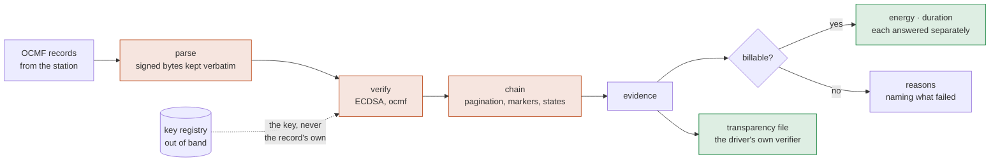

+++
title = "The Eichrecht chain"
weight = 3
description = "How emob verifies OCMF signed meter values under German Eichrecht (MessEG §33): key registry, chain checks, energy vs duration, and the transparency file."

[extra]
state = "built"
nav = "Eichrecht"
+++

German calibration law (*Eichrecht*) lets a charging operator bill a
kilowatt-hour only if the customer can verify the measured value against a
conformity-assessed meter, long after the session `[MessEG §33]`,
`[PTB-A 50.7]`, `[REA 6-A]`. In practice the meter signs each reading in
**OCMF** — the Open Charge Metering Format — and the operator must check those
signatures, bind them to the right station, confirm nothing is missing, and hand
the driver a file they can check themselves. `emob-eichrecht` does all of that.

## A value that does not verify does not bill

This is enforced by the type system, not by convention.
`Evidence::billable_energy()` is the only way to obtain a billable quantity, and
it returns `None` whenever any check failed. Billing anyway requires code that
visibly ignores the answer.

```rust
let evidence = Evidence::assemble(&records, &registry, session_start);

match evidence.billable_energy() {
    Some(energy) => println!("bill {energy}"),
    None => for reason in evidence.reasons() { eprintln!("blocked: {reason}") },
}
```

Each gate between the station's records and the invoice can refuse on its own:



Anyone can check a single signed value without emob or a receipt:
[the verifier](@/verify.md) runs the receipt's own WebAssembly module in the
browser and uploads nothing.

The transparency file comes from the evidence, not from a successful outcome: a
disputed session that did **not** bill is exactly when the driver needs to check
it. In the running estate, the driver's receipt for a refused session says so
first, with the paragraph and the finding:

<figure class="shot phone">

<figcaption>The demo's tampered session: not billed, and why.</figcaption>
</figure>

Each refusal is also available as a typed finding — `Evidence::findings` gives
the kind of fault, what it disqualifies and the paragraph it rests on (for
example a signature mismatch under `[MessEG §33]`) — which the operator page
shows under "Warum?". Next steps for a verified quantity are covered in
[Sessions and settlement](@/docs/settlement.md) and
[Tariffs](@/docs/pricing.md).

## The checks, and who owns each

Parsing and verifying OCMF belongs to the [`ocmf`](https://crates.io/crates/ocmf)
crate. Deciding what a failure costs — which is a question of law — belongs to
`emob-eichrecht`. As `ocmf` itself puts it, *"whether a session may be invoiced
depends on tariffs, on a key registry binding each record to this charge point,
and on law — none of which is in scope"*.

| Question | Answered by | Whose | Skipping it means |
|---|---|---|---|
| Did *this key* produce *these bytes*? | `ocmf::verify` | the format's | anyone can bill you |
| Are any records missing? | `ocmf::session` | the format's | a session with a hole in it bills |
| Is this key *this charge point's* key? | `KeyRegistry` | **ours** | the record vouches for itself |
| Which quantity does each failure take away? | `chain::validate` | **ours** | one boolean throws away what the format kept apart |
| Are the two ends the same quantity? | the OBIS code **and the unit** | **ours** | kWh minus Wh, off by a thousand |
| May these readings be billed? | `MeterState`, error flags | both | a substitute value becomes an invoice |
| May the **duration** be billed too? | `TimeStatus`, the `t` flag | both | an occupancy fee is billed off an unsynchronised clock |
| Which way did the energy go? | the OBIS code | both | a V2G discharge is billed as consumption |
| …and did only **one** direction move? | the OBIS codes of every register | **ours** | the other half of a V2G session vanishes with no finding |
| Who was charging, and did it hold? | `IdentificationLevel` | both | a rejected certificate becomes a customer |
| Can the **customer** repeat all of it? | `transparency::to_xml` | both | the law's actual requirement is unmet |

## How OCMF records are parsed: signed bytes stay verbatim

The signature covers the payload **exactly as written**:

> Between signing and validation, the payload section must not be manipulated
> (removing and adding white spaces), otherwise positive validation is not
> possible.

So `ocmf` never re-serialises: `Record::signed_bytes()` returns a slice of the
input. It is tested against the whole **S.A.F.E. Transparenzsoftware reference
corpus** (256 records from eleven manufacturers, 705 readings) with OpenSSL's
verdict on each as an independent oracle, plus a 162-case conformance suite.

The corpus shows why a parser written from the specification alone fails:

| Measured | Count | What a parser built from the tables does |
|---|---:|---|
| Records omitting `MS`, which `[OCMF Tab. 3]` marks `1..1` | 229 / 256 | strict cardinality rejects nine real records in ten |
| Readings omitting `TM`, relying on carry-forward | 205 / 705 | a reading read independently of its neighbours is wrong |
| Readings writing `RV` as a JSON **string** | 23 | a typed deserialiser refuses them |
| Records whose payload is pretty-printed | 9 | any re-serialisation destroys the signature |
| OBIS codes written the way `[OCMF Tab. 25]` specifies | **0** | a canonical-form check refuses every record ever sent |

Deviations are **reported, never swallowed**: each becomes a typed finding naming
the value and the table it departs from. A strict parser would make lawful
sessions unbillable; a silent lenient one would hide that a fleet emits records
the official tool rejects.

Two more parsing rules matter for money:

- **Numbers keep their scale.** `2935.600 kWh` states three decimals of meter
  resolution; routing it through `f64` turns it into `2935.6`.
  `reading.value().as_str()` returns `"2935.600"`.
- **An omitted field is unchanged, not absent.** Within a record, readings omit
  fields identical to the previous reading `[OCMF Tab. 7 preamble]`. `RU`, `RT`,
  `ST` and `EF` carry forward; reading an omitted `EF` (error flags) as "no
  fault" would clear something the station signed.

## Why a valid signature is not enough

### Signatures cannot see a deleted record

Each record is signed independently, so deleting the middle of a session leaves
every remaining signature valid. The chain check catches it: pagination must be
contiguous, the first record must open the transaction (`TX=B`), the last must
close it, and nothing may be added in between.

```rust
// Every signature genuine; the session still does not bill.
let report = chain::validate(&[record_pg1_begin, record_pg3_end]);
assert!(report.findings.iter().any(|f| matches!(
    f,
    ChainFinding::Sequence(Finding::PaginationBroken { from: 1, to: 3, .. })
)));
assert!(!report.is_billable());
```

`ChainFinding::Sequence` wraps what `ocmf` found; `disqualifies` says what it
costs. The chain also requires one signing component throughout
`[OCMF §Relation of Serial Numbers]`, anchored on the first record that names
one, and rejects pagination written as both `T007` and `T7`.

### The key comes from outside the record

A verifier that reads the public key from the record it checks has verified
nothing. OCMF requires the key to arrive "by means other than this protocol
(out-of-band)". `KeyRegistry` is filled from type approval documents or a
provisioning system, and identifies the signer by meter serial, gateway serial,
or **both** when one gateway serves several meters.

Keys carry **half-open** validity windows `[from, until)`, so a meter exchange
does not make past sessions unverifiable and no instant is covered by two keys:

```rust
registry.key_at(&component, datetime!(2026-01-15 12:00 UTC));  // the original key
registry.key_at(&component, datetime!(2026-09-15 12:00 UTC));  // the one after the swap
```

`insert` refuses a window that overlaps an existing one for that component, and
an empty window (`until <= from`) that would register cleanly and verify
nothing. A gap between windows stays a gap: a record from an uncovered period
fails rather than borrowing a neighbouring key.

### Meter state and error flags

`ST=S` means the meter substituted a value because it could not measure one —
valid telemetry, never a basis for an invoice. Only `ST=G` bills. An unknown
`ST` code, or an unrecognised `EF` error-flag character, blocks billing, so a
future OCMF revision cannot widen what gets invoiced.

## Energy, duration, identity and direction are separate answers

OCMF keeps four facts apart, and so does the evidence: `EF` flags energy (`E`)
and time (`t`) separately `[OCMF Tab. 7]`, `TM` says how far the clock can be
trusted `[OCMF Tab. 19]`, `IL` says how the user was identified
`[OCMF Tab. 11]`, and the OBIS code says which way the energy went
`[OCMF Tab. 25]`.

```rust
// The same session, clock status `U` — unsynchronised.
assert_eq!(report.billable_energy.unwrap().to_string(), "29.500 kWh");
assert!(!report.is_billable_for_time());
```

An unsynchronised clock leaves good energy and an indefensible duration, so a
per-kWh price bills and the per-minute occupancy fee `[AFIR Art. 5(4)]` allows
must not. `emob-cdr` enforces this too, refusing a per-minute tariff on such
evidence and naming the fix. A register from the range `[OCMF Tab. 25]` reserves
but does not define (`B4`–`BF`, `C4`–`C7`) is the opposite case: it takes the
energy and leaves the clock.

`ChainFinding::disqualifies()` names which quantity each finding removes, and a
test asserts every finding removes at least one. To explain a dispute about one
quantity, ask for just its reasons:

```rust
evidence.reasons_for(Disqualifies::Duration);   // the clock
evidence.reasons_for(Disqualifies::Energy);     // empty — the register held up
```

### User identification

`IL` values `MISMATCH`, `INVALID`, `OUTDATED` and `UNKNOWN` mean the
identification failed — energy was measured but nobody is provably behind it —
so they block billing. They are kept **off** the ordered strength scale, so no
`>=` comparison can treat a rejected certificate as merely weak. The strength
that is on the scale (`HEARSAY` to `SECURE`) is taken as the weakest any record
asserted and passed to the CDR's cross-check.

### Energy direction and V2G

`[OCMF Tab. 25]` assigns OBIS codes `B0`–`B3` to import and `C0`–`C3` to export:

```rust
assert_eq!(ObisCode::new("01-00:C2.08.00*FF").direction(), Some(Direction::Export));
```

A record claiming a draw over an export register is a V2G discharge billed as
consumption; `emob-cdr` and the partner pre-flight both refuse it. A code that
cannot be classified states no direction rather than defaulting to import. A
chain in which **both** an import and an export register moved bills neither —
otherwise one direction would vanish without a finding. A bidirectional meter
whose export register stood still is fine.

### Units must match at both ends

`RU` (the unit) carries forward only within a record `[OCMF Tab. 7]`, so a chain
can open at `2935.600 kWh` and close at `2965100 Wh` with valid signatures. That
is refused, not converted — a conforming meter does not change units mid-session,
and silently repairing it would put an unreproducible number on an invoice
`[MessEG §33]`:

```rust
let report = chain::validate(&[opens_in_kwh, closes_in_wh]);
assert_eq!(report.billable_energy, None);
assert!(report.billable_duration.is_some()); // the clock is unaffected
```

### Cable-loss compensation

`CL` reports cable-loss compensation already included in `RV`. It is valid
"only when RI is indicating an accumulation register reading" and resets at
`TX=B` `[OCMF Tab. 7, CL]`. emob checks the OBIS `D` group (8 = time integral,
so `1.8.0` accumulates and `1.7.0` does not), reads `CL` on the register chosen
for billing, and returns it as an `Energy` in the register's unit — so 420 Wh
never reads as 420 kWh. The loss is never subtracted; it travels on the CDR, and
the OCPI crossing states it in a note, because `[REA 6-A §3.2]` makes telling the
customer what is inside a measured value a duty.

### Transaction markers

- `TX=X` — "error during charging … time and/or energy are no longer usable
  **from this reading (incl.)**": nothing is billed across it.
- Two `TX=B` markers mean two sessions were concatenated; pagination stays
  contiguous across the join, so only this check sees it.
- `TX=S` (suspended, not charging) and `TX=T` (tariff change) are signed facts
  about the session's shape. `evidence.suspended_intervals()` returns them, and
  `emob-ocpp` compares them with OCPP's unsigned `chargingState` — as a note,
  never a refusal, since `S` is optional.

## The transparency file for the S.A.F.E. verifier

`[MessEG §33]` requires that the affected party can **check** a measured value,
not merely that it is correct. In Germany the check is done with the S.A.F.E.
Transparenzsoftware, an independent verifier, which reads an XML container:

```xml
<values>
  <value transactionId="120" context="Transaction.Begin">
    <publicKey encoding="hex">3059301306072A8648CE3D…</publicKey>
    <signedData format="OCMF" encoding="plain">OCMF|{…}|{"SD":"…"}</signedData>
  </value>
  <value transactionId="120" context="Transaction.End">…</value>
</values>
```

```rust
let xml = transparency::to_xml(&evidence)?;   // hand this to the driver
```

- Each record appears **verbatim**, beside the key from the registry — never a
  key chosen later to make the file verify. The export takes an `Evidence`, not
  loose keys, for that reason.
- The key element comes first, as the verifier's own `values.xsd` requires.
- A record that did not verify has no `<value>`; `reasons()` explains why.
- `transactionId` is one id per **transaction**, since the verifier groups by it
  to pair begin and end. The grouping comes from `ocmf::xml`, which matches how
  S.A.F.E.'s 257 reference values are grouped — including the 223 that carry
  begin and end in one record and therefore have no `transactionId`.

When a driver sends a file back, read it with `transparency::from_xml`. The key
inside is a **claim** by the file, not the key: compare it with your registry —
a different key is a dispute with an answer. The reader is strict (no comments,
CDATA, namespaces or unknown entities), because a verifier that accepts what it
half-understands defeats its purpose.

### The driver receipt: three checks a driver can make

Every session `csmsd` settles or refuses has a receipt page at
`<public_url>/r/<token>`. It gives the driver three independent ways to check
the value:

1. **The meter key**, in groups of four, to compare with the label on the
   charge point.
2. **The transparency file** above, for the S.A.F.E. Transparenzsoftware.
3. **Selbst prüfen** — a WebAssembly build of the same `ocmf` verification,
   which checks every signed value on the phone, offline once loaded. On the
   command line, `emob verify <file>` runs the same function.

<div class="shot-pair">
<figure class="shot phone">
<picture><source media="(prefers-color-scheme: dark)" srcset="../../img/receipt-dark.webp"></picture>
<figcaption>A billed session.</figcaption>
</figure>
<figure class="shot phone">

<figcaption>After <em>Selbst prüfen</em>.</figcaption>
</figure>
</div>

The verifier's verdict equals OpenSSL's and `emob-eichrecht`'s on all 256
records of the S.A.F.E. reference corpus. The page shows no contract id and no
card number. See [Run the estate](@/docs/run-the-estate.md#the-driver-receipt).

## Tested against real meters

Self-signed fixtures only prove the code agrees with itself, so the suite also
runs records from **five** third-party devices, each against its published key:

| Record | What only a real meter produces |
|---|---|
| eBZ LD3 (secp192r1) | a curve the default toolbox does not carry, and a non-canonical DER signature |
| DZG DVH4013 / Nano (secp256k1) | a signature with `s` in the **high half** of the curve order, which some libraries reject but plain ECDSA allows |
| DZG + TwinCharger Pro | `RV` written as a **quoted string**, padded with spaces |
| TwinCharger Pro | `FV` and `CT` written as **numbers** where the tables say String |
| DZG GSH01.1K2L | the Open Charge Alliance's own `StopTransaction.req` example |

```rust
// an eBZ LD3 from the S.A.F.E. reference data set
assert_eq!(evidence.billable_energy().unwrap().to_string(), "0.268 kWh");
assert!(!evidence.is_billable_for_time());   // its clock is only informative
```

A rejected high-`s` signature would report **tampering** on a meter that did
nothing wrong, for every session it signs.

### Signature curves and DER encoding

`[OCMF Tab. 22]` names seven algorithms. **Four** verify in pure Rust —
secp256r1 (the default since OCMF 0.4), secp384r1, secp256k1 and secp192r1. The
other three are refused **by name**, so an operator learns what the fleet needs
instead of seeing a signature mismatch. `ocmf` can verify them through OpenSSL,
but a sans-I/O domain crate cannot link a C library that opens files; a daemon
may do so and pass in the verdict. secp192r1 is supported because ordinary
German hardware (the eBZ LD3) signs with it.

Meters do not always emit canonical DER: the eBZ firmware pads `r` and `s` to a
fixed 24 bytes regardless of sign. emob reads each integer as an unsigned
magnitude and re-encodes it minimally before verifying — lenient about
**encoding**, strict about **structure**. Because OCMF pairs SHA-256 with every
curve, verification uses the prehash path, which handles digests shorter or
longer than the curve's field.

## Rectifier losses on DC stations metered on the AC side

`[REA 6-A §3.2]` lets a DC station meter on the AC side, before the rectifier,
so the rectification loss is inside the billed value — on three conditions:

1. the station was **placed on the market before 2018** and is rated **at most
   50 kW** (AFIR's fast-charger duties begin *at* 50 kW; this allowance still
   applies *at* 50 kW);
2. the rectification "kann einem einzelnen Ladevorgang ausschließlich und
   eindeutig zugeordnet werden" — a multi-outlet cabinet sharing one rectifier
   does not qualify;
3. the customer is told: "Die von einem Messwert oder einer Rechnung Betroffenen
   sind in geeigneter Weise darauf hinzuweisen, dass die … Energie für die
   Gleichrichtung … Bestandteil des angegebenen Messwerts ist."

The third condition names both the measured value **and the invoice**. Where the
evidence states a compensated loss `[OCMF Tab. 7, CL]`, `emob-billing` puts the
figure and the notice on the invoice line (BT-127, the EN 16931 line note). The
notice at the charge point is a profile field, `rectification_loss_disclosed`.
"Placed on the market" is not commissioning; where it is unknown, the profile
falls back to the later commissioning date, so the exemption fails rather than
being granted on an unstated date.

## Durations shorter than the clock can resolve

`[REA 6-A §3.1]` caps the shortest time span a station's clock must measure
accurately at 60 seconds, and says **values below that span are not used for
billing**. `ClockResolution` defaults to that cap; a station whose manufacturer
states a better figure can say so.

The two clock rules are handled differently on purpose. A clock that cannot be
placed in time vouches for no duration, so a time-based tariff is refused. A
span below the resolution is one unusable value, so the rating drops only that
line with `RatingNote::DurationBelowResolution`, and the energy still bills —
otherwise the common 30-second `EVConnected` wait before charging starts would
make ordinary sessions unbillable.

## The operator's other Eichrecht duties

Verifying records is not the whole law. Duties on whoever **uses the meter**
`[MessEG §31(2)]` and whoever **uses its values** `[MessEG §33(2)]` are facts
about the operation, not the records, so they live in the
[obligation calendar](@/docs/compliance.md):

- **Verification period.** `[MessEG §37(1)]` forbids using a meter after its
  *Eichfrist*. It starts at **placing on the market** `[MessEG §37(1) S. 2]`,
  runs **eight** years for charging equipment `[MessEV Anl. 7 Nr. 6.7]`, and ends
  at the end of that calendar year `[MessEV §34(2)]` — so a meter placed in March
  2018 may be used until 31 December 2026.
- **Interventions.** `[MessEG §31(2) Nr. 4]` requires a record of every
  maintenance, repair or electronic measure on the meter — including firmware
  pushes from the CSMS.
- **Confirmation from the meter operator.** `[MessEG §33(2)]` requires a provider
  billing on someone else's meter, as in roaming, to obtain confirmation that the
  meter's operator meets its duties — a clause in the roaming agreement.

## Limits

Retention periods per artefact: MessEV and PTB give them but the reading is not
settled, so nothing here expires an artefact.

Related: [Getting started](@/docs/getting-started.md) ·
[The OCPP seam](@/docs/ocpp.md) · [The obligation calendar](@/docs/compliance.md)
