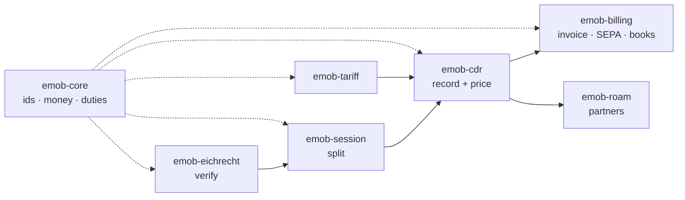

+++
title = "Getting started"
weight = 1
description = "Try emob with just demo, then walk one EV charging session in Rust: verify Eichrecht OCMF meter values, price it under AFIR, build a CDR and an e-invoice."

[extra]
nav = "Getting started"
+++

The fastest way to see emob is to run it: `just demo` starts the whole estate —
every daemon, three simulated charge points and a roaming partner — on your
machine. The rest of this tutorial takes one charging session from the meter to
the money in library code: you verify the station's signed meter values, split
the energy into quarter hours, price it with a tariff, build a charge detail
record (CDR) and close a month into an EN 16931 e-invoice. ✅

## Try the whole estate: `just demo`

You need Rust, [`just`](https://just.systems) and `openssl`; `just doctor`
checks them and prints the command that installs anything missing. Without
Rust, `just demo` runs the released `ghcr.io/hupe1980/emob` image with Docker
instead, from the first release that publishes it (0.3).

```console
git clone https://github.com/hupe1980/emob && cd emob
just doctor      # what is missing, and the command that installs it
just demo        # the estate on loopback: Heute, a receipt and the partner's inbox
```

Within a minute it prints three links: **Heute**, the operator page, signed in;
a driver's **receipt**; and the roaming partner's **inbox** — and after the
simulated month end, the partner's **invoice** page with its XRechnung files. Open the receipt
on a phone and tap *Selbst prüfen* to check the signed meter values on the
device. Ctrl-C ends the run and removes its journals.

<div class="shot-pair">
<figure class="shot phone">
<picture><source media="(prefers-color-scheme: dark)" srcset="../../img/heute-mobile-dark.webp"></picture>
<figcaption>Heute at phone width.</figcaption>
</figure>
<figure class="shot phone">
<picture><source media="(prefers-color-scheme: dark)" srcset="../../img/receipt-dark.webp"></picture>
<figcaption>The driver receipt.</figcaption>
</figure>
</div>

`cargo run -q -p emob-cli -- demo --check` plays the same morning at full speed
and asserts every outcome — CI runs it on every push, followed by `just a11y`,
which checks every page a person reads for accessibility. What the demo starts, the
estate file and how to run the daemons yourself are on
[Run the estate](@/docs/run-the-estate.md).

## Install the crates

emob needs Rust **1.94** or later (`emob-roam` needs 1.96, because its OCPI
library does). Add the crates for the steps you follow:

```console
cargo add emob-core emob-eichrecht emob-session emob-cdr emob-tariff emob-billing
```

Each crate answers one question, and its dependencies come with it:

| I want to… | Crate |
|---|---|
| Check that a signed meter value is genuine, and say why if it is not | `emob-eichrecht` |
| Split a session across the 15-minute intervals the energy market settles on | `emob-session` |
| Turn a session into a record another company will pay against | `emob-cdr` |
| Price a session, and show the same price before it starts | `emob-tariff` |
| Parse identifiers (EVSE id, eMAID), exact money and energy; check regulatory duties | `emob-core` |
| Turn a month of records into an e-invoice, a SEPA direct debit and postings | `emob-billing` |
| Lift signed values out of OCPP traffic; send a tariff to a station | `emob-ocpp` |
| Publish locations and prices to the national access point | `emob-poi` |
| Exchange records with roaming partners over OCPI or OICP | `emob-roam` |
| File the greenhouse-gas quota (THG-Quote) | `emob-thg` |
| Share a site's power under a § 14a grid setpoint | `emob-smart`, `emob-eebus` |
| Check a Plug & Charge contract certificate | `emob-pnc` |
| Build a daemon: settings, health probes, graceful shutdown | `emob-service` |
| Test against a simulated fleet that signs real records | `emob-sim` |

The domain crates do no I/O and never read the clock: every instant and every
key is an argument. That makes any past check reproducible — you can replay a
two-year-old disputed session exactly as it ran. `emob-service` is the one
shared crate that does I/O, and it is what the daemons build on.



## Step 1: verify a charging session (Eichrecht)

A charging station with an Eichrecht-approved meter emits **OCMF** records — the
Open Charge Metering Format, in which the calibrated meter signs each reading.
German calibration law lets you bill only a value the customer can verify
`[MessEG §33]`. `Evidence::assemble` runs every check: signature, key binding,
completeness of the record chain, and meter state.

```rust
use emob_eichrecht::{ComponentRef, Evidence, KeyRegistry, RegisteredKey};
use ocmf::{Curve, PublicKey, Record};

// The station's public key comes from its type approval or your provisioning
// system — never from the record you are about to check.
let mut registry = KeyRegistry::new();
registry.insert(
    ComponentRef::Meter { serial: "BQ27400330016".into() },
    RegisteredKey::unbounded(
        PublicKey::from_text(station_public_key, Some(Curve::Secp256r1))?,
        "type approval 2026-01",
    ),
)?; // refuses a validity window that overlaps one already registered

// A `Record` borrows the exact bytes its signature covers, so keep the texts alive.
let records = raw_records
    .iter()
    .map(|r| Record::parse(r))
    .collect::<Result<Vec<_>, _>>()?;

let evidence = Evidence::assemble(&records, &registry, session_start);

match evidence.billable_energy() {
    Some(energy) => println!("bill {energy}"),
    None => for reason in evidence.reasons() {
        eprintln!("blocked: {reason}");
    },
}
```

`billable_energy()` returns `None` if *anything* is wrong, and `reasons()` says
what. There is no other way to obtain a billable quantity, so "a value that does
not verify does not bill" is enforced by the type system.

Energy, duration and identity are separate answers. A station with an
unsynchronised clock still has billable energy, but no billable duration — so a
per-kWh price applies and a per-minute fee does not:

```rust
assert!(evidence.is_billable_for_time());            // the clock was synchronised
assert_eq!(evidence.direction(), Some(Direction::Import)); // read off the OBIS code
```

Typical reasons a session is blocked:

```text
record 2: the signature does not match the payload
pagination jumped from 1 to 3: a record is missing or duplicated
the meter was in state Substitute at record 2, which may not be billed
the register ran backwards: 2965.100 then 2935.600
no public key is registered for signing component "meter:BQ1"
```

The pagination case matters most: every remaining signature is genuine, and
only the chain check notices a record was removed. See
[The Eichrecht chain](@/docs/eichrecht.md) for every check.

### Give the driver a file they can check

The law requires the customer to be able to **check** the value. The
deliverable is the XML file read by the S.A.F.E. Transparenzsoftware, the
independent verifier used in Germany:

```rust
let xml = emob_eichrecht::transparency::to_xml(&evidence)?;
```

It contains each record verbatim beside the registered key it was checked
against. A session that does not bill still gets a file, because a dispute is
when the driver needs it most.

## Step 2: split the session into quarter hours

Electricity is settled in 15-minute intervals. `emob-session` splits a session's
meter series on that grid so the parts sum *exactly* to the total:

```rust
let split = session.split(Direction::Import)?;

assert!(split.conserves());       // parts sum to the total, to the last digit
assert!(split.fully_measured());  // every boundary had a meter reading
```

A `Session` is opened with `Session::open` and given its readings with
`attach_series`; in production the OCPP seam builds it from station traffic. See
[Sessions and settlement](@/docs/settlement.md) for why the split conserves by
construction.

## Step 3: price it and build a CDR

A tariff rates the session's own quarter hours, and the **same** tariff produces
the price text a driver sees before starting — so the price shown is the price
charged `[AFIR Art. 5(4)]`.

```rust
use emob_cdr::{Acceptance, CdrBuilder, CdrLedger, EvidenceRef};
use emob_core::TimeZone;
use emob_tariff::{Dimension, PriceComponent, Tariff, TariffKind, check_afir, describe};

// Time-of-day restrictions are local time at the charge point.
let berlin = TimeZone::new("Europe/Berlin")?;

let tariff = Tariff::simple("ad-hoc-dc".parse()?, Currency::EUR, TariffKind::AdHoc, berlin, vec![
    PriceComponent::new(Dimension::Energy, dec("0.49")).with_vat(dec("19")),
    PriceComponent::new(Dimension::ParkingTime, dec("6.00")).with_vat(dec("19")),
]);

// What the driver is shown, in the order AFIR prescribes.
assert_eq!(describe(&tariff, session.started_at).one_line(),
           "0.49 EUR / kWh · 0.10 EUR / min");

// May a 150 kW charger offer this tariff at all?
assert!(check_afir(&tariff, dec("150")).is_lawful());

let cdr = CdrBuilder::from_session(&session, Direction::Import)?
    .key(party, "cdr-1".parse()?)
    .evidence(EvidenceRef::from_evidence(&evidence, "OCMF")) // read off the verified records
    .rated_with(&tariff)
    .build()?;

assert_eq!(cdr.total_cost().unwrap().to_string(), "8.82 EUR"); // 18.000 kWh × 0.49

let mut ledger = CdrLedger::new();
assert_eq!(ledger.accept(cdr.clone()), Acceptance::Stored);
assert_eq!(ledger.accept(cdr), Acceptance::Duplicate); // a retry, not a second invoice
```

The builder refuses a record whose claims contradict its signed evidence: a
stronger authorisation than the record supports, a per-minute price on a session
whose clock cannot carry a duration, or a direction that contradicts the meter's
register.

An invoice needs the taxable amount per VAT rate (EN 16931), not one gross
figure. The rated cost provides it:

```rust
let rated = &cdr.cost.as_ref().unwrap().rated;
for line in rated.tax_summary() {
    println!("{} %: net {} + tax {} = {}", line.rate, line.net, line.tax, line.gross);
    // 19 %: net 7.41 + tax 1.41 = 8.82
}
```

See [Tariffs and price transparency](@/docs/pricing.md) for tiers, time
restrictions and the AFIR shape rules.

## Step 4: settle the month

`emob-billing` turns the month's accepted CDRs into an EN 16931 e-invoice, a
SEPA direct-debit file (pain.008) and balanced bookkeeping postings. Rounding
happens once, per line, as EN 16931 requires; the difference against the exact
total is reported rather than hidden.

```rust
use emob_billing::{InvoiceBuilder, Specification, Syntax, en16931, postings};

let crossing = InvoiceBuilder::new("R-2026-0001", issued, (from, to), cpo, driver)
    .supplied_from("DE", dec("19"))  // country of supply and its VAT rate
    .ledger(&ledger)
    .due_on(due)
    .build()?;

let invoice = crossing.value;
assert!(invoice.reconciles());                     // subtotals reproduce the lines
assert_eq!(invoice.gross_total().to_string(), "31.04 EUR");
for reason in crossing.reasons() { eprintln!("{reason}"); }
// /totals/taxable: the records came to 26.0800840336… exactly and this invoice
//                  states 26.08 EUR

// Validate against the EN 16931 rules, then write UBL (or CII).
assert!(en16931::to_en16931(&invoice, Specification::Core)?.value.is_valid());
let xml = en16931::write(&invoice, Specification::Core, Syntax::Ubl)?.value;

assert!(postings::postings_for(&invoice).balances());
```

The VAT treatment follows from the parties: an invoice to an e-mobility provider
established in another member state becomes a reverse charge `[UStG §3g]`, with
no VAT on the document. Every date is an argument, so re-running a billing job
produces the same bytes. See [Sessions and settlement](@/docs/settlement.md).

## Check a charge point against the regulations

`emob-core` holds an obligation calendar — dated, cited duties from AFIR (the EU
Alternative Fuels Infrastructure Regulation), German law and NIS2. Ask it about a
charge point on a date:

```rust
use emob_core::obligation::{assess, Verdict};
use emob_core::station::{AdHocPayment, ChargePointProfile};
use time::macros::date;

let mut point = ChargePointProfile::bare("DE*AB7*E840*6487".parse()?, date!(2026-06-01));
point.ad_hoc_payment = AdHocPayment::CardReader;

let report = assess(&point, date!(2027-01-01));
for finding in report.breaches() {
    println!("{}  {}", finding.obligation.citation, finding.obligation.remedy);
}
assert_eq!(report.verdict(), Verdict::Failing);
```

`ChargePointProfile::bare` starts every field at its non-compliant value, so a
test exercises the duty it was written for. Provider and company duties are
assessed with `assess_provider` and `assess_undertaking`; see
[The obligation calendar](@/docs/compliance.md).

## Test against a simulated fleet

`emob-sim` runs a day of sessions on virtual stations that sign genuine OCMF,
with faults injected, through the same verifier, split, rating and ledger:

```rust
use emob_sim::{FaultPlan, Rate, ReferenceDay};

let outcome = ReferenceDay::builder()
    .stations(100)
    .sessions_per_station(4)
    .faults(FaultPlan::everything(Rate::one_in(9)))
    .build()
    .run();

println!("{}", outcome.summary());
// 400 sessions: 197 settled (8969.120 kWh), 203 refused (9555.738 kWh),
//               metered 18524.858 kWh

assert!(outcome.reconciles());                 // settled + refused == metered
assert!(outcome.every_refusal_has_a_reason());
```

The assertion is not "everything billed" but that every kilowatt-hour either
settled or was refused with a reason. A run is fully determined by its seed.

## Build and run the workspace

```console
just            # list every recipe
just ci         # fmt, clippy, purity, tests, guards, cargo-deny, docs — what CI runs
just guards     # the workspace's consistency checks (citations, API names, counts …)
just msrv       # the crates that promise Rust 1.94 still build on it
just a11y       # accessibility of every page, light and dark, 320 and 1280 px
```

To run the daemons — `just demo`, `just desk`, `just up` with compose, the
estate file, the data keys and TLS — see [Run the estate](@/docs/run-the-estate.md).

## Next

| To learn… | Read |
|---|---|
| running the daemons, the operator page and the driver receipt | [Run the estate](@/docs/run-the-estate.md) |
| every check between a meter's signature and a bill | [The Eichrecht chain](@/docs/eichrecht.md) |
| how signed values are taken from OCPP, and a price sent back | [The OCPP seam](@/docs/ocpp.md) |
| sending CDRs to roaming partners over OCPI and OICP | [Roaming](@/docs/roaming.md) |
| publishing to the national access point | [Locations](@/docs/locations.md) |
| how the crates and daemons fit together | [Architecture](@/docs/architecture.md) |
