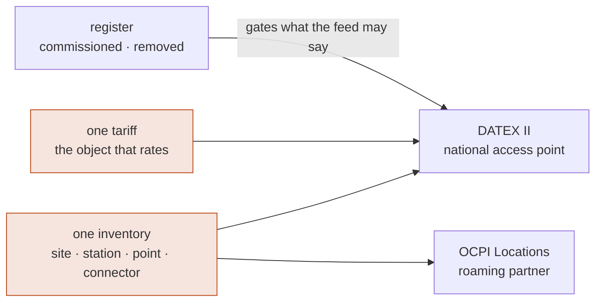

+++
title = "Locations and the national access point"
weight = 7
description = "AFIR Art. 20 charge point data for the Mobilithek: one inventory feeds DATEX II and OCPI Locations, priced by the tariff that rates each EV charging session."

[extra]
state = "built"
nav = "Locations"
+++

`[AFIR Art. 20]` requires every charge point operator to publish static and
dynamic data about its charge points — location, connectors, power,
availability, ad-hoc price — free of charge through the **national access
point**. In Germany that is the **Mobilithek**, in the DATEX II *Recharging*
profile, from **14 April 2026**. `emob-poi` builds that feed from one inventory
(site · station · point · connector) and one tariff, so the access point, roaming
partners and the charge point display all say the same thing. The documents are
written by [`datex2`](https://crates.io/crates/datex2), whose Mobilithek writer
refuses anything the profile's schemas would reject.



Most stacks generate the feed from a different inventory than the roaming module
publishes, so the two drift and nobody compares them. Here there is one
inventory with two audiences.

## Publishing the ad-hoc price from the tariff itself

`[AFIR Art. 5(2)]` makes the price shown before a session the price that may be
charged; `[AFIR Art. 20(2)(c)]` makes that same ad-hoc price data an operator
must publish. Computed twice — once in billing, once in an export job — the two
drift, and nobody reconciles a feed against an invoice.

`emob-poi` has no price model. It publishes the [tariff](@/docs/pricing.md)
itself, exact from the object to the JSON number:

```rust
let (rate, notes) = emob_poi::rate::publish(&tariff, "rate-1");
// reaches the feed as `"value":0.49`, not 0.49000000000000000222
```

`notes` is a list of `RateNote`s: everything the profile could not say exactly,
described below.

## Connector compliance from the same inventory

A point's connectors go to the access point in `[DATEX-II-Profil Tab. A.88]`'s
spelling, and they are also a legal duty: `[AFIR Art. 21(1)]` applies Annex II,
which requires at least Type 2 on AC and at least CCS Combo 2 on DC
`[AFIR Anh. II 1.1]`. `[LSV26 §5(3)]` — the German charging-station ordinance —
lets the Bundesnetzagentur forbid operating a point that breaches it.

`ChargingPoint::profile` builds the compliance profile the
[obligation calendar](@/docs/compliance.md) judges from the inventory's own
connector list, not from a flag somebody set:

```rust
let profile = point.profile(commissioned_on, Accessibility::Public);
// A CHAdeMO-only DC post: ordinary hardware, and a closable breach.
assert_eq!(
    assess(&profile, on).status_of(ObligationId::AfirAnnexIiConnector),
    Some(Status::Failing),
);
```

It fills only what the inventory knows. Notice dates, metering posture and the
ownership arrangement live in a register export, a type approval and a contract,
and stay for the caller to state.

## DATEX II profile gaps: what the feed cannot say exactly

The profile offers six price types: `basePrice`, `flatRate`, `free`, `other`,
`pricePerKWh` and `pricePerMinute`, and an amount of money with two places after
the point. Six mismatches with real tariffs follow. Five are published as
accurately as the profile allows and reported as a `RateNote`; one cannot be
published at all:

| Gap | What emob publishes |
|---|---|
| **No per-hour price type.** Tariffs are written per hour; the profile counts minutes. | The hourly price ÷ 60 under `pricePerMinute` — where that terminates (see below). |
| **Per-minute price is not whole cents.** €2.50/h is €0.041666…/min and €0.30/h is €0.005/min; rounding to cents is a price the operator does not charge `[PAngV]`. | The hourly figure under `other`, with the unit in `additionalInformation`. OCPP 2.1 [refuses this tariff](@/docs/ocpp.md); a feed cannot refuse, because publishing is the duty. |
| **No occupancy price type.** AFIR permits a per-minute fee for time connected and not charging at 50 kW and above; the profile only has a boolean saying whether charging and parking share one fee. | `other` with a sentence. |
| **Delivery fee has no tax flag.** `minimumDeliveryFee`/`maximumDeliveryFee` are a bare `AmountOfMoney`, without `taxIncluded`/`taxRate`. | The fee in the basis the tariff states, and a note naming it. |
| **A price with a fraction of a cent.** `AmountOfMoney` holds two places after the point, so €0.589/kWh has no spelling. | Nothing. The feed is refused with `PoiError::AmountNotInCents` naming the rate and the figure; rounding either way publishes a price the operator does not charge. |
| **Tier bands are integers.** Energy and elapsed-time bands are non-negative integers; tariff thresholds need not be. | Lower bounds round **up**, upper bounds round **down**, so the published band is a subset of the real one and every published statement stays true. |

### Time zone: the profile types it as a fixed offset

`FacilityLocation.timeZone` is typed as an ISO 8601 offset (`"+01:00"`), and the
Mobilithek's own reference instance writes `"+01:00"` for a site in Aachen. An
offset cannot express summer time, so that value is wrong from late March to
late October — for the field a consumer reads a `22:00` night rate against.

emob publishes the offset **in force at the instant of publication**, the one
reading true of the document when issued, and
`RateNote::DailyWindowHasOnlyAnOffset` names the real IANA zone beside it.

## The register gates the availability feed

`[LSV26 §4(1)]` makes three events notifiable — commissioning, decommissioning
and a change of operator — so an operator knows each point's lifecycle state.
Decommissioned points still published as `available` are the commonest defect in
European charging data, and no schema validator catches them.

`ChargingPoint::report` is the only way to build a status `Report`, and it reads
the lifecycle off the point rather than taking it as an argument:

```rust
point.lifecycle = Lifecycle::Decommissioned;
point.report(PointStatus::Available)      // Err(StatusContradictsRegister)
point.report(PointStatus::Removed)        // Ok — the register's own answer
```

## Status updates must resolve against the published table

A DATEX II status message carries no infrastructure — every object in it is a
reference (class, id, version) into a **table publication** sent separately. A
reference that does not resolve is not an error at the consumer: the status is
silently dropped and the point's availability vanishes from every map reading the
feed.

The consumer holds the last table **it was sent**, not the operator's current
estate. So an update must resolve against both:

- the **estate** — does the update describe a real point in a state the register
  admits? (`emob_poi::feed::check`)
- the **accepted table** — does the consumer have an object to attach it to?
  (`emob_poi::feed::resolves`, against `TablePublication::published()`, the
  manifest read off the document that was actually built)

If not, publish the table first. Ad-hoc price changes are checked the same way:
a dynamic rate update names the rate by the `idG` the table gave it, and one
naming a rate no table carried is refused.

## Two more checks a schema validator would pass

- **A station's total power must lie between its largest point and the sum of
  its points.** Below the largest point it turns traffic away; above the sum it
  advertises capacity the sockets cannot deliver. Load management makes the
  interval between them legitimate — two 150 kW points behind a 200 kW
  connection is normal — so the check is the interval.
- **`iso15118` in this profile means ISO 15118-20.** The dictionary says so and
  has no literal for the 2016 generation (ISO 15118-2). A `-2`-only point
  published as `iso15118` would claim readiness for the duty phasing in from 2027,
  so it is published as `other` — and so is a DIN SPEC 70121 point, because
  `none` means *"no communication between vehicle and the grid"*. A test asserts
  the names emob emits are the names the `iso15118` crate defines.

## Tested against the profile's reference instances

The profile ships no XSD; its two published example instances are the only
statement of what a conformant message looks like. The tests assert that **every
JSON path emob emits is a path the reference instance also contains** (array
indices collapsed). A misspelt key, a missing nesting level or an attribute on
the wrong class fails there. The few attributes the examples do not exercise are
attested from the profile's dictionary, each naming its class and multiplicity.

## No I/O, no clock

`emob-poi` opens no socket, reads no file and never asks the time. The
publication time is an argument, so an export replayed two years later produces
the same bytes.

## The poid daemon

`poid`'s inventory is the estate's `[[stations]]`, one site per `location.id`,
with coordinates as exact decimals; `GET /v1/poid` shows it to operators. Its
library decides **when** a snapshot goes out: it records the table the access
point accepted, refuses updates no consumer could resolve, and reports when the
feed has gone stale (`Poid::stale`). Its prices are the version of each
station's tariff in force at the moment of publication. With a `[mobilithek]`
section — the publication's push address and the operator's client
certificate — the daemon posts the table at start and hourly, journals only an
accepted push, and names each documented refusal. ⏳ The dynamic delta is built
but not yet sent.

`emob check-feed <file>` reads any DATEX II AFIR file — XML or JSON, emob's or
anyone's — lists what the reader tolerated, and holds every publication to the
Mobilithek profile with the writer `poid` uses. See
[Run the estate](@/docs/run-the-estate.md).

**Related:** [Tariffs and price transparency](@/docs/pricing.md) ·
[Roaming](@/docs/roaming.md) · [Compliance](@/docs/compliance.md) ·
[Glossary](@/docs/glossary.md)
