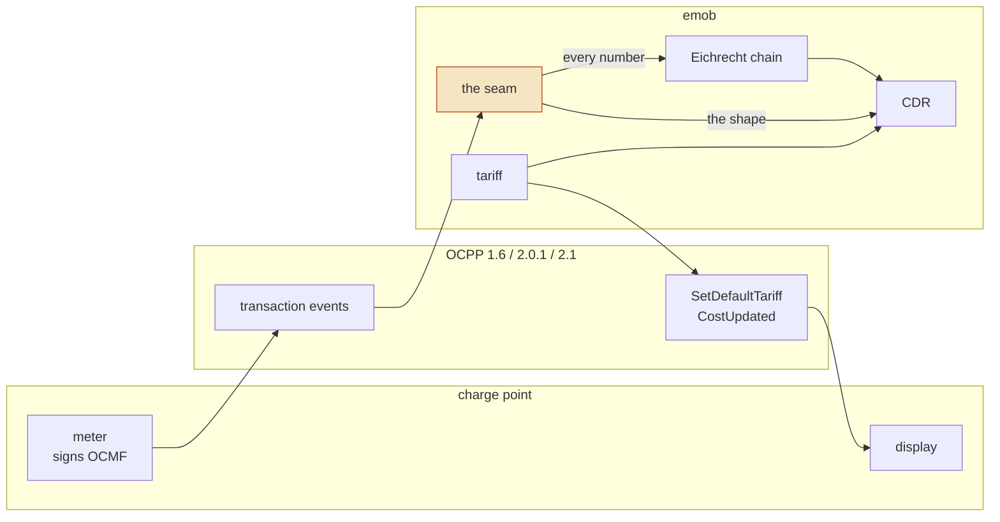

+++
title = "The OCPP seam"
weight = 4
description = "How emob turns OCPP 1.6, 2.0.1 and 2.1 transaction events into Eichrecht-signed CDRs, and pushes the same tariff to the charge point display via OCPP 2.1."

[extra]
state = "built"
nav = "OCPP seam"
+++

OCPP — the Open Charge Point Protocol — is how a charge point and its backend
(the CSMS) talk. `emob-ocpp` is the seam between that wire and the money: it
lifts **signed meter values** out of OCPP transaction events for the Eichrecht
chain, takes the session's *shape* (start, stop, charging or idle) from the
events, and sends the **tariff** back to the charge point's display through
OCPP 2.1. It supports OCPP 1.6, 2.0.1 and 2.1 through
[`ocpp-kit`](https://crates.io/crates/ocpp-kit) 0.5.



## Only signed meter values are billed

OCPP carries the meter register twice, and only one copy is money.

- The **numeric** fields — `meterStart`, `meterStop`, `SampledValue.value` — are
  operational telemetry. They show whether every event arrived. They are not
  billable: the Open Charge Alliance's own example carries `meterStop: 108814`,
  the meter's *lifetime* register in watt-hours, beside a signed data set
  reporting `0.636 kWh` for the transaction.
- The **signed** value is a `SignedMeterValueType` carrying an OCMF data set —
  the Open Charge Metering Format, in which a calibrated meter signs each
  reading. It is the only thing that becomes a billed kilowatt-hour.

This is enforced by types: **the seam's input vocabulary has no numeric meter
value in it.** A `TransactionEvent` carries signed readings, instants and
whether energy was flowing — there is no field to put a float in. A workspace
guard also fails the build on any `f32` or `f64` outside tests.

## Reading OCMF out of OCPP 1.6 and 2.x

The OCMF data set arrives wrapped in up to three layers:

- **OCPP 2.x** has a typed `signedMeterValue` field.
- **OCPP 1.6** serialises the whole object into the `value` string of a
  `SampledValue` whose `format` is `SignedData` — a string holding JSON holding
  Base64 holding the record.
- The `publicKey` is Base64 over `oca:base16:asn1:<hex>`; the same application
  note's own example sends Base64 over plain hex with no envelope. Both are
  accepted.

The envelope parsing lives in `ocpp-kit`, so one `match` in `emob_ocpp::record_of`
covers all three generations.

A public key that arrives on the same socket as the record proves only that the
sender holds *a* private key. OCMF says the key travels out of band, so the key
that decides anything comes from the operator's meter registry — see
[Eichrecht](@/docs/eichrecht.md).

## A retried MeterValues is not a second reading

OCPP guarantees delivery by retrying, so the same signed record can arrive twice
with the same pagination counter. Appended twice, the Eichrecht chain would report
`Finding::PaginationBroken` — a transport retry misreported as a missing record.

Records are de-duplicated by the digest of the bytes their signature covers. Two
with the same digest are one record. Two that differ are both kept, because a
station that reused a counter for different content is exactly the fault the
chain exists to find.

## Which fact comes from OCPP and which from OCMF

| Fact | Source | Why not the other |
|---|---|---|
| The register, and its scale | the **signed record** | OCPP's numbers are telemetry |
| When the transaction opened and closed | the **OCPP events** | OCMF's clock is often only *informative*, and the backend knows when it authorised |
| Charging, or merely connected | the **OCPP events** | a meter cannot tell a taper from an occupancy, and the two are priced differently |
| Whether a reading is clock-aligned | the **OCPP reading context** | nothing in the record says why it was taken |

A transaction is assembled with its **shape** from the protocol and every
**number** from the signature.

One exception is reported rather than resolved. OCMF's transaction marker `S`
(*"Suspended = Transaction active, but currently not charging"*) lets a meter
sign an occupancy interval too. It is optional, so its absence means nothing; but
where it is present and disagrees with the OCPP events, the seam reports a
`ChargingDisagreement`. `[AFIR Art. 5(4)]` prices those minutes differently, so
an operator should look rather than silently prefer either account.

## Showing the tariff on the charge point with OCPP 2.1

`[AFIR Art. 5(4)]` — the EU Alternative Fuels Infrastructure Regulation —
requires the ad-hoc price to be *"known to end users before they initiate a
recharging session"*, and the place a driver learns it is the charge point's
display. OCPP 2.0.1 could only send a display string and a running cost computed
elsewhere, so the screen and the invoice came from different places. OCPP 2.1's
*Tariff and Cost* block closes that gap, and `emob_ocpp::to_ocpp` converts the
same `Tariff` that rates the session:

```rust
let crossing = emob_ocpp::to_ocpp(&tariff, at)?;                  // the same Tariff that rates
let request = v2_1::SetDefaultTariffRequest::new(0, crossing.value); // evseId 0 = all EVSEs

for reason in crossing.reasons() {
    eprintln!("{reason}");
    // /energy/prices/0: OCPP 2.1 quotes prices excluding tax and carries at
    //                   most eighteen decimals: 0.49 at 19 % is …
}
```

The result is a `Crossing`: the OCPP value plus an account of anything the wire
could not carry, each note addressed by JSON Pointer.

### The station selects the same tier the invoice uses

OCPI orders tariff *elements* and picks, per dimension, the first whose
restrictions match. OCPP 2.1 orders *prices* inside each dimension and picks the
first whose conditions match. Projecting the element list onto one price list per
dimension, in order, is the projection the rating engine already performs — so
the station selects the component the invoice is built from **by construction**.

OCPP 2.1 also requires the station to display the tariff's description. emob
fills it with every tier and its conditions in the order AFIR prescribes, so the
disclosure duty and the rating travel in one object.

### What OCPP 2.1 cannot express is refused, not noted

A loss in the driver's disfavour that the document does not show is a
**refusal**, because the receiver is entitled to read the number at face value.
[Roaming](@/docs/roaming.md) applies the same rule.

| Refused | Why |
|---|---|
| a time price with no exact per-minute value | OCPP's field is `priceMinute`, and €2.50 an hour is €0.041666… a minute; a rounded figure is a price the station charges and the tariff does not |
| a dimension charged at two VAT rates | OCPP carries one tax-rate list per dimension, so the second tier would be taxed at the first tier's rate |
| a session fee conditioned on a quantity | a fixed fee's conditions carry only the wall clock, so the stripped fee would apply to **every** session |
| a restriction emob cannot evaluate | stripping a condition widens the price, as on the [OCPI side](@/docs/roaming.md) |
| a reservation element | OCPP 2.1 prices a transaction; a reservation runs before one exists |

What is merely *invisible* is carried with a note: a block size and a version
expiry OCPP has no field for, the residual when a gross price is quoted net, and
tiers beyond the ten lines the description can hold. The finished document is
then checked against `ocpp-kit`'s OCPP 2.1 schema validator, so a tariff a
station would reject is rejected here first.

### CostUpdated shows the invoice's own figure

`CostUpdated` carries the running cost *including taxes*. `emob_ocpp::cost_updated`
takes it from the rated session's gross, rounded the way the invoice rounds — per
VAT category, then summed — so the number on the screen during charging is the
number on the invoice afterwards.

## Why the OCPP seam is a separate crate

Folding OCPP into the record layer would put a protocol implementation in the
dependency graph of every crate that decides money. The identifier, session,
evidence, tariff and record crates build with no OCPP in their tree; `emob-ocpp`
is the only crate that sees both vocabularies. It depends on the tariff model,
never the reverse.

## The csmsd daemon

`csmsd` is the endpoint a station connects to — OCPP 1.6J, 2.0.1 and 2.1 over
WebSocket — and it routes every transaction event into the Eichrecht chain
described above. ✅

- **Who the station is.** Each station has an OCPP security profile
  `[OCPP 2.0.1 Part 2 §A00]`: Basic against an Argon2id hash (profile 1, or 2
  over TLS) or a TLS client certificate whose CN is its identity (profile 3). An
  unknown identity gets `404`, a wrong credential `401`, and a station that does
  not offer its provisioned OCPP version is refused. A second connection under a
  known identity supersedes the older one — the credential check is what tells
  an impostor from a reconnect.
- **Authorisation.** `Authorize`, and every transaction start, is answered by
  `empd`. A timeout or an unreachable `empd` answers `Invalid`: it fails closed,
  and a refused start opens no transaction.
- **Nothing is lost on restart.** The CDR ledger, outcomes, in-flight events and
  the OCPP 1.6 transaction counter are folded from `csmsd`'s journal; each
  settled session is delivered to `billd` and `roamd` from a journalled outbox.
- **The driver gets the evidence.** Every session has a receipt page the driver
  can check on a phone.

See [Run the estate](@/docs/run-the-estate.md) and
[Architecture](@/docs/architecture.md) for how daemons stay thin.

## Limits

- OCPP 2.1 DER control is not supported. § 14a allocations become charging
  profiles (`emob_ocpp::to_charging_profiles`, see
  [§ 14a and the grid](@/docs/smart-charging.md)).
- The OCPP 2.1 tariff object has no expiry field, so a version's expiry is
  reported in the crossing's notes and retiring a version is a separate
  `ClearTariffs` call. When a version takes effect is `tarifd`'s decision.

**Related:** [Eichrecht](@/docs/eichrecht.md) ·
[Tariffs and price transparency](@/docs/pricing.md) ·
[Sessions and settlement](@/docs/settlement.md) ·
[Glossary](@/docs/glossary.md)
