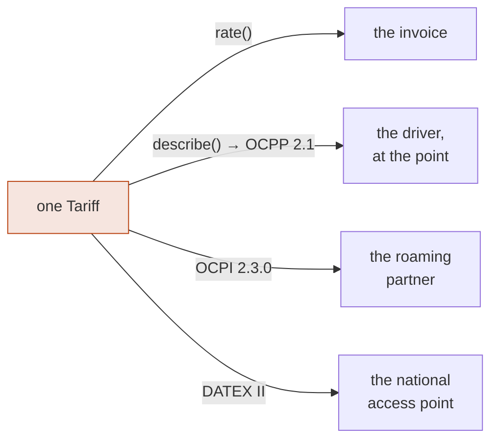
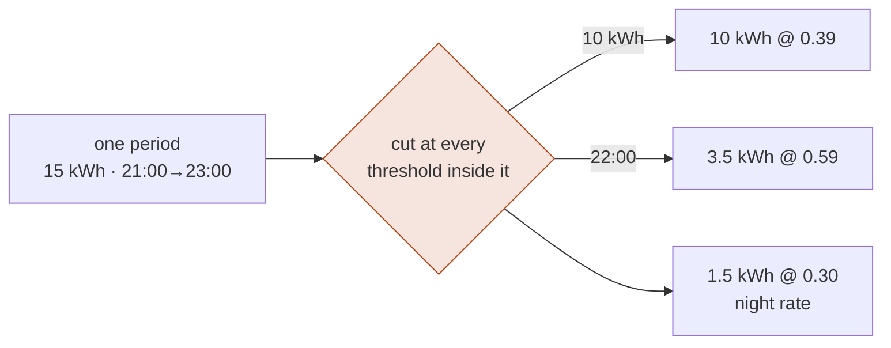

+++
title = "Tariffs and price transparency"
weight = 6
description = "EV charging tariffs in emob: one object rates the session and displays the price, with OCPI tier rules, VAT breakdown and AFIR Art. 5 price transparency checks."

[extra]
state = "built"
nav = "Tariffs"
+++

`emob-tariff` holds one `Tariff` object that both **rates** a finished charging
session and **describes** the price before it starts. `[AFIR Art. 5(4)]` — the
EU Alternative Fuels Infrastructure Regulation — requires the ad-hoc price to be
known to the driver before charging and to be the price charged. When the display
and the invoice come from two systems they drift; here `describe()` and `rate()`
read the same `PriceComponent`s and select the applicable price **through the
same function**.

```rust
use emob_tariff::{Dimension, PriceComponent, Tariff, TariffKind, describe, rate};

// The zone the tariff's wall-clock restrictions are read in.
let berlin = TimeZone::new("Europe/Berlin")?;

let tariff = Tariff::simple(id, Currency::EUR, TariffKind::AdHoc, berlin, vec![
    PriceComponent::new(Dimension::Flat, dec("0.50")),
    PriceComponent::new(Dimension::Energy, dec("0.49")),
]);

// What the driver sees, before anything happens.
assert_eq!(describe(&tariff, at).one_line(), "0.49 EUR / kWh · 0.50 EUR / session");

// What the driver pays, from the same numbers.
assert_eq!(rate(&tariff, &session).gross().to_string(), "14.96 EUR");
```

`describe` asks the same question `rate` asks about a session's first period, so
the price shown is the price the first kilowatt-hour is billed at.

## One tariff, three audiences: OCPP, OCPI, DATEX II

The same price leaves emob three times, each under its own duty:

| Audience | Wire | Duty |
|---|---|---|
| the driver, at the charge point, **before** starting | OCPP 2.1 `SetDefaultTariff` | `[AFIR Art. 5(4)]` |
| the roaming partner who settles against it | OCPI 2.3.0 `Tariff` | the number two companies reconcile |
| the national access point | DATEX II `EnergyRate` | `[AFIR Art. 20(2)(c)]` |



```rust
let ocpp = emob_ocpp::to_ocpp(&tariff, at)?;                       // the screen
let ocpi = emob_roam::ocpi::tariff::to_ocpi(&tariff, &party, at)?; // the partner
let (nap, _) = emob_poi::rate::publish(&tariff, "rate-1");         // the feed

assert_eq!(ocpp.value.energy.unwrap().prices[0].price_kwh.to_string(), "0.59");
assert_eq!(ocpi.value.elements[0].price_components[0].price.get(), dec("0.59"));
assert_eq!(nap.prices[0].value, dec("0.59"));
```

OCPI orders *elements* and picks, per dimension, the first whose restrictions
match; OCPP 2.1 orders *prices* inside each dimension and picks the first whose
conditions match. Projecting the element list per dimension, in order, is what the
rating engine already does, so the charge point selects the tier the invoice uses
**by construction**. OCPP 2.1 also requires the station to show the tariff's
`description`, which emob fills with `describe().full_disclosure()`.

Each crossing returns the value and an account of what it lost, and refuses any
loss in the driver's disfavour that the document would not show. The details are
per wire: [the OCPP seam](@/docs/ocpp.md), [Roaming](@/docs/roaming.md) and
[Locations](@/docs/locations.md).

## OCPI tariff selection: one price per dimension

`[OCPI 2.3.0 §Tariff]`:

> …the first Tariff Element with a Price Component **for that dimension** in the
> list with matching Tariff Restrictions will be used. Only one Price Component
> per dimension can be active at any point in time, but multiple Price
> Components for different dimensions can be active at once.

So several elements apply at once — at most one per dimension. That is why OCPI
advises one unrestricted default element *per dimension* after the restricted
ones:

```rust
let elements = vec![
    element(dec("0.29"), Dimension::Energy, after_22),          // the night rate
    TariffElement::unrestricted(vec![flat(dec("0.50"))]),        // the defaults,
    TariffElement::unrestricted(vec![energy(dec("0.49"))]),      // one per dimension
];

assert_eq!(rated.amount_for(Dimension::Energy), Some(dec("4.90")));
assert_eq!(rated.amount_for(Dimension::Flat),   Some(dec("0.50")));
```

Stopping at the first matching element would bill the session fee and silently
drop every kilowatt-hour. A dimension no element matches costs nothing (*"there
will be no costs for that Tariff Dimension"*), and `RatingNote::Unpriced` states
the **quantity** that went unpriced — "4.5 kWh were not priced" is something a
dispute can use.

## Tiered tariffs: rating a session period by period

"The first 10 kWh at 0.39, the rest at 0.59" depends on how much has been
delivered **so far**. Rated from the session *total*, a 30 kWh session would
reprice all thirty at 0.59. So `rate` walks the periods in order, carrying
cumulative energy and duration:

```rust
let session = Chargeable::new(vec![
    Period::charging(t0, t1, kwh("10")),
    Period::charging(t1, t2, kwh("10")),
    Period::charging(t2, t3, kwh("10")),
])?;

let rated = rate(&tiered, &session);
assert_eq!((rated.lines[0].unit_price, rated.lines[0].quantity), (dec("0.39"), dec("10")));
assert_eq!((rated.lines[1].unit_price, rated.lines[1].quantity), (dec("0.59"), dec("20")));
assert_eq!(rated.quantity_for(Dimension::Energy), dec("30"));  // nothing is lost
```

The quarter-hour slots the [settlement layer](@/docs/settlement.md) produces are
exactly these periods, so the split that conserves energy is the input that
prices it — and a session that crosses into a night rate is priced on both sides
of the boundary.

### Periods are cut at every tariff threshold

A price must not depend on how the caller sliced the session. So every energy,
duration and wall-clock threshold in the tariff becomes a cut point inside any
period that crosses it:



- **Energy thresholds** cut exactly in energy.
- **Clock thresholds** cut exactly in time, on the wall clock of the tariff's own
  zone, on every day the period spans.
- **Local midnight** is cut where a weekday restriction exists, so Friday 23:00 to
  Saturday 01:00 is not priced entirely at Friday's rate.
- **The other quantity** is split in proportion, to the whole second.
- **An energy threshold inside a single second** (a second at 350 kW is about a
  tenth of a kWh) is cut on the register alone, producing a zero-duration slice
  with exact energy. That slice has no average power, so an element restricting
  on power cannot price it; its energy is reported in an `Unpriced` note rather
  than billed at the wrong tier.

```rust
// One period of 30 kWh, three of ten, or ninety-six quarter hours:
assert_eq!(rate(&tiered, &session).exact_total().amount(), dec("15.70"));

// One period 21:00→23:00 under "0.30 from 22:00" is the same money
// as two periods cut at 22:00.
assert_eq!(rate(&night, &coarse).exact_total(), rate(&night, &fine).exact_total());
```

The pieces are differences of cumulative values, so they sum back to the
period's total exactly. A property test rates 2000 generated tariff/session pairs
at three resolutions and asserts one price
(`crates/emob-tariff/tests/the_price_is_a_function_of_the_session.rs`).

Quarter-hour-split sessions never span a price change, because a lawful price
change falls on the quarter-hour grid `[PTB-A 50.7 §3.1.7.2]`. Cutting matters
for everything else: a price quote rating a whole session as one period, and a
partner's CDR sliced however the sender chose.

### Charging, parked, withheld: three activities, not a boolean

A period that moved no energy is not necessarily occupancy — a car at 100 % can
show `0.000 kWh` while the session says it was charging. `Period::activity` is
therefore a stated fact taken from the session history, not derived from energy.

`[OCPI 2.3.0 §mod_cdrs_chargingperiod_class]` redefined `PARKING_TIME` as time
*"the **vehicle is not requesting power**"*, so drivers are not charged loitering
fees while the EVSE withholds power. That gives three activities:

| Activity | Priced as | Energy transferred |
|---|---|---|
| `Charging` | `TIME` | ✅ |
| `Parked` — the vehicle stopped asking | `PARKING_TIME` | |
| `Withheld` — the charge point stopped offering | *nothing* | |

`Withheld` covers a charging profile at zero, a `[EnWG §14a]` dimming, a grid
limit or a fault; OCPP distinguishes it as `SuspendedEVSE` versus `SuspendedEV`.

```rust
// Same duration, energy and tariff. One driver left a full car on the post;
// the other was curtailed by the operator.
assert_eq!(full_battery.total().to_string(), "12.00 EUR");
assert_eq!(curtailed.total().to_string(),   "10.00 EUR");
```

## AFIR price display: order and full disclosure

Below 50 kW, `[AFIR Art. 5(4)]` prescribes the display order: *price per kWh;
price per minute; price per session; any other component*. `Dimension` is
declared in exactly that order and derives `Ord`, so sorting the components is
complying with the article — and invoice and display list them the same way.

Tariffs store time prices per hour (OCPI's unit); the display converts to per
minute once.

The article asks for *all* price components, so a tiered tariff must show every
tier, not just the one applying now — otherwise a driver arriving at 21:58 is
quoted the day rate and billed the night one:

```rust
assert_eq!(describe(&tariff, at_noon).full_disclosure(), vec![
    "0.29 EUR / kWh (22:00–06:00)",
    "0.49 EUR / kWh",
]);
```

Each `Tier` carries its conditions in words and `applies_now`. `describe` takes
an instant, so a display can answer *what will this cost at 22:00*.

## AFIR tariff checks: what makes a tariff unlawful

At **50 kW and above**, `[AFIR Art. 5(4)]` says the ad-hoc price *"shall be based
on the price per kWh"*, plus optionally *"an occupancy fee as a price per
minute"*. The same tariff can be lawful on one post and unlawful on the next.
`check_afir` takes the tariff and the point's power:

```rust
use emob_tariff::check_afir;

assert!(check_afir(&by_the_minute, dec("22")).is_lawful());    // fine on a 22 kW post
assert!(!check_afir(&by_the_minute, dec("150")).is_lawful());  // unlawful beside it

assert!(check_afir(&with_session_fee, dec("22")).is_lawful());   // named below 50 kW
assert!(!check_afir(&with_session_fee, dec("150")).is_lawful()); // and not above it
```

- An energy price **plus a charging-time price** fails at ≥ 50 kW: the article
  permits a fee for *occupancy*, not for the transfer dressed up as time.
- A **per-session fee** fails at ≥ 50 kW: the article lists it only for points
  below 50 kW. The lawful set on a fast charger is `{kWh}` or `{kWh, occupancy}`.

### A per-minute price must be exact

AFIR asks for a price **per minute**; OCPI stores it per hour. €2.50/h is
€0.041666…/min, with no exact decimal. Rounding shows a price the tariff does not
charge, so `check_afir` reports it with the remedy: quote an hourly rate
divisible by three (€6.00/h is €0.10/min). The conversion lives in one function,
`price_per_minute`, which returns `Option`. OCPI has no objection to such a
tariff, but OCPP 2.1's field is `priceMinute`, so the crossing to the charge
point refuses it:

```rust
assert!(to_ocpi(&two_fifty_an_hour, &party, at).is_ok());     // OCPI has no objection
assert!(emob_ocpp::to_ocpp(&two_fifty_an_hour, at).is_err()); // the station cannot state it
```

`check_afir` also reports:

- a VAT rate of exactly −100 % — there would be no net amount and the invoice
  could state no taxable amount `[UStG §14]`;
- a minimum above the maximum;
- an element **every** one of whose dimensions an earlier unrestricted element
  already prices (it can never apply);
- a `step_size`, which OCPI 3.0 removes;
- an unevaluable restriction on an ad-hoc tariff, since a condition nobody can
  check cannot be shown in advance.

Contract tariffs fall under Art. 5(5), a disclosure duty assessed by the
[obligation calendar](@/docs/compliance.md), not this shape check.

### PAngV: German price rules are older and wider

`check_pangv` answers the German *Preisangabenverordnung* (price indication
ordinance). `[PAngV §14(2)]` has bound every publicly accessible point taking
ad-hoc payment since **28.05.2022**, at any power, and `[PAngV §14(4)]` fixes the
unit of the *Arbeitspreis* (energy price) at one kilowatt-hour:

```rust
// 6.00 an hour on a 22 kW post.
assert!(check_afir(&by_the_minute, dec("22")).is_lawful());   // lawful under AFIR
assert!(!check_pangv(&by_the_minute).is_lawful());            // an administrative offence in Germany
```

The objections go to different authorities, so they are two entry points.

### Showing consumers the gross price (Gesamtpreis)

`describe` returns the tariff's own figures with a `TaxIncluded` flag — right for
a settlement partner. A driver must be shown the price *"einschließlich der
Umsatzsteuer"* `[PAngV §2 Nr. 1]`:

```rust
assert!(!describe(&tariff, at).is_gesamtpreis());
assert_eq!(describe(&tariff, at).one_line(), "0.49 EUR / kWh");

// What [PAngV §14(2)] asks for, exactly.
assert_eq!(describe_gross(&tariff, at)?.one_line(), "0.5831 EUR / kWh");
```

The figure is exact, not rounded. Each `DisplayLine` carries its VAT rate, so
components in different VAT categories are grossed individually `[PAngV §3(3)]`.

## Minimum and maximum price (OCPI PriceLimit)

`[OCPI 2.3.0 §mod_tariffs_pricelimit_class]` gives `min_price` and `max_price`
a figure **before** and **after** taxes, and says *"they both apply"*. With one
VAT rate the two are proportional; with a session fee at 19 % beside energy at
7 %, they are not, and keeping only one lets the total exceed the other —
**€11.05 gross** under a published €11.00 maximum. So `PriceLimit` carries both.
OCPI requires `before_taxes`, so the crossing derives it at the tariff's rate and
notes the residual; OCPP 2.1 carries `exclTax` and `inclTax`.

How the bounds are applied:

- **All limbs bind together.** Every limit is a bound on the movement the total
  needs; minima give a floor, maxima a ceiling, and the result is the movement
  closest to zero inside that interval — so order cannot matter. An empty
  interval is a self-contradicting tariff: it is reported, and the **maximum**
  applies, because that is what the driver was shown.
- **A cap below zero is held at zero** — no tariff asked to pay the driver.
- **Decided on the exact total**, not the per-category rounded VAT breakdown, so
  the result does not depend on how finely the session was cut. Consequence: the
  invoice's gross (rounded per VAT category) can sit one minor unit above the
  cap.
- **A −100 % VAT category** has zero gross slope: the walk spends it and moves to
  the next. Two limbs have no answer — a gross minimum on such a category, and a
  rate below −100 % — and both are reported, only when a bound actually needed to
  move.
- **A bound deeper than one category is drawn from several.** A €3.00 cap on
  €5.00 of energy at 19 % and a €20.00 fee at 7 % removes €22.00; as one
  allowance it would state a negative **BT-116 = −2.00**, which **all 317 of the
  standard's own rules** accept and no tax office does. EN 16931's `BG-20` is
  repeatable, so the cut is drawn from the chosen category first, then the rest
  largest first, and the price is solved along that same piecewise-linear walk.

## Reservation pricing

`[OCPI 2.3.0]` prices a reservation through a **restriction**
(`TariffRestrictions.reservation`: `RESERVATION` or `RESERVATION_EXPIRES`) with
`FLAT` and `TIME` components. The window runs from booking until charging starts
or the reservation expires — before the session. `rate_reservation` rates it as
its own entry point; as a session period, its `TIME` would compete with charging
`TIME` for one dimension.

Rules from OCPI's worked examples:

- **An expired reservation** is priced by the reservation elements only — tariff
  18 bills € 9.00, not € 9.50, because there is no session for a session fee.
- **On expiry both kinds apply**, in list order: `RESERVATION_EXPIRES` takes the
  dimensions it states, `RESERVATION` supplies the rest.
- **`min_price`/`max_price` do not apply** — they bound *"a Charging Session"*.
- A window ending before it starts prices no minutes, still owes a `FLAT` fee, and
  carries a note.

The cost travels in `total_reservation_cost` and within `total_cost`, and becomes
its own line group on the EN 16931 invoice. OCPP 2.1 refuses reservation
elements, `[DATEX-II-Profil]` `EnergyRate` omits them with a note, the
`[AFIR Art. 5(4)]` check reads only session elements, and a tier's description
starts with *reservation* so a display never shows a hold fee as a charging rate.

## Invoice lines and what the rating says was delivered

```rust
assert!(rated.lines_sum_to_total());
```

There is one line per **distinct price** applied, with quantity, unit price and
amount; the total is their sum plus at most one `Adjustment` (the minimum or
maximum). Rating notes serialise, and the notes that are terms of the price reach
the driver on the EN 16931 invoice and the roaming partner as `Crossing` notes.

Two lawful things separate the billed quantity from the measured one: a
`step_size` bills up to one block **more**, and an unmatched dimension bills
**nothing**. So the identity a receiving party checks is:

```rust
// what it charged for, less the block it added, plus what it gave away
rated.accounted_quantity_for(Dimension::Energy) == cdr.total_energy.kwh()
```

Every term is in the base unit (kWh, whole seconds) so the subtraction is exact.
The clock-resolution floor bounds only *measured* values, so it does not apply to
a reservation window no meter observed.

`crates/emob-tariff/tests/the_specification_states_its_own_answers.rs` holds the
sessions `[OCPI 2.3.0]` walks through, with the totals its own tables publish:
`step_size` transitions, power and duration bands, two-rate breakdowns, price
limits, reservations, and rounding at a fractional VAT rate. A change that moves
one of these has changed what emob charges a driver.

## step_size: once per session, per family

`[OCPI 2.3.0 §mod_cdrs_step_size]`:

> When calculating the cost of a charging session, `step_size` SHALL only be
> taken into account **once per session** for the `TariffDimensionType` `ENERGY`
> and **once for `PARKING_TIME` and `TIME` combined**.

Within a family, the total is rounded with the block of the **last relevant
price component** and the surplus billed at that component's price: 25 minutes
at €1.20 and 20 at €2.40, not 30 and 30. Where both time dimensions are used,
only the **parking** duration is rounded — 21 minutes charging then 16 parked,
ten-minute blocks, bills 21 + 20. Rounded per price instead, OCPI's tiered energy
example costs €1.31 instead of €1.18, an 11 % over-charge.

The block count is computed after rounding the quantity to nanowatt-hour scale,
so two cuttings of one session cannot land on different sides of a block
boundary (64.821 kWh is exactly 1271 blocks of 51 Wh). Each block rounding
produces a note, because it always goes against the customer.

## Tariff versions and fingerprints

A tariff id is a name, and CPOs edit tariffs in place. So a CDR names its tariff
by **content**:

```rust
assert!(cdr.was_priced_with(&tariff));   // not "does the id match"
```

`Tariff::fingerprint()` is a SHA-256 over a canonical encoding of everything that
can change a price — bounds, window, and every element with its restrictions and
components **in order**. Scale counts: `0.49` and `0.490` are different prices to
display.

`[AFIR Art. 5(4)]` decides which version governs: the price must be known
*"before they initiate"* the session, so a price raised at 10:15 does not apply to
a driver who plugged in at 10:00:

```rust
let cdr = CdrBuilder::from_session(&session, Direction::Import)?
    .rated_with_history(&history)?      // the version in force at the start
    .build()?;
```

`TariffHistory` refuses overlapping versions and reports gaps. Windows are
half-open, `[from, until)`. `[PTB-A 50.7 §3.1.7.2]` — *"Ein Tarifwechsel ist erst
mit dem Beginn der nächsten Messperiode durchzuführen"* — means a version that
begins or ends off the quarter-hour grid is **refused**, and the error names the
*next* boundary, since a price may not apply before it was published.

## VAT breakdown per rate

Energy and a service fee can sit in different VAT categories, and EN 16931 —
the e-invoice standard, mandatory between German businesses from 2027
`[UStG §14]` — wants the taxable amount per rate:

```rust
for line in rated.tax_summary() {
    println!("{} %: net {} + tax {} = {}", line.rate, line.net, line.tax, line.gross);
    // 7 %:  net 1.00 + tax 0.07 = 1.07
    // 19 %: net 42.02 + tax 7.98 = 50.00
}
assert_eq!(rated.net().amount() + rated.tax().amount(), rated.gross().amount());
```

`TaxIncluded::Yes` means component prices are gross; `No` means net. `total()`
reports the tariff's own basis; `gross()` what the driver pays.
`tax_summary_for(Dimension::Energy)` gives the per-dimension breakdown OCPI's
per-dimension costs need — one dimension can have two tiers at two rates. A
minimum-charge top-up is taxed at the rate of the largest line; that choice is a
visible field on the `Adjustment`.

## Exact arithmetic: round once, divide last

Every line stays exact; only the total and the tax breakdown round, to the
currency's minor unit, half away from zero. Order of operations matters — 35
minutes at €6.00/h:

```text
6.00 × 2100 / 3600   = 3.50                              ✅
6.00 × (2100 / 3600) = 3.4999999999999999999999999998    ❌
```

Time accumulates in whole seconds and converts to hours after multiplying by the
price. A time line therefore has two quantities: `quantity` in hours for reading,
and `base_quantity` in seconds, from which the amount comes:

```rust
assert!(rated.lines_reconcile());   // base_quantity × unit_price / 3600 == amount
```

## Average-power restrictions depend on resolution

Energy, duration and wall-clock time accumulate, so a period can be cut where a
threshold falls. Average power does not: a period carries no information about
power inside it.

```rust
// 60 kWh in one hour, under "below 50 kW at 0.30, otherwise 0.60".
rate(&t, &one_period).total()    // 36.00 EUR — one window, averaging 60 kW
rate(&t, &two_halves).total()    // 34.50 EUR — 55 kWh then 5, averaging 110 and 10
```

Both are correct for their input; the finer one is a better measurement. Rate the
periods the meter produced (`Session::split`) and the answer is stable;
`RatingNote::PowerJudgedPerPeriod` explains why a partner's coarser document
gives a different total.

## Overflow-safe rating

`Decimal` panics on overflow, and both operands of every multiplication come from
outside (a partner's CDR quantity, a tariff's price). Three bounds are applied
where values are built:

| Bound | What it limits | Crate |
|---|---|---|
| `Energy::MAX_KWH` | one terawatt-hour | `emob-core` |
| `usable_amount` | a line whose gross exceeds `Decimal::MAX / 4`, so four dimensions still sum | `emob-tariff` |
| `is_carryable_limit` | a published `PriceLimit`, which OCPI does not bound | `emob-tariff` |

A price that fails leaves its dimension **unbilled**, with a note — under-billing
is the safe direction. If one of the two limits is unusable, neither applies.

## Time zones and time-of-day restrictions

"0.30 from 22:00" is local civil time at the charge point
`[OCPI 2.3.0 §mod_tariffs_tariffrestrictions_class]`, and OCPI carries the zone on
the Location (`time_zone`, IANA, mandatory)
`[OCPI 2.3.0 §mod_locations_location_object]`. So a `Tariff` carries a zone too —
not an offset:

```rust
// 20 kWh, 22:00–24:00 in Berlin, 0.30 at night against 0.60 by day.
rate(&tariff, &stamped_in_utc).total()     // 9.00 EUR if judged against the offset
rate(&tariff, &stamped_in_berlin).total()  // 6.00 EUR — the price the driver was quoted
```

With the zone on the tariff, every spelling of those instants (`+00:00`,
`+01:00`, `+09:00`) gives €6.00 — which matters because OCPI timestamps are UTC.
In the spring gap a wall-clock time occurs once; in the autumn fold, twice, and
both crossings are cut. The time-zone database is compiled in (no
`/usr/share/zoneinfo`, no `TZ`), pinned by `Cargo.lock`, so two machines agree and
past sessions replay identically.

## Restriction edge cases

- **A window wrapping midnight** (`22:00`–`06:00`) is a night tariff, not an
  empty range.
- **`end_time` of `00:00` means end of day** — OCPI tells authors to write it that
  way. Read as an exclusive instant it would close the window before it opens.
- **A restriction emob cannot evaluate is not an absent one.**
  `Restrictions::unevaluable` holds anything parsed but not judgeable (OCPI's
  `min_current`/`max_current`, a partner extension). Such an element **never
  matches**, and a note says so:

```rust
assert_eq!(rate(&t, &at_23_00).lines[0].unit_price, night);
assert_eq!(rate(&t, &at_03_00).lines[0].unit_price, night);
assert_eq!(rate(&t, &at_noon).lines[0].unit_price, day);
assert!(rated.reasons().any(|r| r.contains("cannot evaluate")));
```

Supported restrictions: time of day, calendar date, cumulative energy,
cumulative duration, average power and weekday.

## Publishing a tariff version: tarifd

The tariff's window decides *which* version is in force; `tarifd` decides when to
*tell* people. Its library looks **forward** by a lead time, because
`[AFIR Art. 5(4)]` requires the price to be known before the session starts, and
separately reports versions in force that some audience was never told about.
Publication is all three audiences or none: if OCPP 2.1 refuses a tariff, the
access point and roaming partners must not quote a price the stations do not
charge. A delivery is recorded only after the answer comes back.

The tariff that rates a session in `csmsd` and the one `tarifd` publishes are
built from the estate's `[[tariffs]]` by one function, so they cannot drift
apart. ⏳ `tarifd`'s three push clients are not wired yet: it logs what it would
publish. See [Run the estate](@/docs/run-the-estate.md).

## Not in emob-tariff 📐

The invoice belongs to `emob-billing` — see
[Sessions and settlement](@/docs/settlement.md). OCPI booking is carried
verbatim, not evaluated, and `min_current`/`max_current` need an ampere series a
session does not hold.

**Related:** [Sessions and settlement](@/docs/settlement.md) ·
[The OCPP seam](@/docs/ocpp.md) · [Roaming](@/docs/roaming.md) ·
[Locations](@/docs/locations.md) · [Glossary](@/docs/glossary.md)
