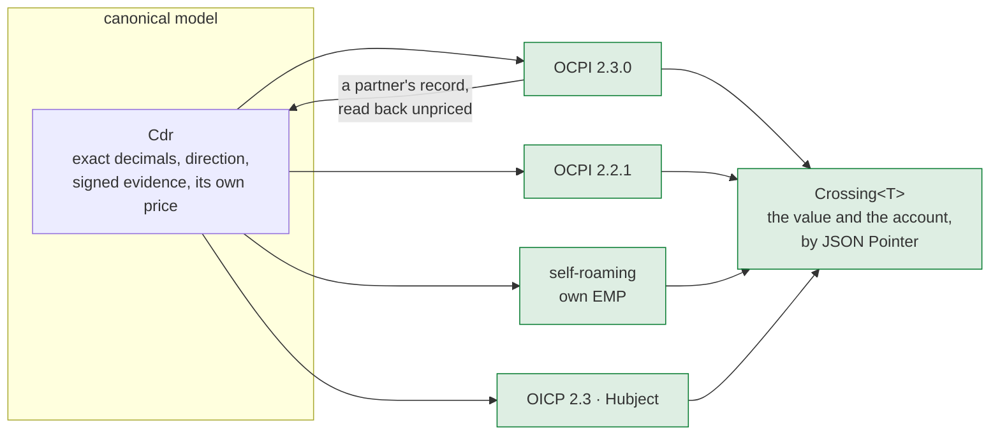

+++
title = "Roaming"
weight = 8
description = "EV roaming with OCPI 2.3.0, 2.2.1 and OICP 2.3 (Hubject) from one canonical CDR: lossy conversions reported, false ones refused, partner CDRs pre-flighted."

[extra]
state = "built"
nav = "Roaming"
+++

**Roaming** is when a driver charges at another company's charger: the charge
point operator (CPO) issues a CDR — a charge detail record — and the driver's
e-mobility service provider (eMSP) pays it. The two companies must agree on a
number neither can re-measure. `emob-roam` keeps one canonical `Cdr` and
translates it to each wire — [OCPI](https://evroaming.org/) 2.3.0 and 2.2.1 in
both directions (via `ocpi-kit` 0.5), OICP 2.3 to Hubject (via `oicp-kit` 0.1) —
and every translation states what it lost.

## One canonical CDR, every roaming protocol native

Most stacks pick one protocol version as the internal model and convert at the
edges; a partner on another version then silently gets a narrower record. In emob
the canonical model is emob's own, and each wire is a translation *out of* it
with its cost written down:



A session between an operator's own CPO and
its own EMP (self-roaming) takes the same path as a stranger's, so adding a
partner changes only the transport.

## Every conversion returns a Crossing

A hand-written `From` impl makes each lossy decision silently. Instead every
translation returns a `Crossing`: the value plus notes on what reaching this
partner cost, each with a JSON Pointer into the document the partner reads.

```rust
use emob_roam::ocpi::cdr::for_partner;

let crossing = for_partner(&cdr, &partner, &context)?;   // 2.3.0 or 2.2.1, per partner

for reason in crossing.reasons() {
    eprintln!("{reason}");
    // /total_time: 1200 s is 0.3333 h rounded to 4 places: an hour has 3600
    //              seconds and 3600 has two factors of three, so most durations
    //              have no exact decimal in hours. The cost beside it was
    //              computed from whole seconds, so re-deriving it from this
    //              figure will not reproduce it
}
```

- **`for_partner` writes the version the registry records.** A `Partner` carries
  the OCPI version the peer speaks; `for_partner` applies every refusal, then
  writes 2.3.0 or downgrades to 2.2.1, and returns a value naming which. (Use
  `emob_roam::ocpi::cdr::to_ocpi` for 2.3.0 directly.)
- **The rating's own notes cross too.** OCPI states a quantity and a cost per
  dimension with nothing between them, so `total_energy: 30` beside a cost for
  20 kWh (a free first tier, a night-only price, a `step_size`) does not multiply
  out. The notes that are terms of the price — the same ones `emob-billing` prints
  on the invoice — cross as `Crossing` notes on that dimension's total. Faults in
  the operator's own tariff stay with the operator.
- **Hours rarely terminate.** OCPI carries `total_time` and each period's `TIME`
  and `PARKING_TIME` in hours. Since `3600 = 2⁴ · 3² · 5²`, a duration has an
  exact decimal in hours only when nine divides its seconds: 21 minutes is `0.35`,
  20 and 22 minutes are not. The money was computed from whole seconds, so a
  partner re-deriving it from the rounded hours gets something else — and the
  note says so.

## Conversions that would be false are refused

A note explains a number that is approximately right. Where the number would be
**wrong** in the driver's or payer's disfavour, the conversion is refused:

| Refused | Why a note would not do |
|---|---|
| A **V2G discharge** | `ENERGY_EXPORT` is Session-only and `total_energy` has no sign, so a partner would read a discharge as a draw and settle backwards |
| An **unrated** record | `total_cost` is required and `0.00` means *free of charge* — sending zero settles the question in the partner's favour |
| A tariff element with an **unevaluable restriction** | dropping a condition *widens* the element, so the partner's re-rating disagrees with ours against the driver |
| A **gross price bound** on a tariff mixing VAT rates | `min_price`/`max_price` must state a pre-tax figure. With one rate it is converted; with no rate the figures coincide; with *different* rates no pre-tax figure exists, and inventing one is the failure |
| A restriction that **does not fit** its OCPI field | OCPI's local time/date types are narrower; dropped, the element widens; defaulted, it *moves* (a start time falling back to midnight turns a night tariff into an all-day one) |

One thing is stated rather than refused: OCPI evaluates time restrictions in the
charge point's local time and carries the zone on the **Location** (`time_zone`,
IANA, mandatory), not on the Tariff. The tariff crossing names the tariff's zone
by JSON Pointer; every Location it applies at must publish the same one.

This is the outward face of the [rating engine](@/docs/pricing.md)'s rule that a
condition it cannot judge never matches. The [OCPP seam](@/docs/ocpp.md) and the
[national access point feed](@/docs/locations.md) return the same `Crossing`
type and draw the line in the same place: **a loss in the driver's disfavour that
the document does not show is a refusal.**

## OCPI PARKING_TIME has two definitions

`[OCPI 2.3.0]` uses the words twice for two quantities:

- The `ChargingPeriod` **dimension** `PARKING_TIME` was corrected by an erratum
  to *"time during which the **vehicle is not requesting power**"*, because the
  old reading exposed drivers to loitering fees while the EVSE withheld power.
- The CDR **field** `total_parking_time` was not corrected: it is still time when
  *"no energy was transferred between EVSE and EV"*.

They differ by exactly the time the charge point withheld power, so neither can
be derived from the other. The crossing takes the dimension from
`Dimension::pricing` and the field from `Activity::transfers_energy`. A withheld
period crosses with its energy and **no time dimension**, its seconds still in
`total_time`; read back, such a period is read as withheld, which costs the driver
nothing on a re-rating.

## Reading a partner's CDR back

`emob_roam::from_ocpi` reads a partner's OCPI CDR into the canonical model. The
round trip holds — same key, window, periods and energy — but the directions are
not mirror images:

| Canonical | OCPI | Coming back |
|---|---|---|
| a period's `end` | a start and no end | the next period's start; the last from `end_date_time` |
| `activity` | the period's dimensions | `TIME` = charging, `PARKING_TIME` = vehicle not asking `[OCPI 2.3.0 §mod_cdrs_chargingperiod_class]`. **Both** is reported (the fallback reads a taper as occupancy); **neither** with no energy is read as withheld |
| `provenance` | nothing | interpolated, for every period — unstated provenance is not *measured* |
| `auth_path` | three values for six paths | narrowed by the token type, noted where it cannot be |
| `cost` | totals, no unit prices | **not** rebuilt |
| `supersedes` | nothing on the replacement | `None` — pairing is the receiving ledger's job, from the Credit CDR it saw first |

The record comes back **unpriced** because rebuilding unit prices from totals
means inventing the numbers that make it add up. The partner's own figure comes
back beside it, and an eMSP re-rates with its own tariff and compares. Signed
payloads come back for the [Eichrecht chain](@/docs/eichrecht.md) to verify
against **this side's** meter registry; the verified result is passed into the
conversion.

### Re-rating a partner's CDR with your own tariff

`Cdr::rerated_with` prices a partner's record with this side's tariff and applies
every gate the issuing side applies — which `rate(&retail, &cdr.chargeable()?)`
skips: a chain that did not verify against this side's registry, a tariff not in
force when the session ran, a version the meter says was superseded mid-session,
a duration the signed records do not vouch for, and the clock resolution under a
per-minute fee. Without the first gate, a forged session would be priced at the
retail tariff and invoiced to a driver.

`crates/emob-roam/tests/the_other_hat.rs` runs the whole EMP half: a partner's
OCPI document, verified against this side's registry, re-rated, invoiced to a
driver, and the books balanced.

### Corrections: Credit CDR, then a new CDR

OCPI never amends a CDR. It reverses one with a **Credit CDR** — `credit = true`,
`credit_reference_id` naming the original, only `total_cost` negated — then sends
*"a new CDR with a new unique ID"*. `to_ocpi_credit` writes the first; `to_ocpi`
writes the second from the superseding record. Inbound, a Credit CDR is refused
by name: it repeats the original's kilowatt-hours with negated money, and read as
a session it would enter the ledger twice.

## Checking a partner's invoice against your CDRs

`[OCPI 2.3.0 §mod_invoice_reconciliation_module]` adds a small record: an invoice
identifier and the CDR ids that invoice covers. `emob_roam::ocpi::reconciliation::check`
reads it against this side's `CdrLedger`, where every record carries its own
rating, so the sum is exact. It returns four separate answers:

- an id nobody here holds — a **transport** question;
- an id this side has since corrected (superseded) — a **settlement** question,
  reported beside the replacing record;
- an id held but **unrated** — a partner's record priced by nobody;
- a **second currency** — a total that cannot be compared with one invoice amount.

## OCPI credentials: a node you can register with

> *The Credentials module is symmetric and has to be implemented by all OCPI
> implementations.* `[OCPI 2.3.0 §credentials]`

The `roamd` library implements the receiving side — `versions`, `credentials`
and the CDRs receiver — and its tests run the handshake through `ocpi-kit`'s
client, reading every URL from this node's own version-details document. Four
rules:

- **Reach back before answering.** A `POST credentials` is not answered until
  this node has read the client's versions *with the token it was just handed*,
  replying `3001` if it cannot.
- **Journal before replying.** A registration is a fact, so it is persisted
  before the peer is told; otherwise a restart answers `401` to every onboarded
  partner.
- **The principal comes from the credential**, never from the pushed document.
- **One computation** yields the served path, the advertised URL and the
  returned `Location`, so they cannot disagree.

The estate advertises its operator as CPO and its provider as eMSP. An authenticated credentials GET returns the caller’s own token and the estate’s versions URL. A registered peer rotates with PUT. Repeating POST after registration, or sending PUT or DELETE before registration, returns HTTP 405.

For inbound charge records, list the CPOs a platform may represent in its estate entry, for example `cdr_owners = ["NL*TNM", "BE*ALT"]`. The receiver checks those grants against the business roles exchanged in Credentials. Follow the returned `Location` to reopen the original. Two CPOs may use the same local ID. Exact retries return the same receipt, and a removed role loses access on the next read. [OCPI specifications](https://evroaming.org/ocpi-downloads/)

Registering is what makes a partner reachable: the handshake keeps the endpoints
it reads from the peer, and the outbound client holds no separate peer list.
The `roamd` daemon mounts these endpoints at `/ocpi` ✅. Partners and their
Token A come from the estate, and each CDR `csmsd` delivers is consigned to the
contract's issuer with the station's location and the verbatim OCMF records,
then pushed. During registration a partner names a URL `roamd` will call back;
a **reach-back guard** admits only `https`, and `http` or private, loopback and
link-local addresses only for hosts the estate allows, so a registering partner
cannot aim the node at an internal service. ⏳ OICP transport to Hubject is not
wired. See [Run the estate](@/docs/run-the-estate.md).

The testing rule for inbound formats: a document you **receive** needs a test
that starts from a string, not from a Rust value — otherwise a serialisation
setting elsewhere in the workspace can break every inbound document while the
suite stays green.

## Routing by contract identifier

A contract identifier (eMAID) names its issuer in its first five characters —
the party holding the driver and paying the bill. emob routes on that prefix. OCPI
warns that a party id need not match a contract's issuer, so an explicit issuer
list (`Partner::issuing`) overrides the prefix — useful after an acquisition.
`PartnerRegistry::route` does the lookup.
The check digit is verified at that edge: a mistyped identifier still parses and
routes, and would bill somebody else's contract.

## Pre-flighting an inbound OCPI CDR

Before conversion has a chance to repair anything, `emob_roam::preflight` asks
OCPI's own questions of the document as it **arrived**:

```rust
use emob_roam::{SignedDataPolicy, preflight};

let report = preflight(&arrived, SignedDataPolicy::Required);
if !report.is_settleable() {
    for reason in report.reasons() { eprintln!("blocked: {reason}"); }
}
```

It checks that periods sum to the stated totals, durations agree with
timestamps, cost parts add to the whole, periods are in order (OCPI periods have
no end, so out of order every derived duration is wrong) and the contract
identifier passes its check digit. Findings are **blocking** or **warning** —
settlement is a business decision — but a warning never carries a *quantity* out
of the check: `ENERGY_IMPORT` is read alongside `ENERGY`, so a partner using the
wrong dimension name cannot make its energy invisible to the sum.

The pre-flight verifies no signatures. It hands back the signed records and the
key the document **claims**; the Eichrecht chain checks them against the registry
this side holds. A matching claimed key narrows a dispute to the numbers; a
different one points to a meter swapped without the registry being told.

## The roamd ledger: who was sent what

`roamd` (library) holds what no document can: a **ledger of what was sent to
whom**.

- **An accepted CDR is sealed.** `[OCPI 2.3.0 §mod_cdrs]`: *"it cannot be changed
  or replaced once sent to the eMSP… Instead, a Credit CDR can be sent."*
  Re-consigning one is refused by name, and an acceptance is terminal — a later
  `refused` cannot reopen it.
- **A reversal is owed only where there is something to reverse.** A record the
  partner refused needs no Credit CDR before its replacement.
- **Lateness is per partner.** The same paragraph allows any agreed cadence
  (*"once a month, that is also allowed"*), so `Roamd::unsettled` judges each
  record against *that partner's* settlement window.

An inbound record is checked in order — authorisation, the document
(`preflight`), the conversion (`from_ocpi`) and the record (`emob_cdr::validate`)
— and `Roamd::receive` returns one of six verdicts:

| Verdict | Means | What the sender does |
|---|---|---|
| `Unauthorised` | this credential may not push this record (decided before the document is read) | nothing it can retry |
| `Accepted` | the document holds up and the record is new | nothing; it is settled |
| `Disputed` | the document is fine; the claim does not hold here | talks to you |
| `Duplicate` | already held, unchanged | nothing; the retry was harmless |
| `Conflicted` | already held, and this one differs | a human answers |
| `Rejected` | it fails OCPI's own checks | fixes it and re-sends |

A disputed record is deliberately kept out of the ledger: it has not been
settled.

## OICP 2.3 via Hubject: the CDR carries no money

OICP is hub-and-spoke: every partner talks only to Hubject, over mutual TLS. The
translation barely changes, except for one fact: **an OICP charge detail record
has no cost field** — no `total_cost`, no price, no breakdown. It carries the
session's four timestamps, register readings, `ConsumedEnergy`, identification,
signed meter values and a `PartnerProductID`; the amount is settled against a
pricing product agreed out of band.

```rust
use emob_roam::oicp::cdr::{check_conserves, to_oicp};

let crossing = to_oicp(&cdr, &partner, &context)?;
assert_eq!(check_conserves(&crossing.value)?, kwh("18.000"));
// the €8.82 did not cross, and the account says so on every record:
// "/PartnerProductID: this record priced at 8.82 EUR on the issuing side and
//  OICP carries no cost field of any kind…"
```

The price travels separately as a `PricingProductDataRecord`
(`emob_roam::oicp::pricing::to_oicp_product`), which has **one** base price per
reference unit, a few named extras, no tiers and no tax. An energy price beside a
charging-time price, or a kWh tier, cannot be expressed and is refused by name.

Differences from OCPI:

- **Discharge** is refused on both: `ConsumedEnergy` has no sign.
- **AutoCharge** is a note on OCPI (whose `AUTH_REQUEST` names neither it nor
  Plug & Charge) but a refusal on OICP, whose `PlugAndChargeIdentification`
  *names* ISO 15118 and would assert a contract certificate that was never
  presented.
- OICP has **four timestamps** to OCPI's two, so the minutes a car sits connected
  before charging begins are stated rather than inferred.

## What is tested end to end

- One genuinely signed session settles at the **same money** over self-roaming,
  OCPI 2.3.0 and OCPI 2.2.1, the signed records arriving verbatim and
  re-verifying against the receiver's registry.
- The same session goes out over OICP to `oicp-kit`'s `MockHubject` — an
  in-process broker that validates records like the live one — with energy and
  evidence intact.
- The tariff reads identically to the partner, the driver at the charge point and
  the national access point — see
  [Tariffs](@/docs/pricing.md#one-tariff-three-audiences-ocpp-ocpi-datex-ii).

**Related:** [Sessions and settlement](@/docs/settlement.md) ·
[Tariffs](@/docs/pricing.md) · [Eichrecht](@/docs/eichrecht.md) ·
[Glossary](@/docs/glossary.md)
