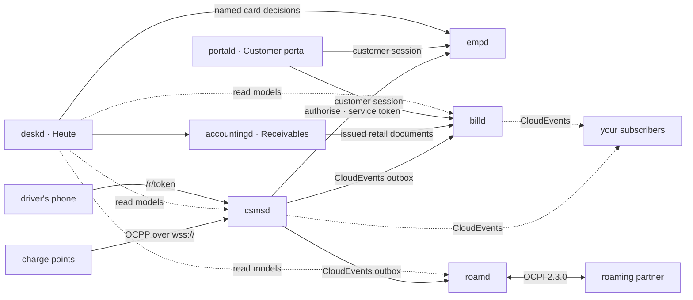

+++
title = "Run the estate"
weight = 2
description = "Run the emob EV charging estate: just demo, one estate.toml, OCPP TLS, signed journal heads, a witness, Heute, the OCMF receipt and the XRechnung invoice page."

[extra]
nav = "Run the estate"
+++

The standalone demo starts seven services, three simulated charging stations and a loopback OCPI peer. Its seeded morning includes a signed meter record that billing refuses. You can investigate that refusal with the same operator desk and receipt pages used on a persistent estate. Use `just run` to run all eleven services from one estate file.

## Try it: `just demo`

```console
just doctor      # what is missing, and the command that installs it
just demo        # the estate on loopback: Heute, a receipt and the partner's inbox
```

`just demo` mints throwaway TLS certificates on first use (`just dev-ca`) and
runs `emob demo`. It generates an estate for *Stadtwerke Musterstadt
eMobility* — one site, three stations on OCPP 1.6, 2.0.1 and 2.1 connecting
over `wss://` with security profile 2, each with a simulated calibrated meter
signing genuine OCMF — registers an OCPI partner, and plays a morning at 60×:
seven sessions billed, one signed value tampered with and refused with its
paragraph, one blocked card, and the month's invoice. Within a minute it prints
its links:

| Link | What it opens |
|---|---|
| Heute | the operator page, already signed in |
| Receipt | what a driver's phone opens for one session |
| Inbox | the CDRs the roaming partner received over OCPI |
| Invoice | after month end: the partner's invoice page, with its XRechnung files |

`CP-3` (OCPP 2.1) is opted in to show each receipt link on its own display for
10 minutes, and the demo says so when it does. At the end the witness line
reports every journal's signed head:
`🔏 witness: csmsd ✓ N · billd ✓ N · roamd ✓ N · empd ✓ N`.

It runs until Ctrl-C. Everything binds to loopback, and every token, key and
password is minted for the run and gone with it; the journals live in a scratch
directory removed on exit.

| Flag | Meaning |
|---|---|
| `--seed N` | the meters and energies (default 2026): the same seed gives the same CDR keys and invoice number |
| `--clock RFC3339` | the simulated start instant |
| `--speed N\|max` | how fast the simulated clock runs (default 60×) |
| `--check` | play the story at full speed and assert every outcome; exits `1` naming the first that differs |
| `--listen IP` | a loopback address only; anything else is refused with exit `64` |

CI runs `cargo run -q -p emob-cli -- demo --check` on every push, so the demo
is also the end-to-end test. Beyond the sessions, the check fetches the invoice
page and validates both of its files with `en16931`, asserts that `CP-3`
received each of its receipt links and `CP-1`/`CP-2` none, fails if a head is
not witnessed or a journal record names no actor, and scans every log line for
a token, key, password, card UID or receipt token. `emob demo` starts each daemon through the same
`daemon::run` function its own `main` calls — configured, not forked — so the
demo exercises the code you deploy.

### Investigate a refused session

1. Open **Heute** from the demo output. In the refused row, select the transaction. **Vorgangsnachweis** shows the station, the billing decision and the observations the station supplied. Select English on Heute before opening the row to read the English view.
2. Follow the station link to its asset card or open the driver's receipt. A session with missing messages shows the gap. A station may decline a card before a session exists.
3. Open the card action to see the provider's current card status. To look up the sample separately, use the private lookup form and choose the printed card number `MOB-1001`. The result shows the same emob reference. A current block and a historical billing refusal answer different questions.

4. For a transaction someone reported by phone, search its exact reference. When several stations have used it, choose by station and decision time.

<figure class="shot">
<picture><source media="(prefers-color-scheme: dark)" srcset="../../img/session-evidence-dark.webp"></picture>
<figcaption>The station supplies the transaction times. The CSMS records when it makes the billing decision.</figcaption>
</figure>

The timeline and search work with JavaScript disabled. Printing the timeline preserves the station, decision and recorded times. A station's evidence stays readable if the operator later retires it.

### Block a lost card and reverse the decision

1. Sign in with a named operator whose estate entry grants `write = true`. Open the exact card from the investigation or search for the example printed number `MOB-1001` and open its result. A read-only operator can see its state and recent history.
2. Select **Reported lost** and choose **Review block**. Check the card label, reason, expiry and effect. Going back leaves the card as it was.
3. Choose **Confirm block**. The provider records the reason, operator and time. The next online authorization for that card is refused. Offline stations may still accept a cached authorization, and a charge already in progress continues.
4. When the card is found, select **Card recovered**, review and confirm the unblock. The provider resumes checking contract standing and credit on the next request. The card history shows the ten most recent actions, newest first. If confirmation times out, reopen history and match the operation reference before trying again.

<figure class="shot">
<picture><source media="(prefers-color-scheme: dark)" srcset="../../img/card-review-dark.webp"></picture>
<figcaption>The provider applies the change only after confirmation.</figcaption>
</figure>

### Enrol a driver and issue a card

1. In **Heute**, open **Driver contracts** with the example writer. Choose the private or fleet billing account, select the **standard** offer at the demo point and enter the sleeve code `STOCK-1004`. Use a different stock code for each additional driver under the same payer.
2. Select **Review contract**. Check the charging point, provider, gross component prices, monthly fee, validity and offer reference. The card is still unissued at this stage.
3. Select **Confirm enrolment**. Keep the agreement reference from the receipt. It reopens the original terms, eMAID, masked card label and issuing operator. If the provider’s reply is lost, use the same operation or reopen the agreement.
4. The new card can now start an online charge at the selected point while that offer remains current. A different point or a withdrawn offer refuses the card. Open its agreement to review and confirm a replacement card or termination. Replacing preserves the eMAID and payer. Ending retires the active card. A read-only operator can use **Open agreement**.

The agreement receipt documents card issuance and the agreed price. The driver's charging receipt reports the station-side meter and price evidence. To replay the issuance and charge using simulated equipment, run `just e2e`. To provision your own unissued card, add a unique uppercase inventory code and its hexadecimal RFID UID to `[[card_stock]]`. Protect the estate file containing those identifiers.

<figure class="shot">
<picture><source media="(prefers-color-scheme: dark)" srcset="../../img/enrolment-review-dark.webp"></picture>
<figcaption>The price reference identifies the exact offer staff reviewed.</figcaption>
</figure>

### Close a driver or fleet billing month

1. Open **Retail invoices**, select the billing account and a completed UTC calendar month, then choose **Review charges**. Each session shows its agreement, source record, offer and retail amount. The issuer re-prices verified usage at the agreed rate.
2. Check net, VAT, rounding and payable. Each agreement with a full month of coverage contributes its agreed monthly fee once. A positive fee with unspecified partial-month pricing holds the close. Resolve any listed holds before issuing.
3. A writer selects **Issue invoice**. Staff can use **Open issued invoice** to inspect the closed month. A named operator with `finance = true` can download the original UBL, including after a restart. If late usage changes a closed month, review again before issuing the credit and replacement.

Configure the provider in `[billing.retail_seller]` and each bill-to party in `[[retail_accounts]]`. The native workflow supports domestic German EUR invoices. A staff download records neither delivery to the customer nor consent to electronic delivery.

## Without Rust: the `emob` image

On a machine without `cargo`, `just demo` runs the released
`ghcr.io/hupe1980/emob` image instead, on the host's network (the demo binds
loopback only, and the links it prints are the host's) and as your user, with
the TLS directory from `just dev-ca` mounted read-only:

```console
mkdir -p -m 700 "$PWD/target/demo-tmp"
docker run --rm -it --network host --user "$(id -u):$(id -g)" \
  -e TMPDIR="$PWD/target/demo-tmp" -v "$PWD/target/demo-tmp:$PWD/target/demo-tmp" \
  -v "$PWD/target/dev-tls:/tls:ro" ghcr.io/hupe1980/emob demo --tls /tls
```

On Docker Desktop, `--network host` needs host networking
enabled (Settings → Resources → Network).

### Accessibility: `just a11y`

`just a11y` starts the demo like `just screenshots` and checks every page a
person reads — Heute, the receipt billed, refused and after *Selbst prüfen*, and
the invoice page — in light and dark at 320 and 1280 px, through Chrome's own
accessibility tree and computed styles (no npm packages). It checks `lang`, one
`h1` and ordered headings, named controls, alt text, banner and main landmarks,
a visible focus on every Tab stop, text contrast (4.5:1, 3:1 for large text),
24×24 px targets and no sideways scroll at 320 px. Without Node or Chrome it
says so and skips; in CI, where it runs after the demo check, a missing tool
fails it.

## Allocate a payment

In `just demo`, open **Receivables** from Heute, enter `PAYER-PRIVATE` and choose EUR. The invoice comes from the same simulated charge the driver sees in the customer portal. The demo includes a EUR 5.00 payment with source `LOCAL-BANK` and reference `DEMO-PAYMENT`.

1. Open the account. Read the amount outstanding and the unapplied cash.
2. Select the payment and the issued invoice. Enter `1.00` and choose **Review allocation**. The review shows the remaining invoice amount and the payment left after allocation.
3. Confirm and reopen the balance. The remaining cash is EUR 4.00. The allocation names the operator who confirmed it.

<picture><source media="(prefers-color-scheme: dark)" srcset="../../img/payment-review-dark.webp"></picture>

To import another payment, open **Receivables**, choose the [sample statement](../../examples/payment-statement-v1.json) or another local version 1 JSON file and select **Import file**. The report counts booked and duplicate rows and explains held entries. For a persistent estate enable a named `[[operators]]` entry with `finance = true` and a distinct `token_env`. For an existing estate starting its first accounting journal, add fresh 32-byte base64 `ACCOUNTINGD_DATA_KEY` and `ACCOUNTINGD_SIGNING_KEY` values to its private environment. A restored journal requires its original keys. The operator’s ordinary write permission is independent. [Statement format](@/docs/settlement.md#local-statement-import)

## Credit one invoice line

1. Sign in to Heute with both `finance = true` and `write = true`. Open **Retail invoices** and the line credit form. In `just demo`, use the fleet invoice and agreement printed together in the terminal.
2. Select the original line and reason, enter the **net** credit amount and review. Check the VAT, gross credit and net amount still available on that line. **Confirm and issue credit** creates a separate numbered UBL document.
3. Open the account balance to reconcile the credit with cash already applied. The authorized payer can download both documents and select **View invoice balance** in the customer portal. A credit exceeding the unpaid amount leaves a credit balance.

<picture><source media="(prefers-color-scheme: dark)" srcset="../../img/line-credit-review-dark.webp"></picture>

If the requested split cannot reconcile the original VAT to the cent, return to the source line and review the amount. Once a line credit has been issued, billing holds whole-invoice cancellation and automatic month replacement to prevent a second credit for the same charge.

## Apply an invoice credit

Sign in to Heute with finance and write access. Open **Receivables** and select the payer and currency. When an invoice has available credit and another has unpaid debt, select **Invoice with available credit** and **Invoice to pay**, enter the amount, then choose **Review credit offset**. You can type an invoice number from another page. Check both resulting amounts and choose **Confirm credit offset**.

If a colleague posts first, review the new figures before submitting again. A lost confirmation response can be retried with the same review. The account history identifies the writer and both invoices. The customer portal shows the credit used or received on the selected invoice. [Reconciliation example](@/docs/settlement.md#apply-credit-across-invoices)

## Erase customer portal access

1. In Heute, sign in with a named operator whose estate entry has `privacy = true`. Select **Customer erasure** and enter the customer’s sign-in ID. In the disposable demo, use **mika**.
2. Review the agreement and payer grant counts and the retained records. **Permanently erase portal access** ends the customer’s sessions and destroys the key for those links. Open the same sign-in ID again for the dated receipt.
3. Remove the obsolete `[[portal_users]]` entry and its credential from your identity configuration. Review any separate requests concerning the agreement, charging evidence or finance records. The card can still charge under an active agreement.

<picture><source media="(prefers-color-scheme: dark)" srcset="../../img/erasure-review-dark.webp"></picture>

For recovery, stop the provider, restore the journal and signed head, and mount the **current** `EMPD_CUSTODY_DIR`. Its native default is `custody/empd`. Compose mounts a separate volume. Protect this directory independently of journal backups. Rolling back both stores together can restore retired keys. Include earlier snapshots, replicas and exports when defining your key retirement procedure.

## Review a withdrawal

1. Copy the private driver’s agreement reference from their contract receipt. In the demo, sign in as **mika** to find it under **Charging agreements**. In Heute, open **Driver contracts → Manage a withdrawal** and enter the reference.
2. Record when the declaration arrived (UTC), its channel and your intake reference. Review the archived terms and the case file. A hold keeps the existing entitlement. Approving the withdrawal blocks the current card on its next online authorization. The driver sees the status on their agreement.
3. If the invoice needs review, select that billing disposition. Open the case with a named operator who has both `write` and `finance` grants. Enter the issued invoice number to inspect its billed lines and payment allocations. Review the amount and original number, then confirm a full credit only when justified. For a shared invoice, [review the attributable line](#credit-one-invoice-line).

<picture><source media="(prefers-color-scheme: dark)" srcset="../../img/withdrawal-review-dark.webp"></picture>

A held case can be reviewed again. Approval or decline closes the case. For each agreement the owner retains a single case and its confirmed decisions.

A confirmed credit appears in the payer’s archive. Its billing reference points to the original invoice. Allocated cash stays recorded and can leave the payer with a credit balance. A bank refund is a separate operation.

## Customer portal

Open the portal URL printed by `just demo`. Sign in as **mika** using the access key in the local file named beside the URL. The overview shows the agreed price, the receipt for a simulated charge and the issued monthly invoice. Download the UBL to get the original XML.

<picture><source media="(prefers-color-scheme: dark)" srcset="../../img/customer-overview-dark.webp"></picture>

For a persistent estate, set `[portal].public_url` to the browser origin. Use a dedicated HTTPS hostname outside loopback. Enable a `[[portal_users]]` entry and set its `secret_env` variable in the provider environment to 32 random bytes encoded as 64 hex characters. For the Compose example with an existing private `.env`, append the new key once with `printf 'EMOB_PORTAL_MIKA=%s\n' "$(openssl rand -hex 32)" >> .env`. Reload the provider and deliver the key privately to the customer.

In Heute, open **Customer access** with a named writer account. Enter the sign-in ID, select an agreement for charging receipts or a payer account for invoices, then review and confirm. A private customer may need both grants. Fleet drivers can each receive their own agreement while finance receives the account. Removing a grant applies to the next request, including downloads from an open browser tab. The provider expires sessions after 30 idle minutes or eight hours and ends them on restart.

## What runs: eleven daemons

| Daemon | Role | Loopback | Compose |
|---|---|---|---|
| `csmsd` | the CSMS stations connect to; settles sessions; serves receipts | OCPP `:9000`, shell `:9001` | `:9000`, `:8080` |
| `roamd` | the OCPI roaming node | `:9583` | `:8081` |
| `billd` | receives CDRs, closes each partner's month into an EN 16931 invoice | `:9584` | `:8082` |
| `empd` | the provider: contracts, tokens, authorisation | `:9585` | `:8083` |
| `poid` | the charge point inventory for the national access point | `:9582` | `:8084` |
| `tarifd` | publishes the estate's tariffs | `:9581` | `:8085` |
| `agentd` | advisory specialists; cannot move money | `:9580` | `:8086` |
| `sited` | the § 14a site controller | `:9586` | `:8087` |
| `deskd` | the operator page Heute; the witness | `:9587` | `:8088` |
| `accountingd` | retail receivables and payment allocation | `:9591` | `:8090` |
| `portald` | customer sign-in, charging agreements, receipts and invoice downloads | `:9589` | `:8089` |



`csmsd` asks `empd` about every `Authorize` and every transaction start; a
timeout or an unreachable `empd` answers `Invalid` — it fails closed. Each
settled session with a provider is delivered to `billd` and `roamd` as a
`de.emob.cdr.issued` CloudEvent signed per Standard Webhooks, retried until
acknowledged and recorded in `csmsd`'s journal, so a restart loses nothing. `csmsd`, `billd` and `roamd` expose bounded operator views at
`GET /v1/<daemon>/today`. The six journal owners (`csmsd`, `billd`, `roamd`,
`empd`, `poid` and `accountingd`) also serve their
signed head at `GET /v1/<daemon>/head`.

## The estate file

Every daemon reads its own sections of one `estate.toml` (`EMOB_ESTATE`,
default `./estate.toml`). `deploy/estate.example.toml` is the loopback demo
estate, `deploy/estate.compose.toml` the compose one. A daemon refuses to start
on a key it cannot parse or a variable that is unset, naming it — and `emob
check` finds the same mistakes before any daemon reads the file:

```console
emob check estate.toml             # every section, then each daemon's own checks
emob check --secrets estate.toml   # …and every *_env variable is set (named, never printed)
```

A mistake is reported the way `rustc` reports one — the file, the line, the
key underlined, and what would be valid (`= help: did you mean `evse`?`). The
estate's JSON Schema is published at
[`schemas/estate.schema.json`](https://hupe1980.github.io/emob/schemas/estate.schema.json);
`#:schema ../schemas/estate.schema.json` on the first line lets Taplo or Tombi
complete keys, show what each means and flag a typo as you type.

| Section | Read by | Holds |
|---|---|---|
| `[parties]` | all | the operator (CPO) and provider (eMSP) party ids |
| `[[stations]]` | `csmsd`, `poid`, `roamd` | identity, OCPP version, `security_profile`, `password_hash`, EVSE id, power, tariff, location; optional `receipt_display_minutes` and `commissioned` (`YYYY-MM-DD`, the station page shows its age) |
| `[[meter_keys]]` | `csmsd` | each meter's public key and where it came from — never the key a station sends itself |
| `[[tariffs]]` | `csmsd`, `tarifd` | the tariff that rates and the one that is published, built by one function |
| `[[partners]]`, `[billing]` | `billd`, `roamd` | roaming partners, their Token A, billing address, invoice `specification`, `buyer_reference` and `mandate`; the invoice series, seller, `iban`, `creditor_id`, `contact`, `public_url` and `[billing.delivery]` |
| `[[contracts]]` | `empd` | contracts and their tokens, seeded once |
| `[[card_stock]]` | `empd` | unissued RFID inventory. Enrolling one creates the agreement and activates the card together. |
| `[[operators]]` | all | named accounts that may read the desk. Set `write = true` to grant card and station actions. Every resulting operator fact records the account name |
| `[csms]` | `csmsd` | TLS certificate, key and client CA; `max_connections`, `messages_per_minute`, `idle_timeout_secs` |
| `[receipts]` | `csmsd` | `public_url`, where a driver's phone reaches the receipts |
| `[desk]` | `deskd` | the CSMS address, the dedicated read-only token variable and the page’s time zone |
| `[witness]` | `deskd` | optional `keys = { <daemon> = "<verifier key>" }`; a daemon not named is pinned at first sight |
| `[services]`, `[roaming]` | several | the daemons' addresses, the secrets' variable names, retry timing; OCPI `public_url` and `reach_back_allow` |

Secrets never go in the file. A field ending in `_env` names an environment
variable:

| Variable | Purpose |
|---|---|
| `EMOB_WEBHOOK_SECRET` | `whsec_<base64>`: signs the deliveries between daemons |
| `EMOB_SERVICE_TOKEN` | the bearer `csmsd` presents to `empd` |
| `EMOB_OPERATOR_TOKEN` | the example named writer’s password for Heute and bearer for authorized owner APIs |
| `EMOB_DESK_READ_TOKEN` | the dedicated read-only credential for background queries |
| `EMOB_PARTNER_DE_MSP_TOKEN_A` | the Token A the example partner registers with |
| `CSMSD_DATA_KEY`, `ROAMD_DATA_KEY`, `EMPD_DATA_KEY`, `BILLD_DATA_KEY` | 32 random bytes, base64: each daemon's data key |
| `CSMSD_SIGNING_KEY`, `ROAMD_SIGNING_KEY`, `EMPD_SIGNING_KEY`, `BILLD_SIGNING_KEY`, `POID_SIGNING_KEY` | 32 random bytes, base64: the Ed25519 seed that signs where each journal ends |
| the variable `[billing.delivery] secret_env` names | `whsec_<base64>`: signs each invoice `billd` hands to the operator system |
| `POID_NAP_IDENTIFIER` | the identifier the national access point issued; `poid` refuses to start without it |
| `EMOB_LOG_FORMAT` | `text` for a terminal; JSON lines otherwise |

### Data keys and sealed journals

Each daemon with a ledger rebuilds its state from an append-only, hash-chained
journal. Because a journal is the file most likely to leave the building in a
backup, a daemon never writes a credential or a card UID into it in clear: it
seals record bodies with AES-256-GCM under its own data key, and keeps tokens it
only needs to recognise as keyed digests. The hash chain runs over the sealed
bytes, so it verifies without the key.

`eval "$(just dev-keys)"` prints a fresh set of data and signing keys; `just
up` and compose require these keys. Recover each journal with its original key. The provider also needs its current customer key store. [Customer custody and recovery](#erase-customer-portal-access)

### Every fact names its actor

Every journal record carries an `actor` beside its `kind`, inside the record's
digest: who caused the fact, taken from what the daemon **authenticated** —
never from what a request says about itself. An incident report needs an
author `[NIS2 Art. 21(2)]`.

| Actor | Who |
|---|---|
| `station:<identity>` | a station, by the identity its socket authenticated as |
| `partner:<party>` | a roaming partner, by the OCPI party its credential belongs to |
| `operator:<name>` | an operator, by the estate's `[[operators]] name` — never the token |
| `service:<daemon>` | another daemon of the estate (a signed delivery or the service token) |
| `timer` | the daemon's own loop: a calendar, a drain, a retry |
| `estate` | the estate file, read at start |

The actor is outside the sealed body, so it reads without the data key:

```console
jq -r .actor "$EMOB_JOURNAL_DIR/billd.ndjson" | sort | uniq -c
```

An operator `name` is 1–64 characters of `[A-Za-z0-9*._:=+|@ -]`; a daemon
refuses to start on any other.

### Signed journal heads: a truncation is caught

A hash chain proves nothing was rewritten or removed from the middle, but not
that nothing was cut off the end — a journal missing its last record looks like
one whose process was killed mid-append. So after **every** append, each
journalled daemon (`csmsd`, `billd`, `roamd`, `empd`, `poid`, `accountingd`) signs its head —
the position and the hash there — with its Ed25519 signing key, and keeps it in
`<journal>.head`. The head is a [C2SP signed note](https://c2sp.org/signed-note),
readable with `curl` and checkable by any signed-note verifier:

```console
$ curl -H "Authorization: Bearer $EMOB_OPERATOR_TOKEN" http://127.0.0.1:9001/v1/csmsd/head
emob/csmsd
57
q1Iot…=

— emob/csmsd GrH0…==
```

The verifier key is in the `Emob-Verifier-Key` response header. At start, a
daemon **refuses** a journal shorter than its head, one that diverges at the
head's position, one more than one record past it (a crash between append and
signature leaves at most one), and one longer than one record with no head at
all — naming both positions. A head signed under another key also stops it.
After an intended reset, moving `.head` aside is the deliberate operator step.

### The witness: a copy no daemon holds

Whoever can cut a journal can delete its `.head` too, and a restore from last
week's backup brings last week's head. A **witness** keeps the copy: it reads
each head, remembers the highest position and its hash, and alarms on a head
that went **backwards** (regressed), one at the same position with another hash
(a **fork**), or one signed by another key (a **rekey**). Each observation is a
record in the witness's own chained file, so an alarm stays until somebody
moves that file aside.

`deskd` witnesses `csmsd`, `billd`, `roamd`, `empd` and the configured `accountingd` every 30 seconds into
`witness.ndjson` beside its journals (in compose, its own `deskd` volume).
Anyone else can run one from their own machine — including for `poid`, which
`deskd` does not read:

```console
EMOB_OPERATOR_TOKEN=… emob witness [--file PATH] http://127.0.0.1:9001 http://127.0.0.1:9584
```

It reads `/about` and `/v1/<name>/head`, records into `./witness.ndjson` by
default, and checks each head against the key in the estate's `[witness] keys`
or, for a daemon not named there, the key it pinned at first sight. Exit status:
`0` every head witnessed · `1` an alarm, now or on record · `2` a daemon could
not be read · `64` usage. A head that moved forward is accepted as it is: the
journal is a chain, not a Merkle tree, so a history rewritten **and** extended
past the witnessed position is out of the witness's reach.

### Logs: JSON lines with a request id

Daemons log JSON by default, with the daemon's name and version on each line;
`EMOB_LOG_FORMAT=text` switches to a human format, `RUST_LOG` filters. Each
HTTP request runs in a span with its `id`, `method`, the matched `route` and,
once admitted, the `actor`. The id is the inbound `x-request-id` when it is 1–64
characters of `[A-Za-z0-9._-]`, otherwise a fresh one, and is echoed in the
response. The span names the route, never the raw path, because `/r/{token}`
is a capability. `csmsd` puts `station:<identity>` on each OCPP call's span. No
token, secret, key, password or card UID is logged.

### Station security: profiles 1–3 and TLS

Each station names its OCPP security profile `[OCPP 2.0.1 Part 2 §A00]`:
profile 1 is HTTP Basic, profile 2 Basic over TLS, profile 3 a TLS client
certificate chained to `[csms] client_ca` whose CN is the station identity.
Passwords are stored only as Argon2id hashes; print one with:

```console
printf '%s' "$PASSWORD" | cargo run -q -p csmsd -- hash-password 2.0.1
```

`csmsd` refuses to listen on a non-loopback address without TLS, caps
connections, budgets messages per connection and closes idle ones. `just
dev-ca` mints a throwaway CA, a loopback server certificate and client
certificates into `target/dev-tls/`, which the example estate's `[csms]` names.
In that estate, `CP-1` is profile 2 with the `AuthorizationKey`
`6d6f636b2d73746174696f6e2d736563726574` (hex of `mock-station-secret`).

## The operator page: Heute

<!-- screenshot: heute-light/dark (generated by just screenshots) -->
<figure class="shot">
<picture><source media="(prefers-color-scheme: dark)" srcset="../../img/heute-dark.webp"></picture>
<figcaption>Heute from <code>just demo</code>, in German (<code>?lang=en</code> switches to English).</figcaption>
</figure>

**Heute** ("today") is what needs a person today, in order. `deskd` renders it
on the server from the read models of the daemons that made each decision; it
decides nothing, and the only thing it keeps is the witness file.

- **Charging success rate** (*Ladeerfolg*) — records settled ÷ sessions
  attempted, counted from the ledger that bills, for **today** and the **last
  7 days** in the estate's time zone, for the estate and per charge point, with
  failures by cause: authorisation, evidence, station fault, cancelled. Uptime
  says a station answered; success says a driver charged.
- **Refused sessions, with "Warum?"** — the evidence chain's typed findings,
  worded, each with the paragraph that refused the session and what would have
  made it billable.
- **Silent stations** beyond their heartbeat, **records a partner has not
  taken**, **invoices awaiting acceptance**, and the compliance calendar's
  duties for the next 90 days.
- **Journale** — for `csmsd`, `billd`, `roamd` and `empd`: the last witnessed
  position, when, and where the key came from (*Schlüssel aus dem Estate* or
  *beim ersten Mal gemerkt*, pinned at first sight). A regression, fork or rekey
  is a red row naming both positions; it stays until the witness file is moved
  aside, and while it stands the page does not say that nothing needs you.

### Onboarding stations

Stations live in `csmsd`'s **registry**, a journalled record of who may
connect and as what. The estate's `[[stations]]` seed it on first start;
after that the registry rules, and a station is added, changed or retired
without a restart:

- **Heute → Stationen** searches every station — identity, EVSE id, vendor,
  model, serial, firmware, state, mobile network — in pages, at ten thousand
  stations as at three. Above the list, a **map** of what the search found:
  a dot per station, coloured by state, or — above 300 — circles per area,
  each opening the search narrowed to that area. It is drawn by `deskd` over a
  bundled Natural Earth outline: no tiles, no script, nothing fetched from a
  third party. **+ Station hinzufügen** is one form; its answer is an **installer
  sheet**: the CSMS address (`[desk] ocpp_url`), the identity, the security
  profile and the password, minted for this station and shown **only now**
  (the registry keeps its Argon2id hash). The station can connect at once.
- On a station's page, **Verwalten** changes its tariff, power or location,
  mints a new password (a new sheet) or retires the station — its next
  connection is refused; its history stays. Each asks why, and every change is
  journalled under the operator's name.
- **Notizen** on a station's page hold what the next person needs — access,
  keys, quirks — under the name of whoever wrote them; the newest one shows on
  Heute when the station goes silent, and the search finds stations by them.
- **Reservierung** holds a point for one card, 5 minutes to a day, once the
  provider accepts the card and the station `ReserveNow`. Only that card
  charges there meanwhile, whatever the station's firmware does; the price
  page says until when, never for whom. It ends when the card starts, when
  cancelled, or on time.
- The **Standort** card draws where the station is, and says so when the
  coordinates lie outside the country it is registered in — or when latitude
  and longitude look swapped — with a link to fix them. Every map a driver
  uses shows that point.
- The same through the API, with an operator token:

```console
curl -H "Authorization: Bearer $EMOB_OPERATOR_TOKEN" "http://127.0.0.1:9001/v1/csmsd/stations?q=1.3.1"
curl -X POST -H "Authorization: Bearer $EMOB_OPERATOR_TOKEN" -H 'content-type: application/json' \
     -d @station.json http://127.0.0.1:9001/v1/csmsd/stations       # → {"identity":…, "password":…} once
```

`POST /v1/csmsd/stations/{identity}/password` and `…/retire` take
`{"reason": "…"}`; `PUT /v1/csmsd/stations/{identity}` replaces a record
(`{"station": …, "reason": …}`). A refusal is `422` naming the field.
`POST /v1/csmsd/stations/{identity}/notes` takes `{"text": "…"}` (1–500
characters) and `…/notes/{number}/remove` takes it off again.
`POST /v1/csmsd/stations/{identity}/reservations` takes `{"uid", "minutes",
"reason"}` and answers `{number, until}`; `…/reservations/{number}/cancel`
ends it.
`GET /v1/csmsd/map?q=&area=` answers the map of a search: `points` up to 300,
else `cells` of a 16 × 16 grid; `area=west,south,east,north` narrows the
search and the map alike.

### When stations go silent together

Most stations reach the CSMS over a mobile network. `csmsd` keeps the network
a station reports at boot — the IMSI's country and network code, `262 01`,
never the IMSI — so Heute's **Stationen ohne Lebenszeichen** opens with the
silent stations per network: *Telekom Deutschland 12 von 40 still*. When every
silent station is on one network, it says that is more likely an outage than
a fault — one call to the carrier, not twelve site visits.

<figure class="shot">
<picture><source media="(prefers-color-scheme: dark)" srcset="../../img/station-dark.webp"></picture>
<figcaption>A station's page from <code>just demo</code>.</figcaption>
</figure>

Every station name on the page opens **its own page**, `/station/<identity>` —
an asset card from what `csmsd` journals: online since when or silent since
when (presence is journalled as transitions, so it survives a restart); what
the station said at its last boot (vendor, model, serial, firmware); what its
meter **signs** about itself in the records of its last billed session (vendor,
model, serial, firmware, gateway version) and whether its key is registered;
where it stands — address, coordinates, time zone and a small map drawn from a bundled outline (no tile, script or tracker reaches the operator's browser), with links that open it in OpenStreetMap or the phone's maps app; every firmware change, which is the intervention record
`[MessEG §31(2) Nr. 4]` makes the operator keep; its firmware and security
reports; its success rate today and over seven days; reboots; its last twenty
sessions with their receipts.

A daemon that does not answer is named in its section with since when, and the
rest of the page renders. Sign in with HTTP Basic: any user name, an
`[[operators]]` token as the password. The page works without JavaScript; a
small script refreshes it while it is visible. Keep the example’s HTTP desk on loopback. A remote browser needs HTTPS because Basic carries the credential on each request. Keep the public Host and browser Fetch Metadata headers intact through a reverse proxy. [HTTP Basic authentication](https://www.rfc-editor.org/rfc/rfc7617#section-4) Run it on its own with `just
desk` (or `cargo run -p deskd`) on `127.0.0.1:9587`.

## The price page

Every charge point has a public page, `/p/<evse>`, served by `csmsd` beside
the receipts: the price per kWh as the largest thing on it, then every other
component in `[AFIR Art. 5(4)]`'s order, what 10, 30 and 50 kWh cost at the
point's power (rated by the function that bills), and the **Preisstand** —
four characters naming the tariff version. The same code stands on the
station's display and on the receipt, and the page says to scan the display,
not a sticker. A version announced in the estate is shown ahead ("Ab
01.01.2027: …"), and `/p/<evse>.atom` lists every version for anyone who
watches prices.

<figure class="shot phone">
<picture><source media="(prefers-color-scheme: dark)" srcset="../../img/price-dark.webp"></picture>
<figcaption>A charge point's price page from <code>just demo</code>.</figcaption>
</figure>

A price change is a second `[[tariffs]]` entry with the same id and a
`valid_from` on a quarter hour; a session is rated with the version in force
when it started. With `show_price = true` on a 2.x station, `csmsd` keeps the
price and its Preisstand on the display — one message per version, each over
its window, so the screen changes on its own at the minute the price does;
on OCPP 2.1 with the page's own QR code. `emob qr estate.toml <evse> >
sticker.svg` prints the code for a sign.

## The driver receipt

<div class="shot-pair">
<figure class="shot phone">
<picture><source media="(prefers-color-scheme: dark)" srcset="../../img/receipt-dark.webp"></picture>
<figcaption>A billed session.</figcaption>
</figure>
<figure class="shot phone">

<figcaption>After <em>Selbst prüfen</em>, checked on the phone.</figcaption>
</figure>
</div>

German calibration law lets an operator bill a measured value only if the
customer can check it `[MessEG §33]`. With receipts enabled, the driver opens a session’s receipt at `<public_url>/r/<token>`. If a station reuses a closed transaction ID, the original link keeps its evidence. An investigation without its own receipt shows that it is unavailable. The receipt includes the following information.

1. **The verdict first** — *Gemessen, signiert, geprüft* (measured, signed,
   verified) or *Nicht abgerechnet* (not billed) with the paragraph that refused
   it.
2. **The energy and the price lines** from the CDR, and the location.
3. **The meter key** in groups of four, to compare with the label on the charge
   point.
4. **The transparency file** — the S.A.F.E. format the independent
   Transparenzsoftware reads.
5. **Selbst prüfen** ("check it yourself") — a WebAssembly build of the same
   OCMF verifier, which checks every signed value on the phone and works
   offline once loaded.

The same check runs on the command line:

```console
emob verify transparenz.xml   # exit 0 all verified · 1 one did not · 2 one could not be checked here
```

The receipt link is an unguessable token; an unknown one gets the same `404` as
any other path, and the page shows no contract id or card number. Each invoice
line `billd` issues carries its receipt link, so the payer can reach the
evidence behind every line. [How the evidence is verified →](@/docs/eichrecht.md)

### The receipt link on the station's display

A station can show its receipt link on its own screen after the session. Set
`receipt_display_minutes` (1–15) on its `[[stations]]` entry, and `csmsd` sends
one `SetDisplayMessage` `[OCPP 2.0.1 Part 2 §O]` reading `Beleg: <link>` until
then, once per filed receipt:

```toml
[[stations]]
identity = "CP-3"
ocpp = "2.1"
receipt_display_minutes = 10
```

It is **off by default** because a screen is public: whoever stands there next
can read the link. That is acceptable only because the window is short and the
receipt shows no name, card or contract. The message is a courtesy, not a fact:
it is sent after the receipt is journalled, never retried and never journalled,
and logged without the link. OCPP 1.6 has no display message, so a 1.6 station
with the option is named at start-up and skipped; a value outside 1–15 refuses
to start, naming the key.

## The invoice page

From 01.01.2027 a German business invoice is the structured file
`[UStG §14(1)]` names — EN 16931 in UBL or CII — and nobody reads XML. So each
invoice `billd` issues has a page at `<public_url>/i/<token>` (`[billing]
public_url`): what is owed, by when and how it is collected; who bills whom;
every session with its receipt link; the VAT; the one rounding amount the
document states; and the two files that are the invoice in law:

| Path | Answers |
|---|---|
| `/i/{token}` | the page — German first, `?lang=en`, printable, no script |
| `/i/{token}/ubl.xml` | the invoice as OASIS UBL 2.1 |
| `/i/{token}/cii.xml` | the invoice as UN/CEFACT CII |

Every figure is the document's own, and the files are byte for byte what the
operator system receives. A partner whose `specification = "xrechnung"` gets
XRechnung 3.0; the default is EN 16931 itself, and a closing whose document
the partner's specification rejects is refused.

The token is the capability, as for receipts: 128 bits, an HMAC under
`invoice.key` (created beside the journal, mode 0600), never journalled. The
routes need no login, take 60 requests per second, send `noindex` and
`no-store`, and answer an unknown token with the router's own empty 404. A
debtor's IBAN is masked to its country and last four. A receipt deliberately
does **not** link back to its invoice: the invoice is the partner's whole
month, every driver on it, and a back-link would widen one driver's
one-session link to all of them.

### Subscribing to events

Any system — a data warehouse, an ERP, a field-service adapter — can receive
emob's events. Each `[[subscribers]]` entry names a URL, the variable holding
its own `whsec_` secret, and the types it takes:

```toml
[[subscribers]]
name = "warehouse"                          # recorded as subscriber:warehouse
url = "https://dwh.example.com/emob/events" # https, or http on loopback only
secret_env = "WAREHOUSE_WEBHOOK_SECRET"
types = ["de.emob.cdr.issued", "de.emob.invoice.*"]
```

| Type | From | Subject | `data` |
|---|---|---|---|
| `de.emob.cdr.issued` | `csmsd` | `cdr/<key>` | the record, the token it bills, the signed meter values, the station, the receipt link (JSON) |
| `de.emob.invoice.issued` | `billd` | `invoice/<number>` | the invoice file (`application/xml`); the page link as `invoiceurl` |

Each event is a structured-mode CloudEvent 1.0 (`application/cloudevents+json`)
with source `urn:emob:<daemon>`. Deduplicate on the source and event id. Each
attempt carries that same id as `webhook-id` and a fresh signature with the
attempt's timestamp. [Standard Webhooks specification](https://github.com/standard-webhooks/standard-webhooks/blob/main/spec/standard-webhooks.md)

A `2xx` acknowledges the delivery. A `401`, `408`, `429`, server error or
missing answer leaves it pending for the next `retry_secs` interval. Configure
the receiver's final URL. A redirect leaves the event pending at the configured
destination. Other `4xx` answers record a final refusal with bounded diagnostic
text. The journal records who answered. A subscriber receives events issued
while it is named in the estate.
A pattern that matches no type emob emits refuses the start, so a typo does not
subscribe to nothing. Each type has a published JSON Schema —
[`de.emob.cdr.issued`](https://hupe1980.github.io/emob/schemas/events/de.emob.cdr.issued.json),
[`de.emob.invoice.issued`](https://hupe1980.github.io/emob/schemas/events/de.emob.invoice.issued.json)
— that the daemons' tests hold to what they send. To prove a receiver before the
first real record reaches it:

```console
$ emob subscribers test warehouse
✓ → https://dwh.example.com/emob/events de.emob.cdr.issued … 204 No Content (83 ms)
```

Each invocation sends one signed sample per subscribed type. Every sample carries
`emobtest: true` and a fresh `test-` id so a receiver can exercise deduplication
without booking a real document.

Billd records the selected XML syntax at issue. Switching the estate from UBL to
CII affects newly issued invoices. Pending deliveries and recovered invoices
keep the original document and event id. Links to the receipt or invoice page
use the configured public origin when served. An earlier journal whose issued
invoice facts lack the delivery syntax requires a fresh estate with this version.

`de.emob.cdr.issued` carries the card UID and the station's location: a
subscriber receives personal data, and the estate file is where that decision
is reviewed.

### Handing the invoice to the operator system

`billd` writes the invoice and does not transmit it — no SMTP, no Peppol access
point. With `[billing.delivery]` set, it posts each issued partner invoice to the
operator's ERP or Peppol provider as a `de.emob.invoice.issued` CloudEvent
(`application/cloudevents+json`): `data` is the file in the `syntax` chosen
(`ubl` or `cii`, `datacontenttype: application/xml`), `subject` is
`invoice/<number>`, the page link is the `invoiceurl` attribute. It is signed
per Standard Webhooks with the secret `secret_env` names, `webhook-id` set to
the invoice number — the receiver's idempotency key:

```toml
[billing.delivery]
url = "https://erp.example.com/inbound/invoices"   # https, or http on loopback only
secret_env = "BILLD_DELIVERY_SECRET"
syntax = "ubl"
```

| Answer | Recorded |
|---|---|
| `2xx` | accepted, with the optional reference — then booked |
| `401`, `408`, `429`, `5xx`, no answer | nothing; retried |
| any other `4xx` | rejected, with the body as the reason; the number stays spent |

## Run the daemons yourself

From source, with the example estate, in three commands:

```console
just dev-keys > .env     # every secret the estate names, fresh, for this machine (gitignored)
just dev-ca              # loopback TLS for csmsd
just run                 # checks the estate, starts all eleven, waits until each is ready
```

`just run` prints where Heute is (user `demo operator`, password
`EMOB_OPERATOR_TOKEN` from `.env`), writes each daemon's log to `var/`, and
stops them all on Ctrl-C. The desk reads with its own `EMOB_DESK_READ_TOKEN`. With the example writer you can query the read models directly:

```console
curl -H "Authorization: Bearer $EMOB_OPERATOR_TOKEN" http://127.0.0.1:9001/v1/csmsd/today
curl -H "Authorization: Bearer $EMOB_OPERATOR_TOKEN" http://127.0.0.1:9001/v1/csmsd/stations/CP-1
```

In containers, with a named volume per journal:

```console
just up          # build and start all eleven; shells on :8080…:8090, OCPP on wss://localhost:9000
just down        # stop, keeping the journals
just images      # build the eleven daemon images and the emob image from one Dockerfile
```

`just up` refuses without the data and signing keys and mints the TLS
certificates when they are missing; compose refuses without the shared secrets.
`deskd` has a volume too, for its witness file. Release images are published as
`ghcr.io/hupe1980/emob-<daemon>:<version>`, plus `ghcr.io/hupe1980/emob` (the
`emob` command line, for the Docker-only demo), for `linux/amd64` only, with
build provenance.

## What the daemons do not do

⏳ The OICP (Hubject) push client, SEPA runs
from `billd`, the OCPI tokens endpoint, and the SHIP/EEBUS session for § 14a. The
libraries do each of these and are tested; no daemon calls them.

**Related:** [Getting started](@/docs/getting-started.md) ·
[The Eichrecht chain](@/docs/eichrecht.md) · [OCPP](@/docs/ocpp.md) ·
[Architecture](@/docs/architecture.md)

## Rehearse a recovery

Rehearse a cold restore of the standalone estate with the included synthetic records and local receiver. Use physical directory paths for the inputs and the new report. On macOS, use `pwd -P` inside the report directory to resolve the system’s `/var` or `/tmp` symlink. The drill compares the six signed journal heads belonging to csmsd, billd, roamd, empd, poid and accountingd with a separately held witness history. It then checks a settled session, a refusal, the issued invoice, two card decisions, a roaming consignment, the accepted facility versions and the restored receivables state. Finally, a receiver that already booked a delivery receives the original event twice inside the isolated worker. Its financial effect must stay at one.

Run from a checkout with Python 3 and a local Linux Docker engine connected by Unix socket, including Docker Desktop on macOS. The launcher refuses remote Docker contexts. Use one CLI image for both capture and recovery. The build digest is part of the cut. The temporary directory below contains private synthetic material and the report is created exclusively.

```bash
docker build --build-arg DAEMON=emob-cli --build-arg BIN=emob -t emob-recovery:pilot .
drill_dir=$(mktemp -d)
drill_dir=$(cd "$drill_dir" && pwd -P)
docker run --rm --read-only --network=none --user "$(id -u):$(id -g)" \
  --mount "type=bind,src=$drill_dir,dst=/fixture" \
  emob-recovery:pilot recovery-fixture /fixture/capture
python3 deploy/recovery-drill.py --image emob-recovery:pilot \
  --copy "$drill_dir/capture/copy" --evidence "$drill_dir/capture/evidence" \
  --keys "$drill_dir/capture/keys" --report "$drill_dir/run.json"
```

An installed host CLI accepts the same arguments with `emob recovery-drill`. It includes the launcher. Use `--scratch` to supply a fresh private scratch directory, or let the launcher allocate a disposable memory filesystem.

The fixture writer stops all six writers before capturing the cut. For the custody rehearsal, place the copy, independent witness and expectations, and escrowed keys in separately controlled locations and supply their real directory paths to the launcher. Three sibling folders on a single disk only exercise the mechanics. The launcher mounts inputs read-only and uses a private, network-isolated container. The replay and both retries run entirely in memory. A receipt-link key, invoice-page key, external partner state, station TLS configuration and access to real card or payment systems are outside the six-journal result. Portal grant erasure has a separate cold-restore test in `just e2e`.

Exit 0 means every check passed, 1 means a contradiction or unsafe input, and 2 means evidence, isolation or a completed run is missing. A fresh output path is required for each attempt. Share only the redacted report. It records the measured duration and the witnessed cutoff. To set recovery objectives for an installation, measure restore time on its hardware using a representative backup and record the age of its last independently held witness.
