+++
title = "Sessions and settlement"
weight = 5
description = "EV charging settlement in emob: an exact quarter-hour split, a validated CDR roaming partners settle against, and the EN 16931 e-invoice and SEPA collection."

[extra]
state = "built"
nav = "Settlement"
+++

A charging **session** is what happened; a **CDR** (charge detail record) is a
claim about it, sent to a party who was not there and will pay against it; an
**invoice** is the demand a tax authority reads. emob covers the chain in three
crates: `emob-session` splits the metered energy into quarter hours that sum
exactly, `emob-cdr` builds and validates the CDR, and `emob-billing` turns CDRs
into an EN 16931 e-invoice, double-entry postings and a SEPA direct debit.

```rust
let cdr = CdrBuilder::from_session(&session, Direction::Import)?
    .key(party, "cdr-1".parse()?)
    .evidence(evidence_ref)        // the verified Eichrecht chain
    .rated_with(&tariff)           // priced from its own quarter hours
    .build()?;

assert_eq!(cdr.total_cost().unwrap().to_string(), "8.82 EUR");
```

## The quarter-hour split that conserves energy exactly

Germany's pass-through model (*Durchleitung*) settles a session against the
quarter hours it touched: the operator assigns each quarter hour's energy to the
balance group of the supplier the driver chose `[A6 §IV.1]`. A session from 10:01
to 10:22 touches two quarter hours, and 10:15 falls two thirds of the way
through — so 7 kWh × ⅔ does not terminate.

```mermaid
gantt
    title A session from 10:01 to 10:22, settled against two quarter hours
    dateFormat HH:mm
    axisFormat %H:%M
    section Settlement grid
    first quarter hour   :done, q1, 10:00, 15m
    second quarter hour  :done, q2, 10:15, 15m
    section Measured
    the session          :active, s, 10:01, 21m
    section Slots produced
    4.666… kWh           :crit, a, 10:01, 14m
    2.333… kWh           :crit, b, 10:15, 7m
```



Rounding each slot independently loses a few milliwatt-hours, and pushing the
difference into the last slot misattributes energy to whoever held that quarter
hour. Instead, emob computes the **cumulative** value at each boundary once and
takes differences:

```text
slot[i] = cumulative(boundary[i+1]) − cumulative(boundary[i])
```

Every interior boundary appears once with each sign and cancels, so the slots sum
to `cumulative(end) − cumulative(start)` — the session total, to the last digit.

```rust
let split = split::into_quarter_hours(&series)?;
assert!(split.conserves());   // for every session, whatever the ratio
```

A test runs 144 generated sessions — six start offsets × six durations × four
totals — and asserts conservation on each; a six-hour session with readings only
at its ends yields 24 slots, all interior boundaries interpolated, and still sums
exactly.

Because the sum telescopes *whatever* each boundary was rounded to, an imprecise
boundary would be invisible in the total and land entirely on one supplier. So
interpolation multiplies before it divides:

```text
delta × offset / gap     ✅ exact wherever the ratio terminates
delta × (offset / gap)   ❌ precision spent on the ratio first
```

### Cutting at state changes as well as the grid

A quarter hour is where energy settles; it is not where the price changes.
`[AFIR Art. 5(4)]` prices idle time **per minute**, and a car stops charging when
it stops, not at `:15:00`. So the split also cuts at the session's state changes:

```rust
let split = session.split(Direction::Import)?;           // grid + state changes + idle
let split = split::into_periods(&series, &cuts, &idle)?; // the primitive underneath
```

Every cut is another telescoping boundary, so conservation holds. A quarter hour
can then hold two slots; `market_series()` sums them back for the market, which
settles a whole *Messperiode* (metering period) against one balance group.

### Period labels: start for emob, end for the market

`[PTB-A 50.7 §3.1.7.2]`: *"Der Zeitstempel, der zu einer Messperiode gehört, ist
immer der Zeitpunkt des **Endes** einer Messperiode."* A German meter, an MSCONS
load profile and `mako-emob` call 00:00–00:15 the **00:15** period. `QuarterHour`
names it by its start (00:00), so `containing()` is a truncation. Mixing the two
shifts every slot by fifteen minutes, so the conversion happens once:

```rust
let series = split.market_series();   // each period labelled by its end
```

A § 14a reduction is **not** balanced back to the supplier: *"findet **kein
bilanzieller Ausgleich** im Bilanzkreis des Lieferanten statt"*
`[BK6-22-300 Ziff. 4.8]`. A curtailed quarter hour is allocated at what flowed —
see [§ 14a and the grid](@/docs/smart-charging.md).

### Every slot records where its number came from

```rust
assert!(!split.fully_measured());
for slot in split.interpolated() { /* … */ }
```

| Provenance | Meaning |
|---|---|
| `Measured` | a `Sample.Clock` reading landed on that boundary |
| `Held` | the register was carried unchanged across an interval the session says nothing flowed in |
| `Interpolated` | derived by assuming constant power across a gap |

A tapering charge draws less at the end of a gap than the start, so interpolation
over-allocates to the later side. The assumption therefore travels with the
number onto the CDR the partner receives.

- **Constant power only while charging.** `Session::split` passes the session's
  **idle intervals** to the interpolation; the register is held flat across them
  and the gap's energy is spread over the charging seconds. (A typical OCPP 2.0.1
  transaction opens `EVConnected` with a reading and starts charging 30 s later
  with none.)
- **A coincidence is not a measurement.** A `Sample.Periodic` reading that happens
  to fall on `:15:00` is not counted as measured; OCPP's `AlignedDataInterval = 900`
  is what produces clock-aligned readings.
- **No daylight-saving branch.** Every civil UTC offset is a whole number of
  quarter hours, so a UTC quarter-hour boundary is a local one. The market side
  *does* count periods per day `[A6 §IV.1]`, and 96 is wrong twice a year:

```rust
let berlin = TimeZone::new("Europe/Berlin")?;
QuarterHour::periods_in_local_day(&berlin, date!(2026-06-15));  // Some(96)
QuarterHour::periods_in_local_day(&berlin, date!(2026-03-29));  // Some(92)  spring forward
QuarterHour::periods_in_local_day(&berlin, date!(2026-10-25));  // Some(100) autumn fold
```

It measures between the two local midnights, so unusual transitions need no
special case; `None` means the day is not a whole number of periods.

## Session state history

The session state machine refuses transitions the protocol forbids and records
**when** each state was entered; a transition dated before its predecessor is
refused. Timestamps are required because AFIR's per-minute occupancy fee asks
*for how long*:

```rust
assert_eq!(session.state_at(at(50)), Some(SessionState::SuspendedByVehicle));
assert_eq!(session.activity_throughout(at(45), at(60)), Some(Activity::Parked));
```

The CDR builder uses the same history: energy across a quarter hour the session
logged as suspended throughout is a contradiction between meter and state
machine, and the record is refused rather than guessed.

## Authorisation paths and identification strength

| Path | Contract-free | Strongest honest identification |
|---|---|---|
| `AdHoc` | ✅ — the one `[AFIR Art. 5(1)]` requires | trusted — no contract, nothing for a certificate to certify |
| `PlugAndCharge` | | secure — `ISO15118_PNC` `[OCMF Tab. 15]` |
| `LocalList` | | secure — decides against an RFID card, and `RFID_PSK` `[OCMF Tab. 13]` is a secured one |
| `Roaming`, `RemoteCommand` | | certified — `OCPP_CERTIFIED` `[OCMF Tab. 14]` |
| `AutoCharge` | | hearsay — a MAC address off the wire |

The ceiling comes from OCMF Tables 13–16 (which identifications each mechanism
can carry), not from who made the decision; `[OCMF Tab. 11]` grades how the user
was identified. `AutoCharge` recognises a vehicle by its MAC address — not a
standard, unauthenticated, trivially spoofable — and is kept strictly apart from
[Plug & Charge](@/docs/plug-and-charge.md).

### Three cross-checks between session and signed record

The CDR builder compares what the session claims with what the signed OCMF
records state, and refuses the record when they disagree. The signed side wins.

**Identification strength.** The strength is read off the records by
`EvidenceRef::from_evidence` (the **weakest** level any of them asserted), so
nobody can hand the check its answer:

```rust
CdrBuilder::from_session(&ad_hoc_session, Direction::Import)?
    .key(party, id)
    .evidence(secure_evidence)
    .build()
// Err: the session claims ad-hoc authorisation, which supports at most
//      trusted identification, but the signed record reports secure
```

Under-reporting is fine — a conservative station is not a fault.

**Whether a duration may be billed.** OCMF states how far the station's clock can
be trusted. A per-minute fee bills a duration:

```rust
CdrBuilder::from_session(&session, Direction::Import)?
    .evidence(evidence_ref)          // the clock was never synchronised
    .rated_with(&occupancy_tariff)
    .build()
// Err: … the signed records do not support billing a duration.
//      The energy is unaffected — price this session per kWh
```

The gate reads the seconds the rating **actually charged**, not what the tariff
mentions: a 30-minute session under a fee starting after four hours charges no
duration and passes. The same gate runs in the partner pre-flight.

**Energy direction.** `[OCMF Tab. 25]` reserves OBIS `B0`–`B3` for import and
`C0`–`C3` for export. Import and export never net `[A6 §IV.1]`:

```rust
CdrBuilder::from_session(&session, Direction::Import)?   // the session says draw
    .evidence(evidence_ref)                              // the register says C2
    .build()
// Err: … import and export never net, and one of the two is a V2G discharge
```

## CDR charging periods

A session starting at 10:07 has its first period in the quarter hour beginning
**10:00** (the settlement slot) while the period itself runs from **10:07**. Both
fields exist:

```rust
assert_eq!(cdr.periods[0].quarter_hour.start(), at("10:00"));
assert_eq!(cdr.periods[0].start, at("10:07"));
```

The window comes from the slot's own readings, not the quarter hour clamped to
the session, so a first meter value at 10:20 does not claim twenty minutes of
measurement that never happened.

`ChargingPeriod::activity` is a stated fact from the session history — `Charging`,
`Parked` (vehicle stopped asking, priced as `PARKING_TIME`) or `Withheld` (the
charge point stopped offering, priced as nothing) — not inferred from zero energy.
See [Tariffs](@/docs/pricing.md) for why `[OCPI 2.3.0 §mod_cdrs_chargingperiod_class]`
needs three values. A withheld minute is still inside `total_time` and
`total_parking_time` (that field is defined on energy *transfer*), so the two
figures differ by exactly the withheld time.

### Unmetered time after charging

A car that finishes at 11:00 and leaves at 13:00 leaves two hours no meter
reading covers — precisely what an occupancy fee is for. The builder fills the
gap with zero-energy periods marked `Interpolated`, on the quarter-hour grid, and
asks `Session::activity_throughout` for each: the **one** question every period
is asked, metered or not. "The meter said nothing" is not "the vehicle was not
charging", so a station that stops sending `MeterValues` while still `Charging`
is not billed occupancy. `Pending` and `Ended` count as connected-and-not-charging,
which is what the fee prices.

## Reservations on the CDR and the invoice

`Cdr::reservation` carries the reservation window, `Cost::reservation` its
rating, and both cross in OCPI's `total_reservation_cost`; `Cdr::total_cost` is
both together. It is a second `Rated`, for the same reason OCPI uses a
restriction: reservation `TIME` and charging `TIME` would compete for one
dimension.

On the invoice, the reservation is its own supply, stated first, with its own
dates in BT-134/BT-135 and its `TIME` labelled *reservation*. `validate` blocks
two currencies on one record, a priced reservation not placed in time, and a
reservation billed for longer than its window.

`[REA 6-A §3.2]` allows compensated cable or rectification loss to be stated on
*"einem Messwert **oder einer Rechnung**"*, so it is stated on the invoice line
carrying the measured value (BT-127), built from the station's signed record.
Rating notes that change what the payer is charged (block rounding, unpriced
dimension) appear as BG-1 notes `[AFIR Art. 5(4)]`; faults in the operator's own
tariff go to the operator queue.

## RFID tokens are stored only as digests

```rust
TokenRef::new("1F2D3A4F5506C7")   // Err: that is an RFID UID
TokenRef::new(&keyed_digest)      // Ok: 64 lowercase hex characters
```

A card UID identifies a physical object for life; stored on every session it
builds a movement profile. `TokenRef` accepts only a 256-bit keyed digest.

## The CDR ledger: duplicates, conflicts and corrections

Roaming transports retry. An upsert keyed on the CDR id is wrong both ways:

```rust
ledger.accept(cdr.clone());  // Stored
ledger.accept(cdr.clone());  // Duplicate — one session, one invoice line
ledger.accept(restated);     // Conflict { difference: "total energy 18.000 kWh → 118.000 kWh" }
```

A retransmission must not create a second invoice line; a **different** record
under the same id is a restatement, so the original stays and a human is told
what moved. The key is `(party, id)`, since OCPI ids are unique only per party.

A correction is a *new* CDR that supersedes the old one. Two records superseding
the same key are a fork — the session would be billed twice:

```rust
ledger.accept(another_correction_of(&first));
// Forked { supersedes: DE*ABC/1, held: DE*ABC/2 }

let owed: Energy = ledger.live().map(|cdr| cdr.total_energy).sum();
```

`live()` is what a billing run sums — every record nothing else supersedes;
`iter()` includes superseded ones. A self-superseding record is refused. A
correction arriving before its original is stored, because transports do not
order deliveries.

## Validating a partner's CDR

A CDR emob builds cannot fail its own arithmetic; a partner's can.
`emob_cdr::validate` reports every problem at once and never repairs anything:

```rust
let report = validate(&incoming);
for reason in report.reasons() { eprintln!("{reason}"); }
// the periods sum to 18.000 kWh but the record claims 20.000 kWh
// the period at 2026-01-02 10:15 is out of time order
// the Energy line states 18.000 at 0.49 and an amount of 9.80,
//   but its own numbers come to 8.82
// the period beginning 10:15 starts before the previous one ended at 10:30:
//   the overlap is billed twice
```

| Finding | Severity | Why |
|---|---|---|
| missing signed evidence | warning | blocks a German energy invoice under `[MessEG §33]`, merely notable elsewhere — the billing layer decides |
| money computed for a different quantity | blocking | the costliest settlement fault to unwind |
| a line that does not reproduce its own amount | blocking | the amount is what the payer pays |
| overlapping periods | blocking | the overlap is billed twice |
| more minutes charged than the record spans | blocking | money on the sender's word |
| fewer minutes charged | not blocking | the shape of a lawful tariff (e.g. occupancy from hour four) |
| `CostEnergyMismatch` where no energy price was charged | warning | a per-minute tariff below 50 kW is lawful; a dropped energy line looks identical |
| every rating note | warning | a minimum charge reaches the receiver as a term of the price |

## CDR wire format

What leaves the process must be legible to the receiver:

```json
{
  "started_at": "2026-01-02T10:00:00+01:00",
  "periods": [{ "quarter_hour": "2026-01-02T10:00:00+01:00", "energy": "9.000" }],
  "total_energy": "18.000"
}
```

`time`'s derived `Serialize` writes an instant as `[2026, 2, 10, 0, 0, 0, 1, 0, 0]`
and a currency newtype as `[69, 85, 82]`; a round-trip test passes for any
encoding, including one nobody else can read. `emob-core::wire` pins RFC 3339
instants and ISO 4217 currency codes — what OCPI, OCPP, OICP and EN 16931 all
use — and deserialisers run through the validating constructors, so a bad
currency, a clock resolution above the regulatory cap or a quarter hour off the
grid is refused **on the way in**.

`rated_with` prices the record's own periods, so every euro traces to a quarter
hour that traces to a signed reading, and a re-rating partner reads the same
slices — see [Tariffs and price transparency](@/docs/pricing.md).

## EN 16931 e-invoices from CDRs ✅

`emob-billing` turns CDRs into an invoice — the document a tax authority reads
and a partner pays against.

### Rounding happens once, at the line

EN 16931 states its totals as sums of **line** amounts (`BT-106 = Σ BT-131`, and
per VAT category `BT-116 = Σ BT-131`), so rounding happens at the line. The
document may then differ from the exact CDR totals by up to a minor unit per line,
and that residual is reported:

```rust
let crossing = InvoiceBuilder::new("R-2026-0001", issued, period, cpo, driver)
    .supplied_from("DE", dec("19"))   // the points' country, and its rate
    .ledger(&ledger)                  // `live`, never `iter`
    .due_on(due)
    .build()?;

assert!(crossing.value.reconciles());     // its subtotals reproduce its lines
crossing.value.rounding_residual();       // …and what that cost, exactly
for reason in crossing.reasons() { … }    // named per record, by JSON Pointer
```

The VAT **rate** is a line property; energy and a service fee can sit at
different rates:

```rust
invoice.lines[0].vat_rate;   // 19 — the energy component's own
invoice.lines[1].vat_rate;   //  7 — the service fee's
invoice.tax.len();           //  2 — and the standard's own BR-S-08 checks it
```

### Price bounds as allowances, prices net of VAT

- A `min_price`/`max_price` adjustment is a document-level **allowance or charge**
  (BG-20/BG-21) — a negative line would be a negative BT-146, which `BR-27`
  refuses. With no lines, the bound is the line (`BR-16`).
- Each amount is stripped at **its own** rate: on a €100.00 session of energy at
  19 % and a fee at 7 %, dividing everything by 1.19 bills €98.80.
- A bound deeper than one category becomes **several allowances** (BG-20 is
  repeatable). As one, a €3.00 cap on €5.00 energy at 19 % plus a €20.00 fee at
  7 % states BT-116 = −2.00 — accepted by **all 317 of the standard's own rules**
  and by no tax office. The price is solved along the same category order.
- BT-146 is the item price **excluding VAT**: `29.500 × 0.49` is `14.455` gross
  where the line says `12.15` net. `Invoice::reconciles` checks every line
  reproduces its amount.

### Time lines in seconds (BT-149)

OCPI quotes time per hour and 25 minutes is `0.41666…` h. BT-149 (item price base
quantity) solves it: `1500 SEC` at `6.00 EUR per 3600 SEC`, so
`BT-131 = BT-129 × BT-146 ÷ BT-149` holds exactly.

Nothing is substituted: an amount too precise for the currency and a date outside
EN 16931's four-digit year are refused, not replaced (`1970-01-01` would be a
valid, sendable `BT-2`).

### Validated EN 16931 and XRechnung output

```rust
let crossed = en16931::to_en16931(&invoice, Specification::Core)?;
assert!(crossed.value.is_valid());

// The German public buyer's document, or the terms it is missing.
match en16931::write(&invoice, Specification::XRechnung, Syntax::Ubl) {
    Ok(xml) => submit(&xml.value),
    Err(BillingError::NotCollectable { reason }) => eprintln!("{reason}"),
    Err(other) => return Err(other.into()),
}
```

Specification and syntax have no defaults. `Specification` is BT-24 *and* the
rule set the document is checked against. `[UStG §14]` requires conformity with
Directive 2014/55/EU — EN 16931 itself; XRechnung adds `BR-DE-*` public-sector
rules such as a Leitweg-ID. `Syntax` is UBL or CII (CEN/TS 16931-2). A
`Validated<XRechnung>` cannot be built from an invalid invoice. `BR-CO-25` (state
a due date when something is owed) is checked at construction, because emob reads
no clock to invent one. Built on `en16931`/`en16931-formats` 0.10.

### Billing refuses what must not be invoiced

- **Unsettleable records.** `InvoiceBuilder` accepts only records
  `emob_cdr::validate` settles — covering partner documents and anything read
  back from storage:

  ```rust
  let err = InvoiceBuilder::new(…).record(&overlapping).build().unwrap_err();
  assert!(matches!(err, BillingError::NotSettleable { .. }));
  ```

- **Unsigned energy on a German invoice.** `[MessEG §33(3) Nr. 1]` requires
  invoices resting on measured values to let the recipient check them. A per-kWh
  or per-minute line needs a signed record; a per-session fee does not. The
  regime is where the *measurement* happened.
- **V2G discharges.** 29.5 kWh flowing **out** of a vehicle would otherwise become
  a valid invoice demanding €14.46 from the person who supplied it:

  ```rust
  let err = InvoiceBuilder::new(…).record(&discharge).build().unwrap_err();
  assert!(matches!(err, BillingError::ExportNotBillable { .. }));
  ```

  A discharge is a supply the other way round, usually a self-billed
  *Gutschrift* `[UStG §14]`, and the CDR does not say which arrangement applies.
  `to_ocpi` refuses exports too, and `emob-thg` skips them (`[38k §5(1)]` counts
  electricity *withdrawn*).

### Cancellations (Stornorechnung) are credit notes

```rust
let storno = invoice.cancellation("R-2026-0001-S", date!(2026 - 08 - 15))?;

assert_eq!(storno.kind, DocumentKind::CreditNote);          // BT-3 = 381
assert_eq!(storno.cancels.unwrap().number, "R-2026-0001");  // BG-3
assert_eq!(storno.gross_total(), invoice.gross_total());    // the same money
```

**Nothing is negated**: EN 16931 carries direction in the document type, and UBL
uses a different root element for a credit note. `postings::postings_for`
**reverses every side**; `payment::instruct` **refuses** a credit note (a direct
debit draws money in).

The `billd` library enforces the bookkeeping rules a single document cannot: a
cancellation whose original was never booked is refused, and across a whole
correction chain (invoice, *Stornorechnung*, replacement, repeated) **one invoice
stands in the books at a time**, whatever order the calls arrive in. Its test
suite drives the books with generated sequences — issue, accept, reject, book,
cancel-and-re-bill — and checks after every call that the journal balances,
contains nothing the recipient refused, and holds one document's gross as the
receivable.

### The monthly invoice in the running estate

`billd` receives each CDR `csmsd` settles, signed and checked for freshness, and
an hourly calendar closes each roaming partner's previous month **once**: one
EN 16931 invoice per partner and calendar month, from the records received,
with the seller from the estate's `[billing]` and the buyer from the partner.
The same `Cdr` value reaches the invoice and the roaming consignment, so the two
cannot disagree. Each line carries the driver's receipt link in BT-127
("Beleg: …"). See [Run the estate](@/docs/run-the-estate.md).

## VAT on roaming settlements (C-60/23)

Charging an EV is a single supply of **goods** (electricity), per the Court of
Justice in C-282/22. In C-60/23 (*Digital Charging Solutions*, 17.10.2024) the
Court held that when a driver contracts with an eMSP, the chain is a **commission
structure** under Article 14(2)(c): two supplies of goods, CPO → eMSP → driver.
The eMSP is a *taxable dealer*, and `[UStG §3g]` places a supply of electricity to
a taxable dealer where that dealer is established:

```rust
let rates = VatRates::new().at("DE", dec("19"));
let treatment = TaxTreatment::decide(&cpo.tax, &emsp.tax, "DE", &rates)?;
assert_eq!(treatment.category, VatCategory::ReverseCharge);
assert_eq!(treatment.place_of_supply, "FR");
// …and a service fee asks a different question of the same two parties.
let fee = TaxTreatment::decide_service(&cpo.tax, &emsp.tax, &rates)?;
```

- **Establishment is stated, not inferred.** Article 195 shifts liability only
  when the supplier is *not established* in that Member State, so a CPO with a
  French establishment makes an ordinary French supply:

  ```rust
  let cpo = TaxStatus::business("DE", "DE123456789");
  TaxTreatment::decide(&cpo, &french_emsp, "DE", &rates)?;    // AE, place FR

  let cpo = cpo.also_established_in(["FR"]);
  TaxTreatment::decide(&cpo, &french_emsp, "DE", &rates)?;    // S at 20 %, place FR
  ```

- **The rate follows the place of supply**, not the charge point: a German CPO's
  French chargers settled with a German eMSP are taxed at 19 %. `VatRates` is a
  table the caller states; a missing rate for the place of supply is refused.
- **An eMSP outside the EU** takes the supply out of scope: category `O`, not `G`.
  `O` states no rate (`BR-O-05`), allows no VAT identifier (`BR-O-02`), so the
  seller's legal registration (BT-30, e.g. an `HRB` entry) becomes required
  (`BR-CO-26`). The category enum is `en16931`'s own, with all ten UNCL 5305 codes.
- **Ad-hoc sessions differ**: a driver paying at the point is not a reseller, so
  two sessions at one post a minute apart can carry different VAT. Treatment is
  decided per invoice from the parties, not per station.
- A cross-border reverse charge without a VAT id on either side is refused,
  naming the party (`BR-AE-2`, `BR-AE-3`).
- Where a tariff's own rate differs from the place of supply's, the tariff's rate
  governs and a note reports it: the gross price is never moved
  `[PAngV]` `[AFIR Art. 5(4)]`.

### Subscription fees are a separate service

C-60/23 treats a periodic subscription — charged *"regardless of whether the user
actually purchased electricity"* — as a separate supply of **services**.
`[UStG §3a(1)]` places a service to a private person where the **supplier** sits,
so a German provider billing a Dutch driver who charged in France owes French VAT
on the energy and German VAT on the subscription, on one invoice:

```rust
let invoice = InvoiceBuilder::new(number, issued_on, period, cpo, driver)
    .supplied_from("FR", dec("20"))     // where the electricity was drawn
    .vat_rate_in("DE", dec("19"))       // where the supplier sits
    .subscription(Subscription::new("network access", dec("4.99"), from, to))
    .ledger(&ledger)
    .build()?;
invoice.tax.len();                      // two subtotals, two places of supply
```

That is why the VAT category is a line field (BT-151/BT-152; BG-23 repeats).
`exclusive_category` records that `O` may not share a document with any other
category (`BR-O-11`…`BR-O-14`). The fee line comes from the `empd` library
(`Empd::fees_for`), because a contract with no sessions that month contributes no
CDR yet still owes the fee.

## Double-entry postings and SEPA

```rust
let books = postings::postings_for(&invoice);
assert!(books.balances());     // before a single account is named
```

- Under a reverse charge there is **no VAT posting** — the liability is the
  recipient's.
- A min/max adjustment books against the revenue role of the largest line **of
  that record**, not of the document.
- Postings are addressed by **role** (receivable, energy revenue, service revenue,
  VAT payable at a rate); the caller maps roles onto its chart (SKR03, SKR04). An
  unmappable role is refused, not dropped.
- The journal itself (via `doubleentry` 0.9) lives in `billd`, because
  `doubleentry` generates UUID v7 ids from the system clock and a pure crate must
  produce identical output for identical input.
- `sepa` 0.9 would default a collection date and message timestamp from the
  system clock; emob passes every one as an argument, and a test asserts the same
  inputs produce the same bytes.

## Not yet built 📐

- Submitting invoices and running SEPA collections from `billd`, and fees from
  `empd` (libraries built; the daemons do not call them yet).
- ZUGFeRD (a PDF carrying a CII payload) — `en16931-formats` reads it but does not
  yet write it; emob produces the payload, not the PDF envelope.

**Related:** [Tariffs and price transparency](@/docs/pricing.md) ·
[Eichrecht](@/docs/eichrecht.md) · [Roaming](@/docs/roaming.md) ·
[Compliance](@/docs/compliance.md) · [Glossary](@/docs/glossary.md)
